# 탐색적 데이터 분석 (EDA)

> [!info] 개요
> 2026 KISTI DATA·AI 분석 경진대회 — 호우 시 6시간 최대 하천수위 상승량 예측
> 구성: 개요 → 품질 → 단변량 → 이변량 → 다변량 → 시계열·수문 → train/test → 요약
> 재현: `eda/src/t01_overview_quality.py`, `t03_univariate.py`, `t04_bi_multivariate.py`, `t06_timeseries_split.py` (캐시 사용, 전체 약 1분). 수치 원본: `eda/cache/results/t0*.json`, 표 원본: `eda/figures/textbook/tab*.csv`

---

## 1. 데이터 개요

### 1.1 문제 정의

- 예측 대상: `target_maxrise_6h = max(WL(t+1h), …, WL(t+6h)) − WL(t)` (단위 m, 음수 가능)
- 평가: test 전체 186,263행에 대한 단일 RMSE
- 입력: 시각 t까지의 과거 수위, 위성강우(IMERG), 지상강수, 레이더 반사도, 유역환경

### 1.2 출처와 병합 구조

| 원천 | 변수 | 공간 단위 |
|---|---|---|
| WAMIS 수위 | `wl_t`와 lag 5개, 타깃 | 관측소 |
| IMERG 위성강우 | `imerg_rain_1h/6h/24h` | 격자셀 (관측소 463곳에 시계열 300종) |
| 지상기상 | `sfc_rain_1h/6h/24h` | 격자 (시계열 223종) |
| 레이더 | 반사도 평균·p95·20 이상 비율 | 격자셀 |
| DataON 유역 | 유역환경 7변수 | 표준소권역 (465곳에 조합 329종) |

강우와 유역 값은 여러 관측소가 공유한다. 따라서 관측소를 구별하는 정보는 주로 수위 이력에서 나온다.

### 1.3 관측 단위

한 행은 (관측소, 시각) 하나다. 입력은 과거 24시간의 요약이고, 타깃은 미래 6시간이다. 이웃한 행끼리는 타깃 구간이 최대 5시간 겹친다.

### 1.4 변수 분류 (표 1-1)

| 역할 | 변수 | 측정 척도 | 비고 |
|---|---|---|---|
| 식별 | `row_id`, `station_id` | 명목 | 관측소 465곳, train/test 공유 |
| 식별 | `timestamp` | 구간(합성 시각) | 사상 내 순서와 간격만 유효 |
| 동적 입력 | `wl_t`, `wl_t_minus_*` (6) | **구간** | 관측소마다 기준면이 다름 → 변화량만 의미 |
| 동적 입력 | IMERG·지상 강우 (6) | 비율 | 지상강수 단위는 공식 미확인 |
| 동적 입력 | 레이더 평균·p95 | 구간(로그형) | 단위 미기재 |
| 동적 입력 | 레이더 20 이상 비율 | 비율 | 0~1 |
| 정적 입력 | 유역환경 (7) | 비율·구간·순서 | 시간 불변, 하천차수는 소권역 평균이라 비정수 |
| 타깃 | `target_maxrise_6h` | 비율(차이값) | train에만 있음 |

수위가 **구간 척도**라는 점은 이후 분석의 출발점이다. 관측소 간 절대수위 비교는 의미가 없으므로, 이 보고서는 수위를 차분(`dwl_k = wl_t − wl_t−k`)으로 다룬다.

### 1.5 패널 구조

데이터는 관측소 465곳 × 호우사상 152개(train 122 / test 30) × 시간으로 이루어진 패널이다.
- 사상은 합성 시각에서 1시간이 넘는 공백으로 나뉘는 구간이다. 길이는 중앙값 9~10시간, 최대 155시간이다.
- 사상마다 관측소의 약 98%가 등장한다.

---

## 2. 데이터 품질 점검

데이터 품질의 표준 기준(완전성·유일성·유효성·일관성·정확성)을 차례로 적용했다.

### 2.1 완전성

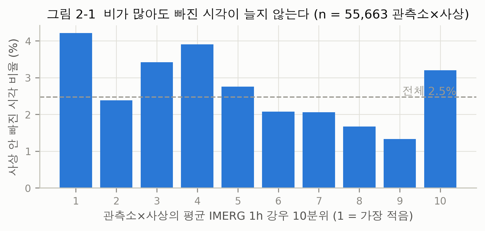

> [!note] 관찰
> - NaN은 0개다.
> - 사상 안에서 빠진 시각은 2.5%다.
> - 관측소×사상의 강우 10분위별 결측률은 1.3~4.2%다. 비가 많아져도 결측이 늘지 않는다.

> [!tip] 시사점
> 홍수 때 값이 잘려 나간 흔적(극값 검열)은 없다. 결측은 대치하지 않고, lag 계산 규칙만 정하면 된다.

### 2.2 유일성

중복 행은 0개, (관측소, 시각) 중복도 0개다. train과 test의 관측소 집합은 같다.

### 2.3 유효성 (표 2-1)

| 규칙 | 위반 | 판정 |
|---|---|---|
| 강우 ≥ 0 | 0 | – |
| 누적강우 1h ≤ 6h ≤ 24h (IMERG·지상) | 0 | – |
| 레이더 비율 0~1 | 0 | – |
| 도시 + 산림 ≤ 100% (최대 99.2%) | 0 | – |
| 면적 > 0, 비율 0~100% | 0 | – |
| 레이더 평균 ≤ p95 | 7.5% | **오류 아님**: 위반 행의 99.9%가 p95 = 0에 평균만 소량인 약한 에코(에코 화소 5% 미만) |

- 수위 범위는 −5.18 ~ 139.7m다. 관측소마다 기준면이 달라 범위가 넓다.
- 지상강수에서 0이 아닌 값의 87%가 0.5의 배수이고, 100%가 0.1의 배수다. 0.5mm 전도형 우량계와 같은 모양이므로 **mm로 추정**한다(공식 단위는 미확인).

### 2.4 일관성 (표 2-2)

| 검산 | train | test |
|---|---|---|
| `wl_t_minus_kh` = k시간 전 행의 `wl_t` (k = 1, 3, 6, 12, 24) | 100% | 100% |
| 6h·24h 누적강우 = 1h 강우의 합 | 100% | 100% |
| 타깃 = 다음 6행 최대 − `wl_t` (미래 6행이 모두 있는 63%) | 100% | – |

병합과 파생 계산이 정확하다. 이전 행을 참조하는 파생변수를 안심하고 만들 수 있다.

### 2.5 이상값 (표 2-3)

> [!note] 관찰
> - 교과서 기준(Tukey 울타리, MAD 강건 z > 3.5)을 적용하면 수위 차분과 타깃의 12~25%가 이상값으로 잡힌다.
>   - 원인: 값이 0에 몰려 IQR이 매우 좁다.
>   - 기계적 기준은 이렇게 치우친 분포에서 정상 호우를 이상값으로 오판한다. 그래서 판정은 물리적 기준으로 했다.
> - 강우는 log1p 척도에서 판정했다. 1시간 100mm를 넘는 IMERG 7행은 국내 극한 호우 범위이므로 실제 극값이다.
> - 오류로 판정한 것은 **ST0027 한 곳**이다. 수위가 train 1,676행과 test 413행 모두 28.19m로 고정되어 있다.
> - 맑은 날(24시간 강우 0)에도 반사도 중앙값이 4를 넘는 관측소가 18곳 있다. 전체 맑은 날 중앙값은 0.17이다. 지형 클러터로 추정된다.
> - 수위는 1cm, 지상강수는 0.5mm 단위로 기록된다. 타깃의 46%가 0 또는 ±1cm다.

> [!tip] 시사점
> 큰 강우와 큰 상승은 이 과제의 핵심 신호이므로 제거하지 않는다.

### 2.6 품질 점검 → 전처리 결정 (표 2-4)

| 품질 발견 | 전처리 결정 |
|---|---|
| ST0027 수위 고정 | test 예측을 0으로 고정, 학습에서 제외 |
| `wl_t`는 기준면이 다른 구간 척도 | 차분·관측소 내 상대값 사용 |
| 유역면적 왜도 7~12 | 로그 변환(트리 모델은 선택) |
| 클러터 관측소 18곳 | 관측소별 맑은 날 바탕값 차감 검토 |
| 지상강수 0.5 계단, 약한 비 미감지 | mm로 추정해 표기, 약한 비는 IMERG로 보완 |
| 1cm 분해능 | 작은 값 정밀도보다 꼬리 예측에 집중 |
| 결측·중복·정합성 문제 없음 | 대치·삭제 없음 |

---

## 3. 단변량 분석

### 3.1 타깃

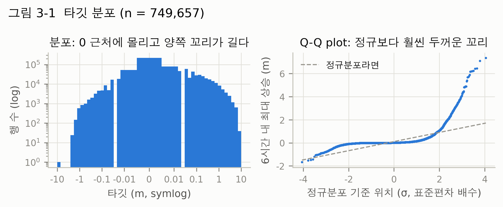

> [!note] 관찰
> - 요약 통계: 평균 0.109m, 중앙값 0.01m, 표준편차 0.395m, 왜도 7.3, 첨도 78.7
> - 부호: 양수 55%, 0 29%, 음수 16%
> - 꼬리: p99 1.87m, 최대 8.30m, 최소 −8.74m. Q-Q plot에서 약 +1m 위쪽부터 정규분포를 크게 벗어난다.
> - **상위 1% 행이 0 예측 기준 제곱오차의 66%**를 차지한다.

> [!tip] 시사점
> RMSE는 사실상 큰 상승을 얼마나 잘 맞히는지로 결정된다.

### 3.2 꼬리는 어디서 오나

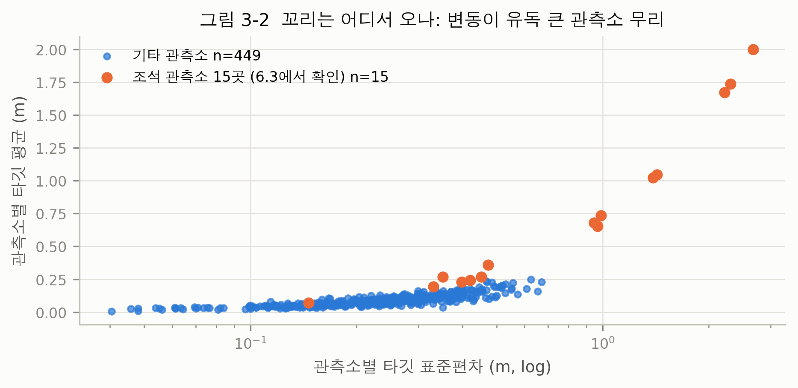

> [!note] 관찰
> - 관측소별 타깃의 평균과 표준편차를 그려 보면, 표준편차 1~2.7m·평균 0.65~2.0m인 **7곳이 무리에서 떨어져 나온다**.
> - 이 7곳을 포함해 6.3절에서 12.4시간 주기(조석)로 확인되는 **15곳**은 행의 3.2%에 불과하다. 그런데 0 예측 기준 제곱오차의 **51%**를 차지한다.
> - 15곳의 타깃 표준편차 중앙값은 0.94m로, 나머지 관측소(0.24m)의 4배다.
> - 15곳 중 나머지 8곳은 일반 관측소 무리의 위쪽 가장자리에 있어, 이 그림만으로는 구분되지 않는다(6.3절 참조).

> [!tip] 시사점
> 4·5장에서 타깃이 들어가는 분석은 **전체(회색)와 비조석(파랑)을 나란히** 보인다. 비조석은 조석 15곳과 고정 관측소를 뺀 것이다.

### 3.3 수위

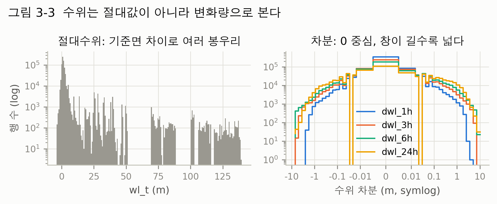

> [!note] 관찰
> 절대수위는 관측소 기준면 차이로 봉우리가 여럿이다(왜도 6.3). 차분은 0을 중심으로 분포하고, 창이 길수록 넓게 퍼진다.

> [!tip] 시사점
> 절대수위 대신 차분을 입력으로 쓴다.

### 3.4 강우

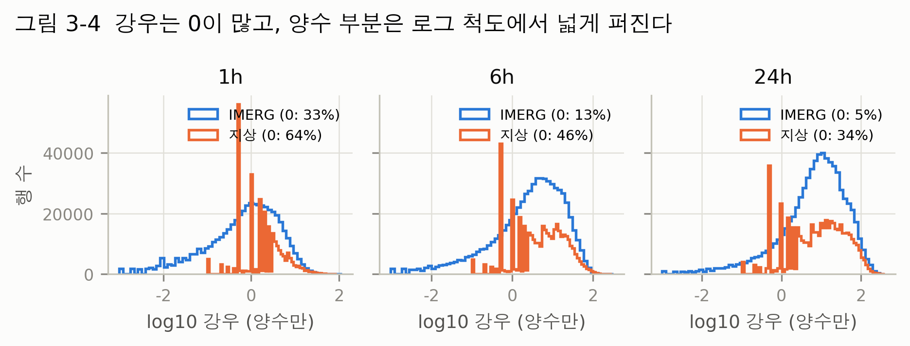

> [!note] 관찰
> - 0인 비율은 IMERG가 1h 33% → 6h 13% → 24h 5%다. 지상은 64% → 46% → 34%로 0을 훨씬 자주 기록한다.
> - 양수 부분은 로그 척도에서 넓게 퍼진다(왜도 3.1~6.6).

> [!tip] 시사점
> 강우는 log1p로 변환한다. 약한 비는 지상강수가 놓치는 경우가 많으므로 IMERG로 보완한다.

### 3.5 레이더

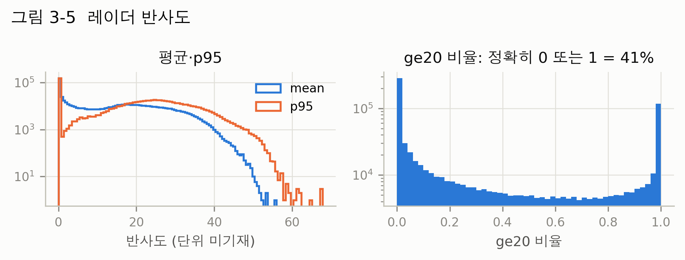

> [!note] 관찰
> - 평균과 p95는 거의 대칭이다(왜도 0.4, −0.2).
> - 20 이상 비율은 **41%의 행이 정확히 0 또는 1**이다(0이 28%). 연속값이라기보다 이진값에 가깝다.

> [!tip] 시사점
> 레이더는 변환이 필요 없다. 20 이상 비율은 평균에 임계값을 적용한 것과 비슷해 새 정보가 적다(5.1절에서 확인).

### 3.6 유역환경 (관측소 단위, n = 465)

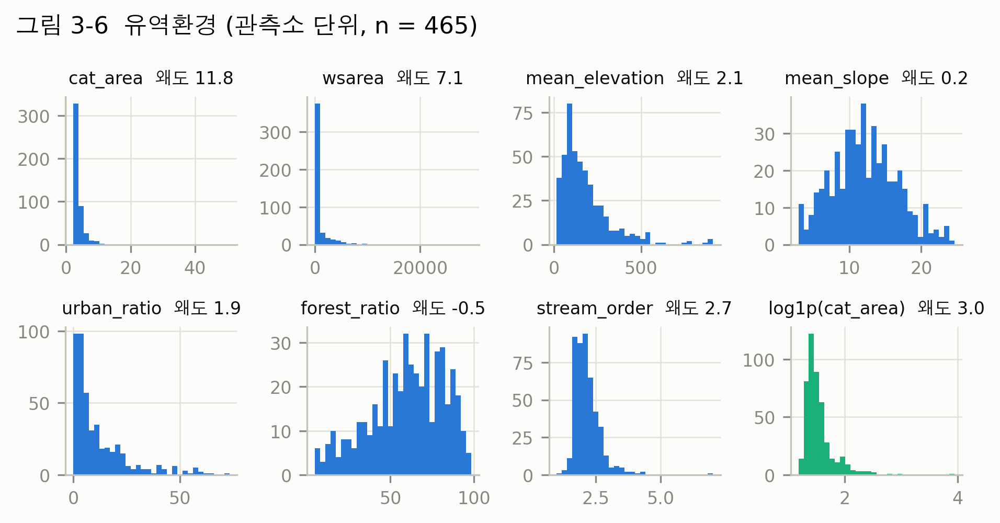

> [!note] 관찰
> - 시간에 따라 변하지 않는 변수라 관측소 단위로 봤다. 행 단위로 보면 행이 많은 관측소에 가중치가 쏠린다.
> - 소권역 집수면적의 왜도는 11.8, 상류 유역면적은 7.1이다.
> - 소권역 집수면적은 log1p 변환 뒤에도 왜도가 3.0이다. 값이 작아(대부분 2~10) log1p의 효과가 약하다.

> [!tip] 시사점
> 면적은 log 또는 순위 변환을 비교한다.

### 3.7 기술통계 요약 (표 3-1)

변수별 평균·중앙값·표준편차·IQR·왜도·첨도·0 비율·권장 변환은 `tab3-1_summary.csv`에 정리했다. 요점은 다음과 같다.
- 강우 6개와 면적 2개는 **log1p 변환**을 권장한다.
- 수위는 **차분**을 쓴다.
- 레이더와 경사·산림은 변환이 필요 없다.

---

## 4. 이변량 분석 — 타깃과 각 변수의 관계

### 4.1 타깃 × 강우

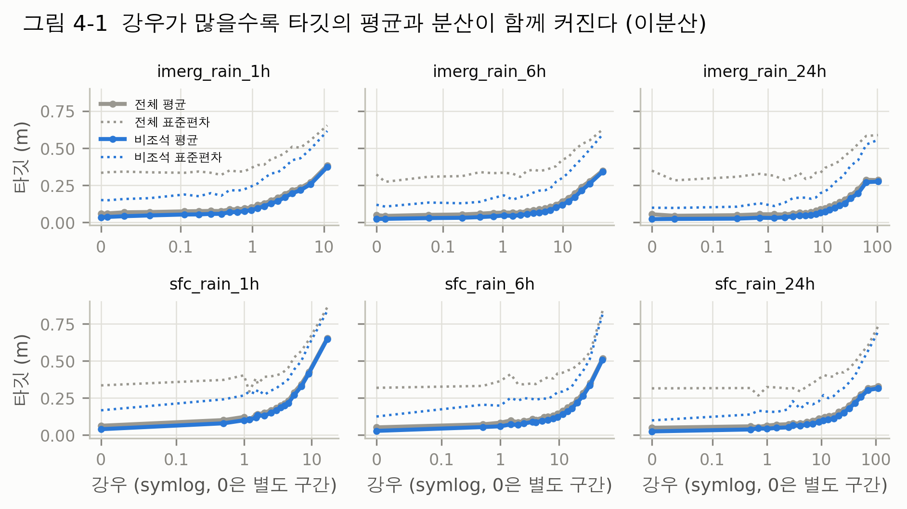

> [!note] 관찰
> - 강우가 약 1mm를 넘으면 타깃 평균이 가파르게 오른다.
>   - `sfc_rain_1h`: 0 구간 0.04m → 최상위 구간 0.65m (비조석)
>   - `imerg_rain_1h`: 0.03m → 0.37m
> - 같은 구간에서 표준편차도 0.17 → 0.84로 커진다(**이분산**).
> - 비가 없는 구간의 표준편차는 전체 0.33 → 비조석 0.15로 절반 이하가 된다. 무강우 시의 흔들림 중 상당 부분이 조석에서 온다.

> [!tip] 시사점
> - 짧은 창(1h·6h)과 지상강수의 신호가 가장 선명하다.
> - 분산이 강우와 함께 커지므로, 큰 사상에서는 극값 가중치나 분위수 손실을 검토한다.

### 4.2 타깃 × 수위 변화

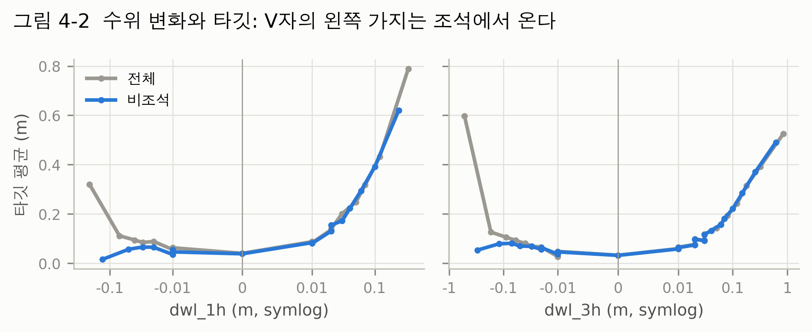

> [!note] 관찰
> - 전체 데이터에서는 V자 관계가 보인다. 수위가 크게 떨어진 직후(dwl_1h 최하위 구간)에도 타깃 평균이 0.32m로 크다.
> - 그런데 비조석에서는 같은 구간의 평균이 **0.02m**로 사라진다(dwl_3h는 0.60 → 0.05m).
> - 오른쪽 가지(상승 중이면 계속 오름)는 두 집단에서 같다.

> [!tip] 시사점
> "크게 떨어진 뒤 반등"은 조석의 썰물 → 밀물 전환이다. 비조석 관측소에서 수위 변화는 **추세 지속** 신호로만 작동한다.

### 4.3 타깃 × 레이더

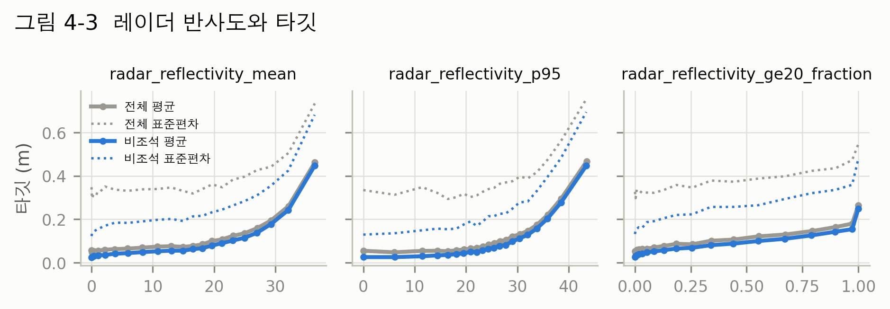

> [!note] 관찰
> 반사도가 높을수록 타깃 평균이 0.02~0.03m에서 0.45m(평균·p95 최상위 구간, 비조석)로 오른다. 20 이상 비율은 최대 0.25m로 상대적으로 약하다.

> [!tip] 시사점
> 레이더도 강우와 비슷한 크기의 신호를 준다. 세 변수 중 평균이나 p95 하나면 충분하다.

### 4.4 타깃 × 유역환경 (관측소 단위, 비조석)

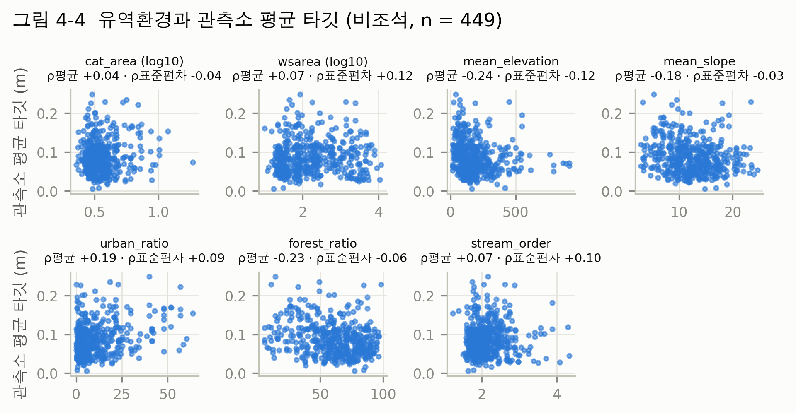

> [!note] 관찰
> - 유역환경과 관측소 평균 타깃의 상관은 모두 약하다(|ρ| ≤ 0.24).
> - 표고(−0.24)·산림(−0.23)·경사(−0.18)가 높을수록 평균 상승이 작고, 도시화율(+0.19)이 높을수록 크다.
> - 면적·하천차수는 거의 무관하다(ρ 0.04~0.07).

> [!tip] 시사점
> 유역환경은 단독으로는 약한 변수다. 강우와의 상호작용으로 봐야 한다(5.3절).

### 4.5 타깃 × 관측소 (비조석)

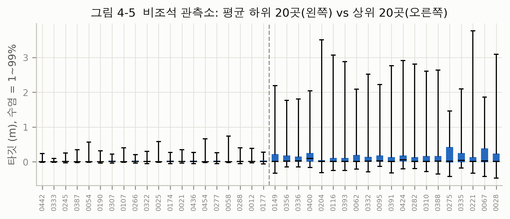

> [!note] 관찰
> 비조석 관측소 사이에서도 평균 타깃이 p10 0.04m ~ p90 0.15m로 약 4배 차이 난다. 상위 관측소는 중앙값뿐 아니라 위쪽 꼬리도 길다.

> [!tip] 시사점
> 관측소 통계(평균·분위수)는 유용한 변수다. 단, 검증 fold 안에서만 계산한다.

### 4.6 상관 요약 (표 4-1)

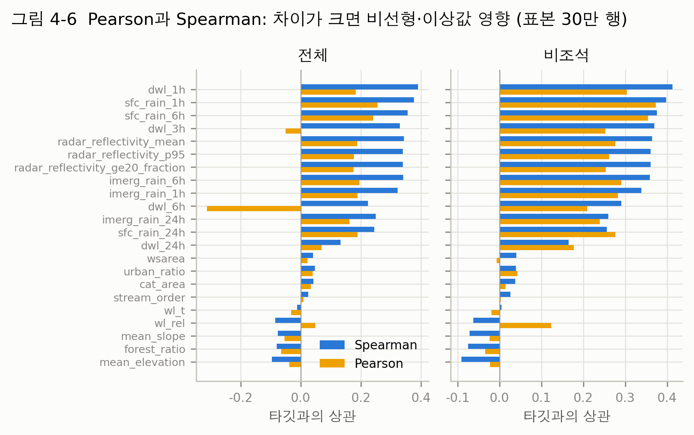

> [!note] 관찰
> - 비조석 기준 Spearman 상관이 가장 큰 변수는 `dwl_1h` 0.41, `sfc_rain_1h` 0.40, `sfc_rain_6h` 0.38, `dwl_3h` 0.37, 레이더 0.36 순이다.
> - Pearson은 Spearman의 절반 정도에 그친다. 관계가 **단조롭지만 비선형**이고, 극값의 영향을 받는다는 뜻이다.
> - 절대수위 `wl_t`는 상관이 거의 0이다.

> [!tip] 시사점
> 비선형 관계를 자동으로 다루는 트리 계열 모델이 적합하다. 선형 모델을 쓴다면 변환과 교차항이 필요하다.

---

## 5. 다변량 분석

### 5.1 입력 변수 간 상관과 다중공선성 (표 5-1)

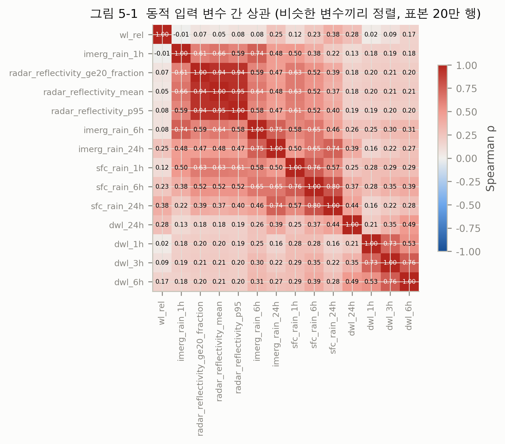

> [!note] 관찰
> - 레이더 평균–p95의 상관은 ρ 0.95, 평균–20 이상 비율은 0.94다. VIF는 레이더 평균 15.9, 20 이상 비율 7.2, p95 6.5로 **레이더 3변수는 사실상 하나**다.
> - IMERG와 지상강수의 상관은 1h 0.50에서 24h 0.74로, 누적 창이 길수록 잘 맞는다.
> - 같은 원천의 6h·24h 강우도 서로 VIF 5~6 수준으로 겹친다.

> [!tip] 시사점
> - 트리 모델에는 큰 문제가 아니다. 다만 변수 중요도를 해석할 때 중요도가 겹치는 변수에 나뉘는 점에 주의한다.
> - 선형 모델에서는 레이더를 하나로 줄인다.
> - 세 강우 원천은 같은 강우를 잰 대리지표이므로 평균·최대·불일치 변수로 합칠 수 있다.

### 5.2 유역환경 주성분분석 (표 5-2)

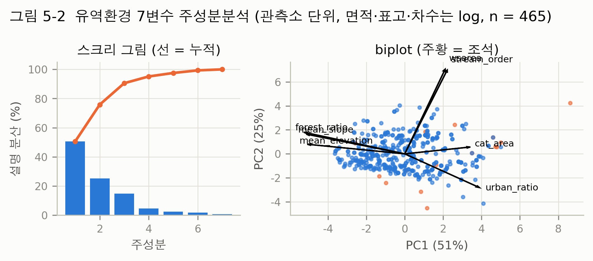

> [!note] 관찰
> 7변수 가운데 PC1이 51%, PC2가 25%, PC3가 15%로 **3개 성분이 92%**를 설명한다.
> - PC1: 산지(표고·경사·산림 −) ↔ 저지·도시(도시화 +)
> - PC2: 하천 규모(상류면적 0.66, 하천차수 0.66)
> - PC3: 소권역 면적과 도시화
> - 조석 관측소는 PC1의 저지·도시 쪽에 모여 있다(PC1 순위 중앙값 상위 82% 지점).

> [!tip] 시사점
> 유역환경은 '산지–저지'와 '규모' 두 축으로 요약된다. 신경망 등에는 주성분 3개로 줄여 넣을 수 있다.

### 5.3 강우 × 유역환경 상호작용 (비조석)

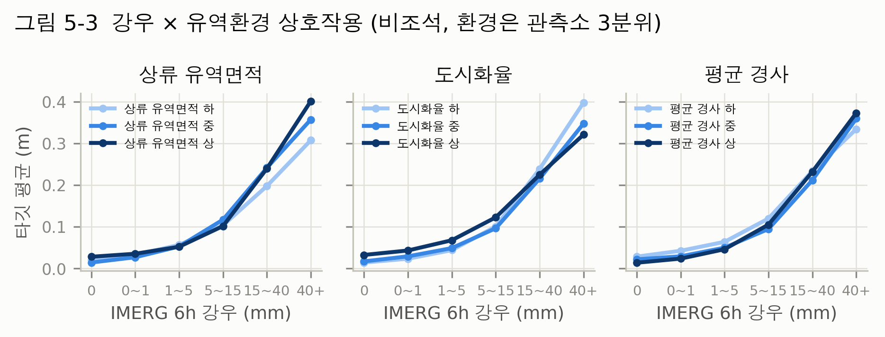

> [!note] 관찰
> - 강우가 15mm 이하일 때는 유역환경 3분위 간 차이가 거의 없다.
> - 40mm를 넘으면 차이가 벌어진다.
>   - 상류 유역면적: 상위 3분위 0.40m vs 하위 0.31m
>   - 도시화율: 반대 방향으로 하위 0.40m vs 상위 0.32m
>   - 경사: 차이가 작다.
> - 비가 없을 때 도시화율 상위 관측소의 타깃이 약간 높다(0.03 vs 0.01m).

> [!tip] 시사점
> 유역환경은 **강한 비가 올 때 반응 크기를 조절하는 변수**다. 트리 모델은 이를 자동으로 잡고, 선형 모델에는 강우 × 면적 교차항이 필요하다.

### 5.4 타깃 분산 분해

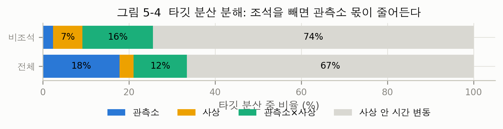

| 성분 | 전체 | 비조석 |
|---|---|---|
| 관측소 간 차이 | 18% | **2%** |
| 사상 간 차이 | 3% | 7% |
| 관측소 × 사상 | 12% | 16% |
| 사상 안 시간 변동 | 67% | **74%** |

> [!note] 관찰
> 조석을 빼면 관측소 몫은 18% → 2%로 줄어든다. 전체에서 '관측소 효과'로 보였던 것은 대부분 조석 관측소였다.

> [!tip] 시사점
> 비조석 관측소에서 예측의 핵심은 "어느 관측소인가"가 아니다. **"사상 안 지금이 어떤 국면인가"**다. 시간 구조를 담은 변수(최근 수위 추세, 누적 강우, 사상 경과 시간)가 중요하다.

### 5.5 관측소 군집

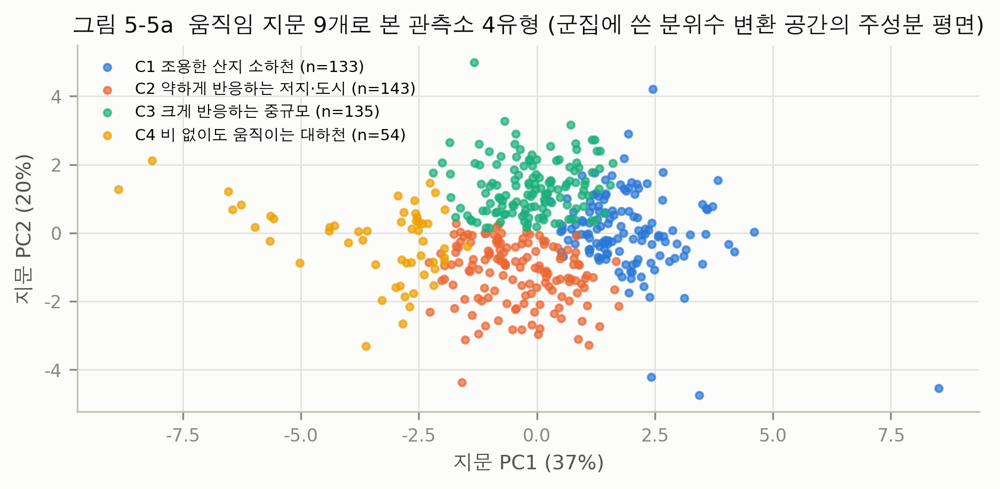
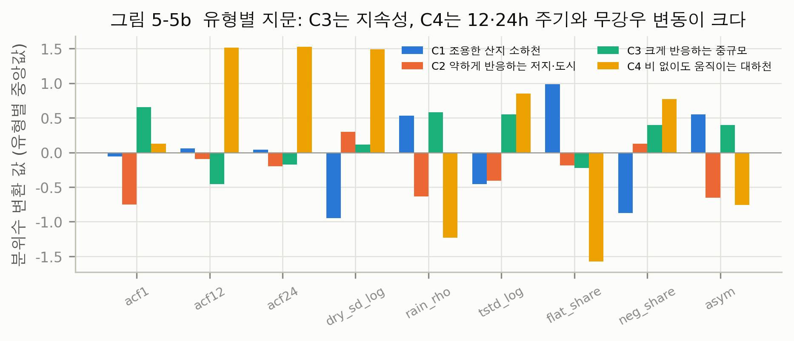

> [!note] 관찰
> 움직임을 요약한 지표 9개(변화 지속성, 12·24h 주기, 무강우 변동, 강우 반응 등)로 관측소를 네 유형으로 묶었다.

  | 유형 | 관측소 수 | 특징 |
  |---|---|---|
  | C1 조용한 산지 소하천 | 133 | 평소엔 멈춰 있다가 비가 오면 빠르게 반응 |
  | C2 약하게 반응하는 저지·도시 | 143 | 비와의 연관이 약하고 잔 흔들림이 많음 |
  | C3 크게 반응하는 중규모 하천 | 135 | 한번 오르면 추세가 몇 시간 이어짐 |
  | C4 비 없이도 움직이는 대하천 | 54 | 조석 관측소 포함 |

  - 군집 품질(실루엣 0.16)은 높지 않아, 연속 스펙트럼 위의 네 영역에 가깝다.
  - 유역환경 7변수만으로 유형을 맞히는 정확도는 49%다(다수결 기준 31%).
> [!tip] 시사점
> 관측소의 움직임 특성은 유역환경만으로는 절반밖에 설명되지 않는다. 관측소별 움직임 지표를 학습 fold 안에서 계산해 변수로 쓸 수 있다.

---

## 6. 시계열·수문 분석

### 6.1 수문곡선

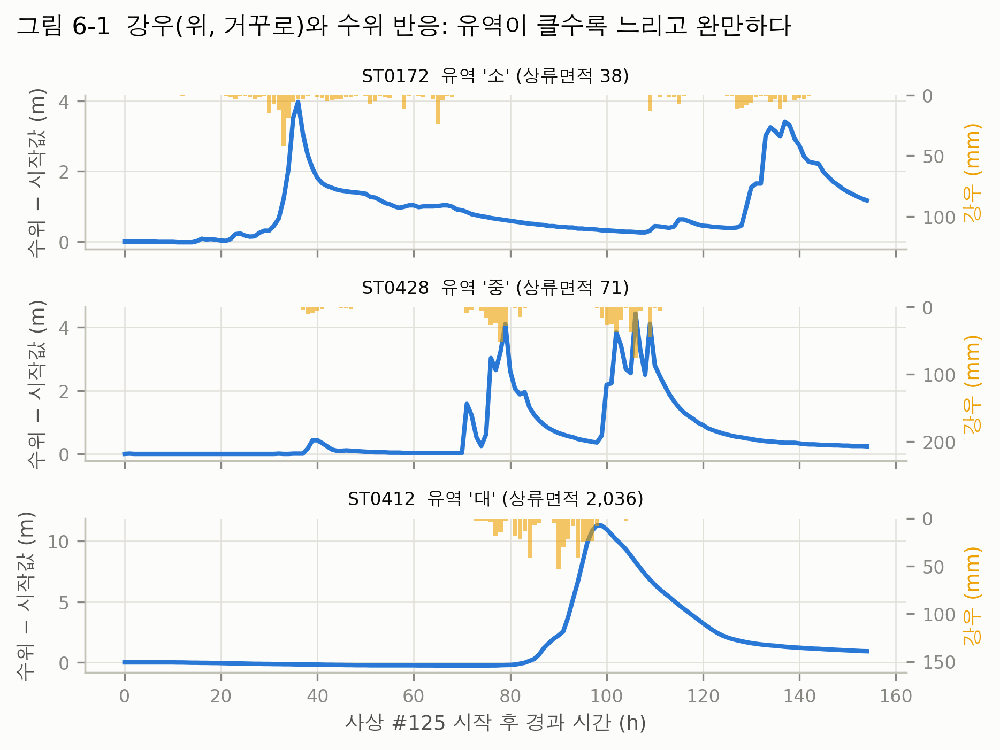

> [!note] 관찰
> - 사상 #125에서 유역 크기가 다른 세 관측소를 비교했다.
> - 소유역(상류면적 38)은 강우 직후 몇 시간 안에 4m 가까이 급상승하고 빠르게 내려간다.
> - 대유역(2,036)은 강우가 쌓인 뒤 약 20시간에 걸쳐 11m까지 완만하게 오르고 천천히 내려간다.

> [!tip] 시사점
> 가장 중요한 예측 신호는 **이미 내렸지만 아직 하천에 도달하지 않은 비**다. 도달 속도는 유역 규모가 정한다.

### 6.2 자기상관 — 지속성과 주기성

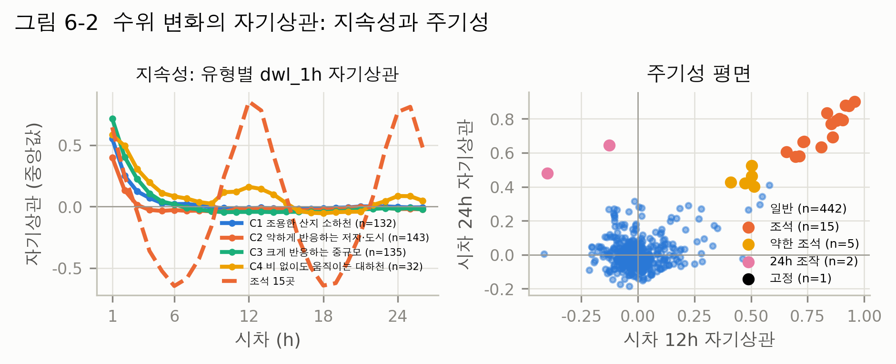

> [!note] 관찰
> - 수위 변화(dwl_1h)의 1시간 자기상관은 C3 0.72, C4 0.58, C1 0.55, C2 0.40이다.
> - 3시간이 지나면 C3 0.23, C4 0.31, C1 0.12, C2 0.01로 줄고, 6시간 뒤에는 거의 0이다.
> - 조석 관측소는 12시간 +0.86, 6시간 약 −0.6으로 뚜렷한 주기를 보인다.

> [!tip] 시사점
> 수위 추세는 1~3시간 정도 이어진다. 그래서 최근 1~3시간의 수위 차분이 강한 입력 변수가 된다(4.6절과 일치).

### 6.3 주기적으로 움직이는 관측소

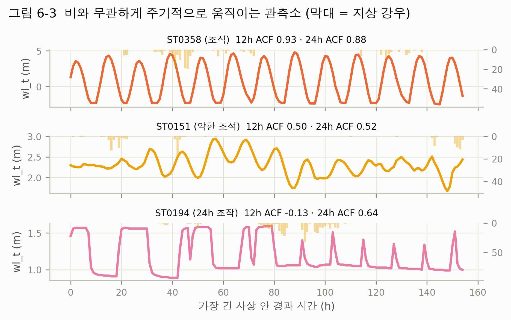

> [!note] 관찰
> 12시간·24시간 자기상관 평면(그림 6-2 오른쪽)에서 관측소가 네 무리로 나뉜다.

  | 무리 | 관측소 수 | 12h 자기상관 | 24h 자기상관 | 특징 |
  |---|---|---|---|---|
  | 조석 | 15 | 0.86 | 0.77 | 하구, 12.4시간 주기 |
  | 약한 조석 | 5 | 0.50 | 0.43 | |
  | 24h 조작 | 2 (ST0194, ST0200) | −0.26 | 0.56 | 비와 무관하게 매일 계단식으로 오르내림(수문 개폐·방류 추정) |
  | 일반 | 442 | ≈ 0 | ≈ 0 | |

  - 3.2절에서 따로 떨어져 나온 무리의 원인이 이 조석 주기다.
> [!tip] 시사점
> - 조석 여부는 이진 플래그 대신 **12·24h 자기상관 값 자체**로 넣는다.
> - 조석의 위상 정보(`wl_t − wl_t−12h` 등)는 이미 입력의 lag 수위에 들어 있다.

### 6.4 교차상관과 지체시간

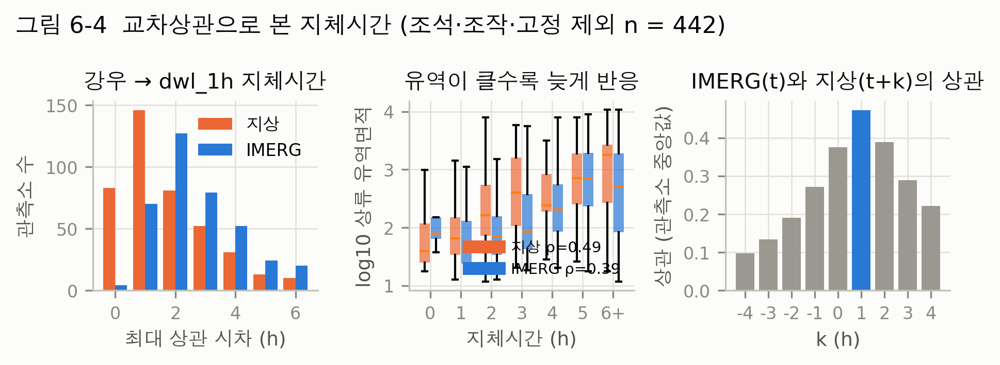

> [!note] 관찰
> - 강우와 수위 변화의 교차상관이 최대가 되는 시차(지체시간)는 관측소 중앙값 기준으로 지상강수 1시간, IMERG 3시간이다.
> - 지체시간이 6시간 이내인 관측소는 지상 기준 94%, IMERG 기준 85%다.
> - 유역이 클수록 지체시간이 길다(유역면적과의 Spearman ρ: 지상 0.49, IMERG 0.39).
> - IMERG(t)와 지상강수(t+k)의 상관은 k = +1h에서 가장 크다(0.47, k = 0에서 0.38).

> [!tip] 시사점
> - 대부분 관측소는 6시간 예측창 안에 이미 내린 비의 영향이 도달한다. 과거 1~6시간 강우가 핵심 입력이다.
> - 유역면적 × 강우 교차 변수와, 원천별로 다른 시간창을 쓰는 것이 유효하다.

### 6.5 사상 안 시간 효과

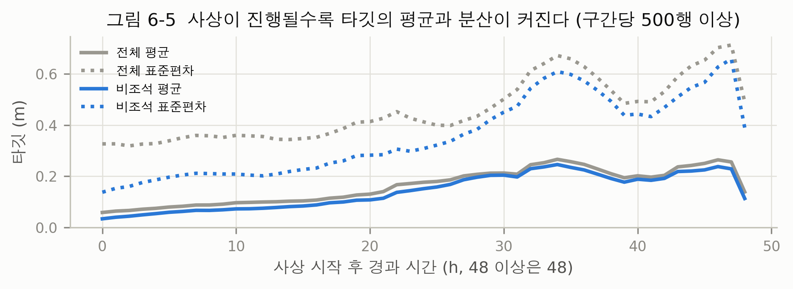

> [!note] 관찰
> 사상이 시작된 시점부터 24시간 뒤까지 타깃 평균은 0.03 → 0.15m, 표준편차는 0.14 → 0.31m로 커진다(비조석).

> [!tip] 시사점
> 사상 경과 시간과 사상 누적 강우는 유용한 파생변수다(5.4절의 '사상 안 시간 변동' 74%와 연결).

### 6.6 관측소 간 선행

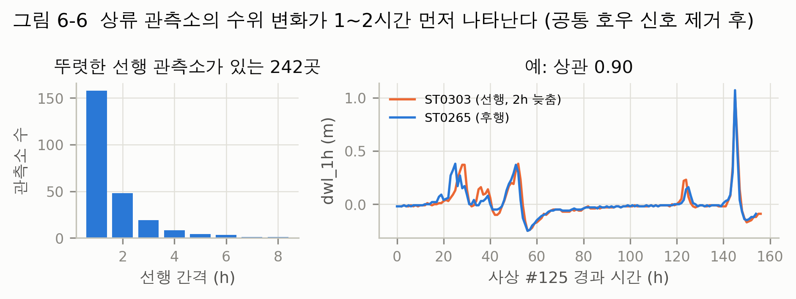

> [!abstract] 방법
> 모든 관측소에 공통인 호우 신호를 먼저 뺐다. 그다음 관측소 쌍마다 시차 상관을 계산했다.

> [!note] 관찰
> - 조석·조작·고정 관측소를 뺀 442곳 중 **242곳(55%)**에 수위 변화를 뚜렷이 앞서는 관측소가 있다(상관 ≥ 0.5).
> - 앞서는 시간은 1시간이 65%, 2시간이 20%다.
> - 소권역이 다른 쌍 중 뒤따르는 쪽의 유역면적이 더 큰 비율이 68%다(무작위라면 50%). 좌표 없이도 상류 → 하류 방향이 복원된다는 뜻이다.

> [!tip] 시사점
> 같은 시각 상류 관측소의 수위 변화는 하류 관측소의 1~2시간 앞 신호가 된다. 사용 여부는 모델링 장에서 대회 규정과 함께 검토한다.

---

## 7. train/test 비교와 검증 전략

### 7.1 분할 구조

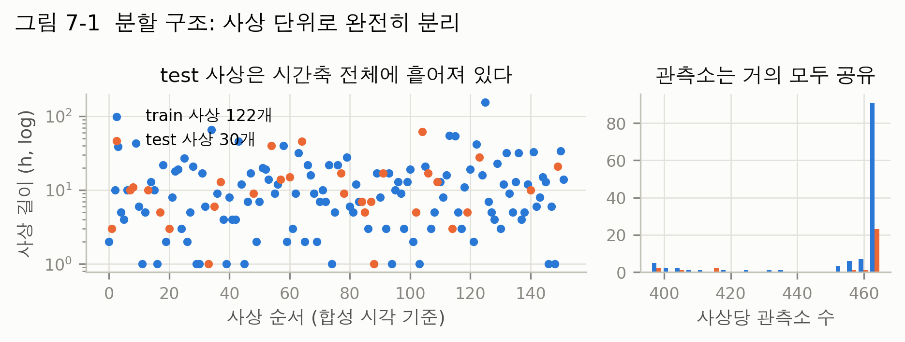

> [!note] 관찰
> train과 test는 **사상 단위로 완전히 분리**되어 있다(train 122개, test 30개). test 사상은 시간축 전체에 흩어져 있다. 사상당 관측소 수는 중앙값 464곳으로, 관측소는 거의 모두 공유한다.

> [!tip] 시사점
> 관측소별 특성은 test에서도 그대로 쓸 수 있다. 반면 사상 자체는 test에서 처음 보는 것이다.

### 7.2 분포 비교 (표 7-1)

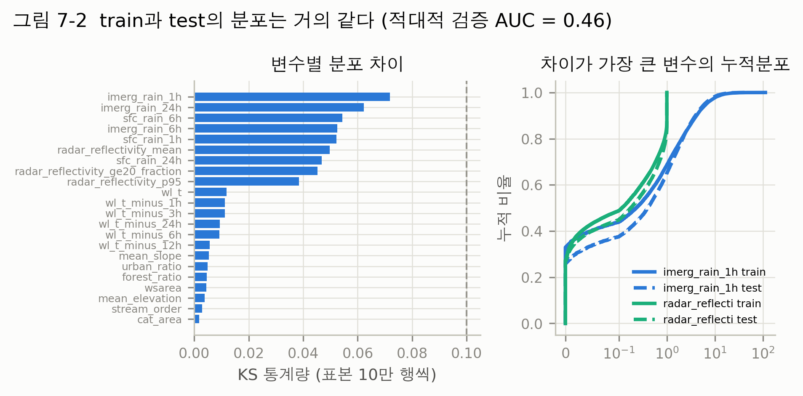

> [!note] 관찰
> - 변수별 KS 통계량은 최대 0.07(`imerg_rain_1h`)로 모두 작다.
> - train과 test를 구분하는 분류기(사상 단위 교차검증)의 AUC는 **0.46**이다. 0.5 이하이므로 두 데이터를 구분할 수 없다.

> [!tip] 시사점
> 분포 이동은 무시할 만하다. 교차검증 점수가 test 성능을 잘 대변할 것으로 기대된다.

### 7.3 검증 방식

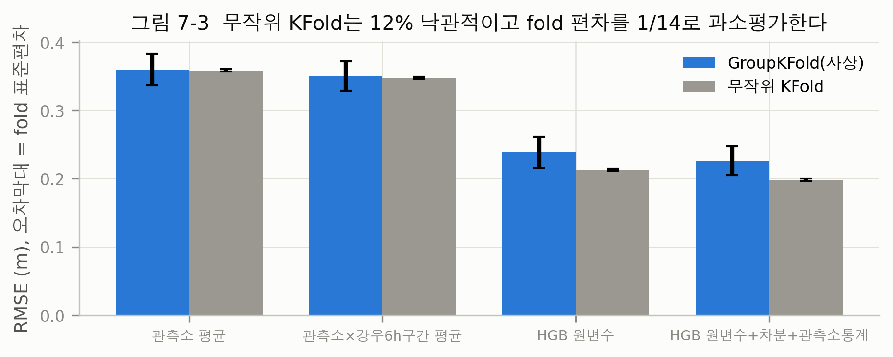

> [!note] 관찰
> - 같은 모델을 두 방식으로 검증했다.
>   - 무작위 KFold: RMSE 0.198
>   - 사상 단위 GroupKFold: RMSE 0.226
> - 무작위 분할은 성능을 **약 12% 낙관적**으로 보여준다.
> - fold 간 표준편차도 0.0015 vs 0.021로 1/14 수준으로 과소평가한다.
> - 원인은 1.3절의 타깃 구간 겹침이다. 같은 사상의 이웃 행이 학습과 검증에 나뉘면 정답 정보가 검증 쪽으로 새어 나간다.

> [!tip] 시사점
> 검증은 **사상 단위 (반복) GroupKFold**로 고정한다.

### 7.4 누수 방지 원칙

예측 시점 t 이후의 정보는 어떤 행에서도 사용하지 않는다.

---

## 8. 요약

### 8.1 핵심 발견

| # | 발견 | 근거 | 모델링 결정 |
|---|---|---|---|
| 1 | 상위 1% 행이 0 예측 기준 제곱오차의 66%를 차지한다 | 3.1 | 꼬리(큰 상승) 예측에 집중: 극값 가중치·손실함수 실험 |
| 2 | 조석 15곳(행 3.2%)이 제곱오차의 51%를 차지하고, 전체 관계(V자, 관측소 효과 18%)를 왜곡한다 | 3.2, 4.2, 5.4, 6.3 | 12·24h 자기상관 변수 추가, 조석 전용 처리 검토 |
| 3 | 비조석에서는 분산의 74%가 사상 안 시간 변동이고, 관측소 몫은 2%다 | 5.4, 6.5 | 수위 추세·누적강우·사상 경과 시간 파생변수 |
| 4 | 가장 강한 신호는 최근 1~3h 수위 변화와 짧은 창 강우이며, 관계는 단조롭지만 비선형이다 | 4.1, 4.6, 6.2 | 트리 계열 모델, 강우 log1p |
| 5 | 강우 → 수위 지체시간은 대부분 6h 이내이고, 유역이 클수록 길다 | 6.1, 6.4 | 유역면적 × 강우 교차, 원천별 시간창 |
| 6 | 유역환경은 단독으로는 약하고, 강한 비가 올 때 반응 크기를 조절한다 | 4.4, 5.2, 5.3 | 상호작용 변수 또는 주성분 3개 |
| 7 | 레이더 3변수는 사실상 하나이고, 강우 3원천은 같은 비의 대리지표다 | 5.1 | 레이더 축약, 원천 평균·최대·불일치 변수 |
| 8 | 무작위 분할은 12% 낙관적이고, train/test 분포는 같다(AUC 0.46) | 7.2, 7.3 | 사상 단위 GroupKFold |

### 8.2 결정 목록

- **전처리**
  - ST0027은 예측을 0으로 고정한다.
  - 수위는 차분·상대값으로 쓴다.
  - 강우·면적은 로그 변환한다.
  - 레이더 클러터 18곳은 맑은 날 바탕값 차감을 검토한다.
  - 결측은 대치하지 않는다.
- **파생변수**
  - 수위 차분(1·3·6·24h)
  - 12·24h 자기상관(관측소별)
  - 사상 경과 시간·사상 누적강우
  - 강우 원천 요약(평균·최대·불일치)
  - 유역면적 × 강우
  - 관측소 통계(fold 안에서 계산)
  - (검토) 상류 관측소의 수위 변화
- **검증**
  - 사상 단위 반복 GroupKFold를 쓴다.
  - 관측소 통계처럼 타깃을 쓰는 변수는 학습 fold 안에서만 계산한다.
  - 전체 RMSE와 함께 비조석 RMSE를 따로 본다.
