# 탐색적 데이터 분석(EDA)과 향후 계획 — 중간보고서

> [!info] 개요
> 2026 KISTI DATA·AI 분석 경진대회 — 호우 시 6시간 최대 하천수위 상승량 예측
> 구성: 한 장 요약 → **EDA 여덟 덩어리**(문제 → 점수 → 관측소 → 수위 신호 → 강우 신호 → 유역 → 변수 중복 → 결론) → **향후 계획**
> 바탕 자료: 팀 노트 `eda_ver1.ipynb`(노션), 공유 종합본(`EDA_옵시디언.md`), 최종 EDA(`report_final.md`), 개인 노트북(`self.ipynb`)
> 새 그림 7장 재현: `python eda/src/m01_midterm_figs.py` (캐시 사용, 약 10초). 수치 원본: `eda/cache/results/m01_midterm.json`, `eda/figures/midterm/*.csv`
> 기존 그림은 종합본 번호를 괄호에 적었다(예: 종합본 3-1).

---

## 한 장 요약

> [!abstract] 발표 흐름
> 1. 이 문제는 **처음 보는 호우**에서 앞으로 6시간을 맞히는 문제다. 그래서 검증은 **사상(호우) 단위**로 나눈다.
> 2. RMSE는 **꼬리**에서 갈린다. 상위 1% 행이 0 예측 오차의 66%를 차지한다. 기준 모델 뒤에 남은 오차는 **강한 비·긴 사상**에 몰려 있다.
> 3. 모든 관측소가 비에 반응하지는 않는다. 조석 15곳을 빼고 보면 예측의 핵심은 "어느 관측소인가"(분산의 2%)가 아니라 **"사상 안 지금이 어떤 국면인가"**(74%)다.
> 4. 국면을 알려주는 신호는 두 가지다. **최근 1~3시간 수위 변화**와 **최근 1~6시간 강우**다. 창이 길어질수록 약해진다.
> 5. 유역환경은 단독으로는 약하다(|ρ| < 0.1). 대신 **비의 세기에 따라 방향이 바뀌는 조절 변수**다. 긴 강한 비에서는 큰 하천이 0.2m 더 오른다.
> 6. 변수는 많지만 정보는 겹친다. 그래도 상관만 보고 지우지 않고, **같은 검증 틀에서 비교해** 고른다.

| 덩어리 | 핵심 메시지 | 모델링으로 넘기는 결정 |
|---|---|---|
| 1. 문제 | 처음 보는 호우를 맞힌다. 이웃 행의 예측 창이 5시간 겹친다 | 사상 단위 GroupKFold, 미래 행 참조 금지 |
| 2. 점수 | 상위 1% 행이 0 예측 오차의 66%, 기준 모델 오차의 40% | 꼬리 대응(가중치·손실), 상위 5사상 제외 점수 병행 |
| 3. 관측소 | 조석·조작·방류 의심 관측소가 전체 관계를 왜곡한다 | 전체·비조석 따로 평가, 구간 플래그 |
| 4. 수위 신호 | 최근 1~3시간 수위 변화가 가장 강하다. 하강 중이면 계속 내려간다 | 수위 차분, 부호 × 강우, 사상 경과 시간 |
| 5. 강우 신호 | 비가 수위에 닿기까지 대부분 6시간 이내다. 두 소스가 함께 볼 때 크게 오른다 | 짧은 창 강우, 겹치지 않는 창, 소스 일치도 |
| 6. 유역 | 중간 비에선 작은·도시 하천, 긴 강한 비에선 큰 하천이 더 오른다 | 규모 × 24h 강한 비, 도시화 × 강우, 수위 분위 q × 강우 |
| 7. 변수 중복 | 레이더 3개는 사실상 하나, 경사–산림 ρ 0.96 | A/B/C 변수 조합 비교 실험 |

---

# Part Ⅰ. 탐색적 데이터 분석

## 덩어리 1. 문제 — 처음 보는 호우에서 앞으로 6시간을 맞힌다

> [!abstract] 핵심 메시지
> 한 행은 (관측소, 시각)이고, 타깃은 **앞으로 6시간 최고 수위 − 지금 수위**다. train과 test는 **호우사상 단위로 완전히 분리**되어 있다. 우리가 맞히는 것은 처음 보는 관측소가 아니라 **처음 보는 비**다.

### 1.1 무엇을 맞히나

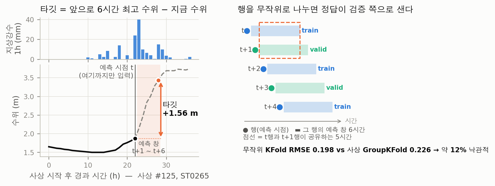

- 왼쪽 예시(사상 #125, ST0265): 22시간째까지 6시간 동안 45mm가 내렸다. 그런데 수위는 직전 1시간에 6cm만 올랐다. 이후 6시간 동안 **1.56m** 오른다.
- 이 그림이 과제의 성격을 요약한다. **이미 내렸지만 아직 하천에 도착하지 않은 비**를 읽어내는 문제다.
- `target_maxrise_6h = max(WL(t+1h), …, WL(t+6h)) − WL(t)`. 단위 m이고 음수도 유효하다. 평가는 test 186,263행 전체에 대한 단일 RMSE다.

### 1.2 데이터는 관측소 × 호우사상 × 시간 패널이다

| 원천 | 변수 | 공간 단위 |
|---|---|---|
| WAMIS 수위 | `wl_t`와 과거 5개 시점, 타깃 | 관측소 |
| IMERG 위성강우 | `imerg_rain_1h/6h/24h` | 격자셀 (관측소 463곳이 시계열 300종 공유) |
| 지상기상 | `sfc_rain_1h/6h/24h` | 격자 (시계열 223종) |
| 레이더 | 반사도 평균·p95·20 이상 비율 | 격자셀 |
| DataON 유역 | 유역환경 7변수 | 표준소권역 (465곳이 조합 329종 공유) |

- 관측소 465곳 × 호우사상 152개(train 122 / test 30). 한 사상에 관측소 약 98%가 함께 들어 있다.
- 사상 길이는 중앙값 9~10시간, 최대 155시간이다. train과 test의 길이 분포는 거의 겹친다(test 최대 62시간).
- 강우와 유역 값은 여러 관측소가 공유한다. 관측소를 구별하는 정보는 주로 **수위 이력**에서 나온다.
- 수위는 관측소마다 기준면이 다른 **구간 척도**다. 절대수위 비교는 의미가 없으므로 차분 `dwl_k = wl_t − wl_t−k`로 다룬다.

### 1.3 품질은 깨끗하다. 주의할 점은 세 가지다

| 점검 | 결과 | 처리 |
|---|---|---|
| 결측·중복 | NaN 0, 중복 0. 사상 안 빠진 시각 2.5%(비가 많아도 늘지 않음) | 대치하지 않는다 |
| 정합성 | 과거 수위 열 = k시간 전 행의 `wl_t`, 누적강우 = 1h 합, 타깃 = 다음 6행 최대 − `wl_t` 모두 **100%** | 이전 행을 참조하는 파생변수를 안심하고 만든다 |
| 이상값 | Tukey·MAD 기준은 0 몰림 때문에 정상 호우 12~25%를 오판 | **큰 비·큰 상승은 지우지 않는다**(핵심 신호) |
| ① 수위 고정 | ST0027이 train·test 모두 28.19m | 학습 제외, 예측 0 고정 |
| ② 단위 | 지상강수는 0.5 계단 → mm로 추정. 레이더는 0~56 로그형(단위 미기재) | 소스끼리 원값을 빼지 않고 순위·임계값으로 비교 |
| ③ 분해능 | 수위 1cm 단위, 타깃의 46%가 0 또는 ±1cm | 작은 값보다 꼬리 예측에 집중 |

### 1.4 그래서 검증은 사상 단위로, 입력은 t까지만

- 같은 관측소의 t행과 t+1행은 예측 창이 **5시간 겹친다**(그림 1-1 오른쪽). 행을 무작위로 나누면 같은 사상의 이웃 행이 학습과 검증에 갈라지고, 정답이 검증 쪽으로 샌다.
- 실제로 같은 모델을 두 방식으로 검증하면 **무작위 KFold 0.198 vs 사상 GroupKFold 0.226**이다. 무작위 분할은 약 12% 낙관적이고, fold 간 편차는 1/14로 과소평가한다(종합본 7-3).
- train 안에는 t+1, …, t+6 시각의 행이 존재한다. 이 값을 피처로 쓰면 정답을 보는 것과 같다.

> [!warning] 쓰면 안 되는 것 (누수)
> - `shift(-1)`, `shift(-6)` 같은 **미래 행 참조**, 미래값이 포함되는 rolling, 미래 데이터를 이용한 보간
> - **사상 길이·끝, 사상 전체에서의 순위·최대·최소**(사상이 끝나야 아는 값)
> - test 안의 뒤 시각 행
> - 타깃으로 만든 관측소 통계를 **fold 밖**에서 계산한 것

> [!tip] 시사점
> 검증은 `GroupKFold(group = 사상)`로 고정한다. train/test 구분 분류기의 AUC가 0.46이라 분포 이동은 무시할 만하다. 교차검증 점수가 test 성능을 잘 대변할 것으로 기대한다.

> [!question] 다음 질문
> 검증 틀은 정해졌다. 그렇다면 **점수는 어디서 갈리는가?**

---

## 덩어리 2. 점수 — RMSE는 꼬리에서 갈린다

> [!abstract] 핵심 메시지
> 행의 절반은 거의 움직이지 않는다. **상위 1% 행이 오차의 대부분**을 만든다. 기준 모델 뒤에 남은 오차는 **강한 비·긴 사상**에 몰려 있다.

### 2.1 타깃은 0에 몰리고 오른쪽 꼬리가 길다

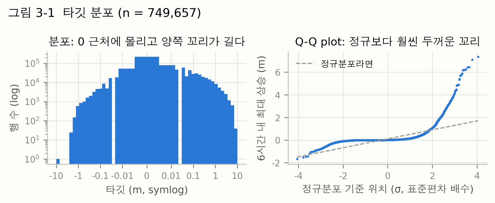

> [!note] 관찰
> - 평균 0.109m, 중앙값 0.01m, 표준편차 0.395m, 왜도 7.3, 첨도 78.7
> - 양수 55%, 0 29%, 음수 16%. p99 1.87m, 최대 8.30m
> - **상위 1% 행이 0 예측 기준 제곱오차의 66%**를 차지한다.

### 2.2 큰 상승은 긴 사상에 몰려 있다

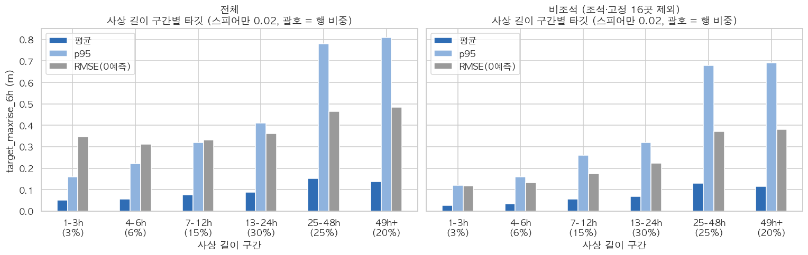

> [!note] 관찰
> - 사상 길이와 타깃의 순위상관은 0.02로 거의 0이다. 보통의 행은 사상이 길다고 더 오르지 않는다.
> - 그런데 꼬리는 다르다. 비조석 p95가 1~3시간 사상 0.12m에서 25시간 이상 사상 0.68m로 오른다.
> - 25시간 이상 사상이 행의 46%를 차지한다. train에서 가장 긴 155시간 사상 하나가 행의 약 10%다.
> - 사상 길이는 사상이 끝나야 아는 값이므로 **변수로 쓰지 않고** fold 설계와 오차 해석에만 쓴다.

### 2.3 기준 모델 뒤에 남은 오차는 어디에 있나

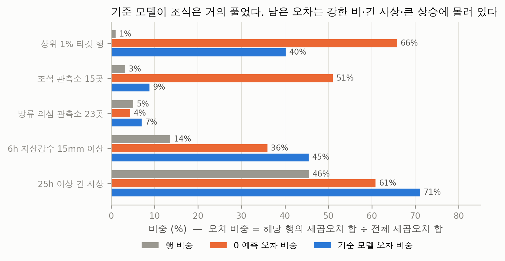

> [!note] 관찰
> - 0으로 예측하면 조석 관측소 15곳(행 3%)이 오차의 51%를 만든다. 그런데 기준 모델(HGB, 사상 단위 5-fold)은 과거 수위로 조석 주기를 대부분 맞힌다. 기준 모델 오차에서 조석 몫은 **9%**로 줄어든다.
> - 반대로 **6h 지상강수 15mm 이상 행**은 행의 14%인데 기준 모델 오차의 **45%**를 차지한다. 25시간 이상 긴 사상은 행 46%, 오차 **71%**다.
> - 상위 1% 타깃 행은 기준 모델 뒤에도 오차의 40%를 차지한다.

> [!tip] 시사점
> - 쉬운 행(비 없음, 조석)은 이미 풀렸다. 점수를 더 올리려면 **강한 비가 오는 긴 사상의 큰 상승**을 맞혀야 한다.
> - 평가에서는 전체 RMSE와 함께 **비조석 RMSE**, **상위 5사상 제외 RMSE**를 본다. 몇 개 큰 사상에 맞춘 과적합을 걸러내기 위해서다.

> [!question] 다음 질문
> 조석 관측소가 0 예측 오차의 절반을 차지했다. **비 말고 다른 이유로 움직이는 관측소는 얼마나 있고, 분석을 얼마나 흐리는가?**

---

## 덩어리 3. 관측소 — 모든 관측소가 비에 반응하지는 않는다

> [!abstract] 핵심 메시지
> 비와 무관하게 움직이는 관측소가 있다. 이들을 빼고 보면 **관측소 간 차이는 분산의 2%**에 불과하다. 비조석 관측소에서 예측의 핵심은 **사상 안의 국면**이다.

### 3.1 비 말고 다른 이유로 움직이는 관측소

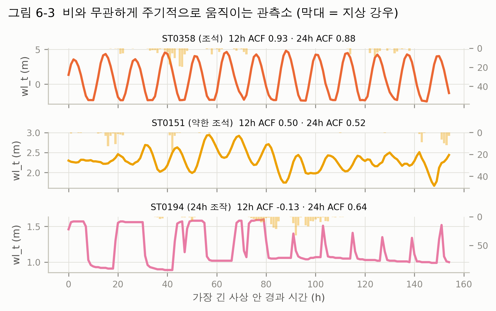

| 구간 | 관측소 | 행 비중 | 특징 | 기준 모델 RMSE |
|---|---|---|---|---|
| 조석 | 15 | 3.2% | 하구, 12.4시간 주기. 강우–수위 상관 −0.03~+0.12 | 0.376 |
| 약한 조석 | 5 | 1.1% | 12h 자기상관 0.50 | 0.180 |
| 24h 조작 | 2 (ST0194, ST0200) | 0.4% | 비와 무관하게 매일 계단식 오르내림(수문 개폐 추정) | 0.214 |
| 방류 의심 | 23 | 5.1% | 비 없이 오르는 비율이 일반 관측소 95% 지점(6.15%) 초과 | 0.266 |
| 수위 고정 | 1 (ST0027) | 0.2% | 28.19m 고정 | – |
| 일반 | 419 | 89.9% | 강우에 반응 | 0.218 (전체 0.226) |

- 조석 세기는 '있다/없다'가 아니라 연속적이다(강한 15곳 + 약한 5곳).
- 관측소를 움직임 지표 9개로 묶으면 네 유형(조용한 산지 소하천 133 · 약하게 반응하는 저지·도시 143 · 크게 반응하는 중규모 하천 135 · 비 없이도 움직이는 대하천 54)이 나온다. 유역환경만으로 유형을 맞히는 정확도는 49%다(종합본 5-5).

### 3.2 조석이 만든 착시

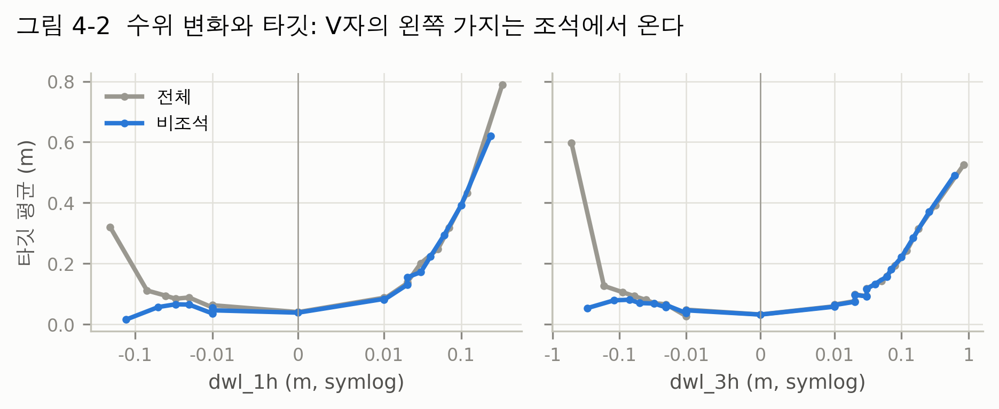

> [!note] 관찰
> - 전체 데이터에서는 "수위가 크게 떨어진 직후에도 크게 오른다"는 V자가 보인다(최하위 구간 평균 0.32m).
> - 비조석만 보면 같은 구간의 평균이 **0.02m**로 사라진다. V자의 왼쪽 가지는 조석의 썰물 → 밀물 전환이었다.

### 3.3 분산은 어디에 있나

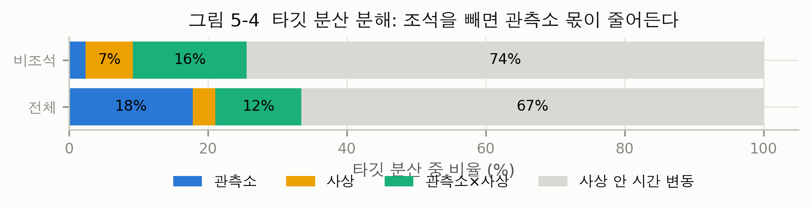

| 성분 | 전체 | 비조석 |
|---|---|---|
| 관측소 간 차이 | 18% | **2%** |
| 사상 간 차이 | 3% | 7% |
| 관측소 × 사상 | 12% | 16% |
| 사상 안 시간 변동 | 67% | **74%** |

> [!tip] 시사점 — 이후 분석의 원칙
> - **층화**: 타깃이 들어가는 분석은 전체와 비조석(조석 15곳 + ST0027 제외)을 나란히 본다.
> - **전체 확인**: 몇 곳의 예시로 결론 내지 않는다. 관측소·사상 중 몇 %가 같은 방향인지 센다. 사상을 짝·홀로 반씩 나눠 두 절반에서 재현되는지도 본다.
> - **판정 기준**(분석 전 고정): 70% 이상 같은 방향이면 채택, 50~70%면 부분 채택, 50% 미만이면 기각.

> [!question] 다음 질문
> 비조석에서는 분산의 74%가 사상 안 시간 변동이다. **지금이 어떤 국면인지 알려주는 신호는 무엇인가?** 첫 번째는 수위 자신이다.

---

## 덩어리 4. 신호 ① — 지금 물이 얼마나 빨리 오르고 있나

> [!abstract] 핵심 메시지
> 가장 강한 단일 신호는 **최근 1~3시간 수위 변화**다. 추세는 1~3시간 이어지고, 창을 12·24시간으로 늘리면 약해진다. 내려가는 중이면 대체로 계속 내려간다.

### 4.1 창이 짧을수록 강하다

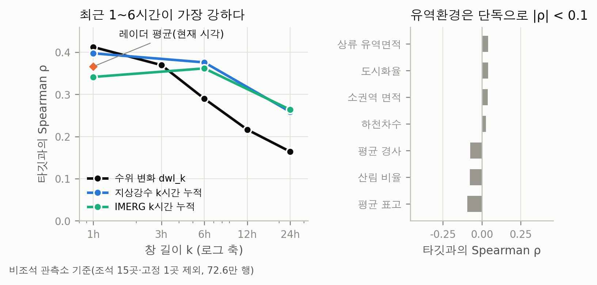

> [!note] 관찰 (비조석, Spearman ρ)
> - 수위 변화: `dwl_1h` 0.41 → 3h 0.37 → 6h 0.29 → 12h 0.22 → 24h 0.16. **오래전 수위보다 직전 추세가 중요하다.**
> - 지상강수: 1h 0.40, 6h 0.38, 24h 0.26. IMERG: 1h 0.34, **6h 0.36**, 24h 0.26. 레이더 평균 0.37.
> - IMERG만 6h에서 가장 크다. IMERG가 지상강수보다 약 1시간 앞서 비를 잡기 때문이다(IMERG(t)와 지상(t+1h)의 상관이 가장 큼).
> - 절대수위 `wl_t`의 상관은 거의 0이다. Pearson은 Spearman의 절반 수준이라, 관계는 **단조롭지만 비선형**이다.

### 4.2 추세는 1~3시간 이어진다

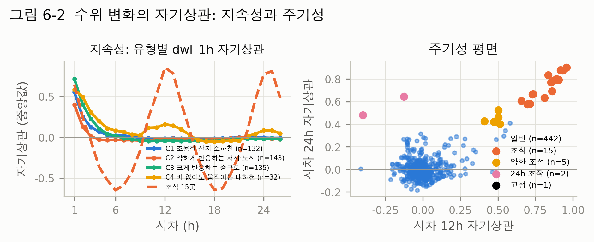

> [!note] 관찰
> - `dwl_1h`의 1시간 자기상관은 유형별로 0.40~0.72다. 3시간이 지나면 0.01~0.31로 줄고, 6시간 뒤에는 거의 0이다.
> - 조석 관측소는 12시간 +0.86, 6시간 약 −0.6의 뚜렷한 주기를 보인다.

### 4.3 내려가는 중이면 계속 내려간다

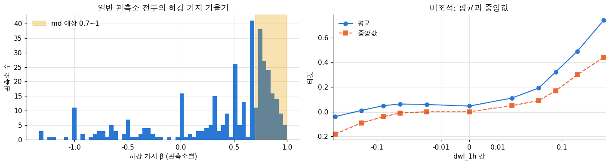

> [!note] 관찰
> - 하강 중인 행의 타깃 평균은 +0.016m지만 **중앙값은 −0.01m**다. 크게 떨어지는 중인 행의 68%는 타깃이 음수다.
> - 관측소의 78%에서 하강 속도가 빠를수록 앞으로도 더 떨어진다.
> - 같은 수위 높이에서 비교하면 상승 중인 행이 하강 중인 행보다 더 오른다(관측소의 99.5%).
> - 평균을 끌어올린 것은 **비 오는 중의 재상승**과 방류 의심 관측소다. `dwl_1h`의 부호와 강우를 함께 보면 구별된다.

### 4.4 사상이 얼마나 진행됐나 — 경과 시간은 보조 변수

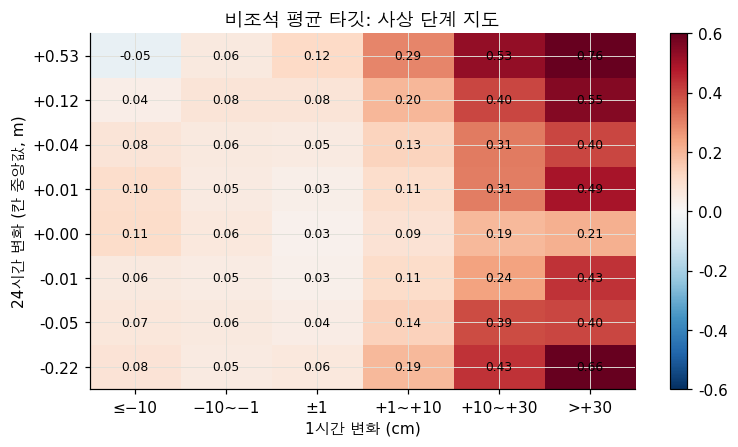

> [!note] 관찰
> - 사상 시작부터 24시간 뒤까지 비조석 타깃 평균은 0.03 → 0.15m, 표준편차는 0.14 → 0.31m로 커진다(종합본 6-5).
> - 하지만 경과 시간이 길다는 것은 보통 **그동안 비가 많이 누적됐다**는 뜻이다. 초반에 비가 몰렸다가 그친 사상처럼 반대인 경우도 있어, 경과 시간 혼자로는 부족하다.
> - 24시간 변화와 1시간 변화를 함께 보면 국면이 드러난다. 막 오르기 시작한 초기의 타깃은 0.18m, 첨두를 지난 뒤는 0.04m다. 이 차이는 **사상의 99%**에서 같은 방향이다. 이 정보는 이미 `dwl_1h`·`dwl_24h`에 담겨 있다.

> [!tip] 시사점
> - 수위 차분 `dwl_1h/3h/6h/24h`와 `dwl_1h` 부호 × 강우를 핵심 변수로 둔다.
> - 사상 경과 시간은 쓸 수 있는 변수지만(사상 **시작 후** 시간은 과거로 정해짐) **보조 변수**로 둔다. 우선순위는 누적·최근 강우 → 경과 시간이다.
> - 가속도(오르는 속도가 빨라지는가)는 `dwl_1h`를 통제하면 오히려 음의 방향이라(관측소 42%·사상 11%) 채택하지 않는다.

> [!question] 다음 질문
> 수위 추세는 "이미 오르기 시작한 뒤"에야 신호를 준다. 그림 1-1처럼 **아직 오르지 않았는데 곧 오를 행**은 무엇으로 알아보는가? 두 번째 신호, 강우다.

---

## 덩어리 5. 신호 ② — 이미 내렸지만 아직 도착하지 않은 비

> [!abstract] 핵심 메시지
> 비가 수위에 닿기까지는 대부분 **6시간 이내**다. 그래서 과거 1~6시간 강우가 핵심 입력이다. 여러 강우 소스가 **함께** 비를 볼 때만 수위가 크게 오른다.

### 5.1 비가 많을수록 더 오르고, 더 흩어진다

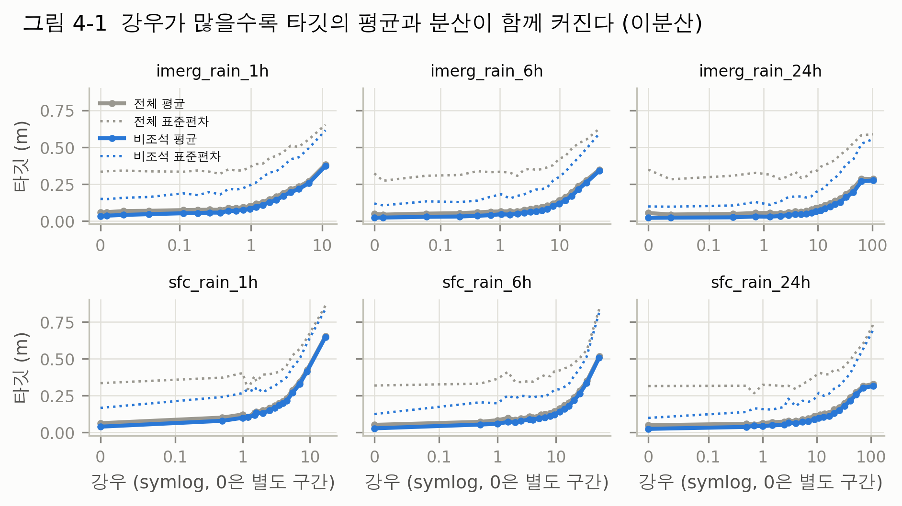

> [!note] 관찰
> - 강우가 약 1mm를 넘으면 타깃 평균이 가파르게 오른다. 비조석 `sfc_rain_1h` 기준 0 구간 0.04m → 최상위 구간 0.65m.
> - 같은 구간에서 표준편차도 0.17 → 0.84m로 커진다(**이분산**).
> - 6시간 누적으로 보면 반응이 꺾이는 지점은 **약 15mm**다. 사상을 반씩 나누면 11mm와 18mm로 흔들려, 날카로운 문턱이라기보다 완만한 전환 구간이다.

### 5.2 비가 수위에 닿기까지

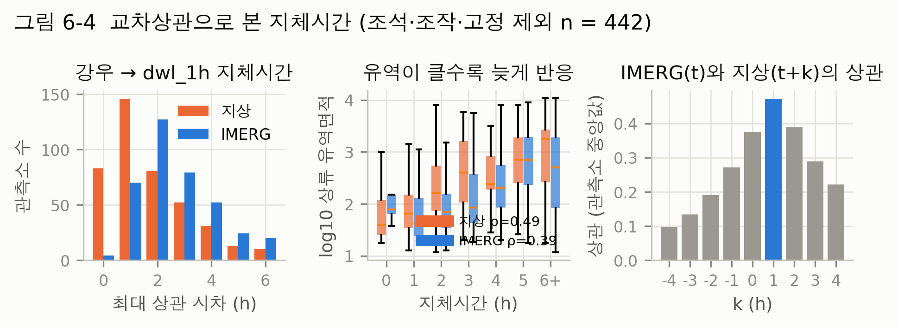

> [!note] 관찰
> - 강우와 수위 변화의 교차상관이 최대가 되는 시차(지체시간)는 관측소 중앙값 기준 지상강수 1시간, IMERG 3시간이다.
> - 지체시간이 6시간 이내인 관측소는 지상 기준 **94%**, IMERG 기준 85%다.
> - 유역이 클수록 늦게 반응한다(사상 단위 지체시간과 유역면적의 ρ 0.55). 소유역은 몇 시간 안에 급상승하고, 대유역은 20시간에 걸쳐 완만히 오른다(종합본 6-1).
> - 같은 시간 안에 반응하는 **초단기 반응 관측소가 33곳**(지체 L = 0) 있다.
> - "급경사일수록 빨리 반응한다"는 확인되지 않았다(면적 통제 시 +0.13, 가파를수록 오히려 늦음).

### 5.3 강우 소스가 서로 일치하는가

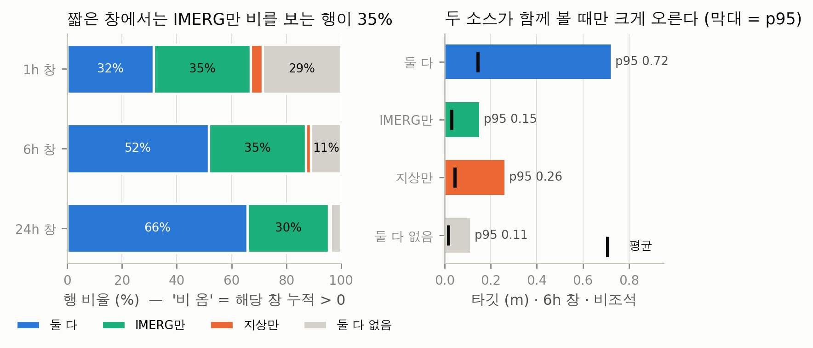

> [!note] 관찰
> - 짧은 창에서는 소스가 자주 어긋난다. 1h 창에서 **IMERG만 비를 보는 행이 35%**, 지상만 보는 행은 4%다. 창이 길어지면 "둘 다"가 32% → 52% → 66%로 는다.
> - 어긋나는 쪽은 대부분 IMERG만 보는 경우다. 이때의 비는 6h 중앙값 약 1.1mm로 약하다. IMERG는 약한 비를 잘 잡고, 지상은 약한 비를 놓친다.
> - 수위는 **두 소스가 함께 비를 볼 때만** 크게 오른다. 비조석 6h 창 p95가 둘 다 0.72m, 지상만 0.26m, IMERG만 0.15m, 둘 다 없음 0.11m다.
> - 크기도 다르게 잡는다. 24h 누적에서 IMERG ÷ 지상 비율은 약한 비(지상 1~5mm) 2.8에서 강한 비(100mm 초과) 0.62로 떨어진다. **IMERG는 약한 비를 크게, 강한 비를 작게** 잡는다.
> - 레이더(p95 ≥ 20)와 IMERG는 비를 보는데 지상은 아직 0인 행은 처음엔 거의 안 움직이다가 천천히 오른다(6h 뒤 +0.04m, 12h 뒤 +0.11m). 이 행에서 지상강수가 뒤따라 잡힐 확률은 1h 뒤 34%, 6h 뒤 48%다. **비가 관측소 쪽으로 오는 중**일 가능성이 있다(미래 값을 쓴 분석이라 변수로는 쓰지 않는다).

> [!warning] 해석 주의
> "둘 다"가 크게 오르는 것은 소스가 일치해서라기보다 **비의 양 자체가 많아서**일 수 있다. 강우량을 맞춘 비교는 아직 하지 않았다. 일치도 변수의 순수한 효과는 모델링 단계에서 검증 점수로 확인한다.

> [!tip] 시사점
> - 핵심 입력은 과거 1~6시간 강우다. 강한 비의 크기는 **지상강수를 주 변수**로 본다.
> - 여러 소스가 같은 상황을 말하는지가 새 정보가 될 수 있다: 소스 간 **순위 차이**, **동시 감지 여부**, 한 소스만 강한 비를 감지했는지. 단위가 다르므로 원값끼리 빼지 않고 순위·임계값으로 만든다.
> - 강우를 겹치지 않는 창(0~1h, 1~6h, 6~24h)으로 나누면 VIF가 2.79 → 1.42로 줄어 선형·신경망 모델에 유리하다.

> [!question] 다음 질문
> 같은 양의 비가 와도 관측소마다 반응이 다르다. **유역환경이 이 차이를 설명하는가?**

---

## 덩어리 6. 유역 — 단독으로는 약하고, 비의 세기에 따라 방향이 바뀐다

> [!abstract] 핵심 메시지
> 유역환경은 타깃과 단독 상관이 |ρ| < 0.1이다. 그러나 같은 비에 대한 **반응 크기를 조절**한다. 중간 비에서는 작은·도시 하천이 조금 더 오르고, **긴 강한 비에서는 큰 하천이 0.2m 더** 오른다.

### 6.1 유역환경은 두 축으로 요약된다

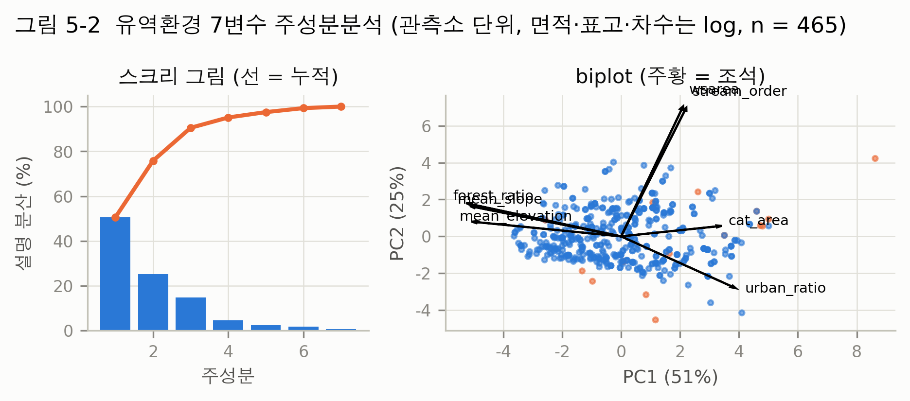

- 7변수 가운데 주성분 3개가 92%를 설명한다. PC1(51%)은 **산지 ↔ 저지·도시**, PC2(25%)는 **하천 규모**(상류면적·하천차수)다.
- 도시화율은 적재값이 PC3에서 가장 크지만, 점수와의 상관은 PC1이 0.68로 가장 크다. 그래서 PC1·PC2 두 축으로 본다.
- 유역환경 단독 상관은 모두 약하다(그림 4-1 오른쪽). 관측소 평균 타깃과의 상관도 |ρ| ≤ 0.24다.

### 6.2 같은 비라도 누가 더 오르나 — 사상 단위 재점검

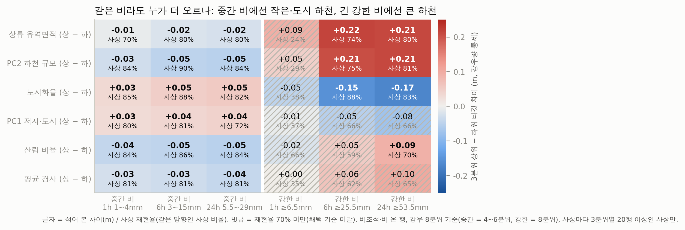

> [!abstract] 방법
> 비조석 관측소에서 비가 온 행만 쓴다. 창(1h·6h·24h)마다 지상강수를 8분위로 나눠 **중간 비**(4~6분위)와 **강한 비**(8분위)를 고른다. 유역 변수 3분위 **상위 − 하위** 타깃 차이를 구하되, 강우 40분위 칸 평균을 빼서 **강우량 차이를 통제**했다. 그리고 사상마다 같은 차이를 구해 **같은 방향인 사상 비율(재현율)**을 셌다.

> [!note] 관찰
> - **중간 비**(1h 1~4mm, 6h 3~15mm, 24h 5.5~29mm): 도시화·저지 쪽이 +0.03~0.05m 더 오르고, 큰 하천·산림·급경사 쪽이 0.01~0.05m 덜 오른다. 효과는 작지만 사상 **70~90%**에서 같은 방향이다.
> - **짧은 폭우**(1h 6.5mm 이상): 어느 유역 변수도 일관되지 않다(재현율 24~66%). 짧고 센 비에는 유역과 상관없이 비슷하게 반응한다.
> - **긴 강한 비**(6h 25.5mm 이상, 24h 53.5mm 이상): 방향이 **뒤집힌다**. 상류면적·하천 규모 상위가 **+0.21~0.22m** 더 오르고(재현율 74~81%), 도시화 상위는 **−0.15~0.17m** 덜 오른다(83~88%). 큰 유역은 오래 모인 비가 뒤늦게 내려오기 때문으로 보인다(5.2절 지체시간과 일치).
> - 산림·경사·PC1은 긴 강한 비에서 재현율 59~70%로 부분 채택 수준이다.
> - 짝·홀 반분 점검: 6h 창은 두 절반 모두 73% 이상이다. 24h 창의 하천 규모·도시화는 한 절반이 64~67%로 기준 바로 아래다.

> [!info] 기존 판정과의 관계
> 최종본(5.3절)은 "강한 비에서 큰 유역이 더 오른다"를 **기각**했다(사상 19개 중 8개). 그때는 IMERG 6h 40mm 초과 행을 썼고 강우량을 통제하지 않았다. 당시에도 이 차이가 **긴 사상에서만** 나타난다고 짚었다(사상 길이와 차이의 순위상관 0.56). 이번에는 비 지속시간을 담는 **24h 지상강수 창**을 쓰고 강우량을 통제했다. 그러자 같은 효과가 사상 80% 수준으로 재현됐다. IMERG가 강한 비를 작게 잡는 것(5.3절)도 차이의 원인일 수 있다(추정). 결론: 큰 유역 효과는 **"강한 비"가 아니라 "오래 이어진 강한 비"와 짝지을 때** 나타난다. 정의에 따라 판정이 흔들리므로 **후보**로 두고 검증 점수로 최종 판단한다.

### 6.3 관측소 안에서 수위가 높을수록 같은 비에 덜 오른다

- 관측소마다 기준면이 달라 칸 평균으로 보면 방향이 뒤집힌다. 관측소 train 수위 분포에서의 분위 **q**로 바꾸면, 수위가 높을수록 같은 비에 덜 오른다(관측소 80%·사상 96%).
- `q × log1p(sfc_rain_6h)`는 기준 모델 잔차를 상위 5사상 제외 기준 **+2.9%** 설명하고, 사상 일관성이 91%다. 지금까지 찾은 후보 가운데 가장 낫다.

### 6.4 확인되지 않은 통념

| 통념 | 이 데이터의 결과 | 판정 |
|---|---|---|
| 경사가 급할수록 빨리 반응 | 면적 통제 시 +0.13(가파를수록 늦음) | ❌ |
| 선행 습윤(6~24시간 전 비)이 많으면 더 오름 | 최근 강우·경과 시간 통제 시 ρ −0.15, 관측소 24%·사상 25% | ❌ |
| 유역이 클수록 강우 1mm당 상승이 작음 | 면적 3분위 0.0040 / 0.0052 / 0.0046 | ❌ |
| 조석 위상 변수를 따로 넣어야 함 | 잔차 −1.5%, 일관성 38%. 위상은 이미 과거 수위에 들어 있음 | ❌ |

> [!tip] 시사점
> - 유역 정보는 단독 변수보다 **강우 × 유역** 형태로 넣는다. 다만 우선순위를 둔다: ① q × 강우 ② 하천 규모(log 면적 또는 PC2) × 24h 강우 ③ 도시화 × 강우. 경사·산림 × 강우는 후순위다.
> - 방향이 비의 세기에 따라 바뀌므로 유역 변수에는 **단조 제약을 걸지 않는다**. 트리 모델은 이런 역전을 스스로 잡지만, 데이터가 몇몇 긴 사상에 몰려 있어 과적합에 주의한다.

> [!question] 다음 질문
> 수위·강우·레이더·유역 변수가 모두 쓸모 있어 보인다. **이들이 서로 얼마나 겹치는가?**

---

## 덩어리 7. 변수 중복 — 많지만 정보는 겹친다

> [!abstract] 핵심 메시지
> 같은 종류의 변수끼리 정보가 크게 겹친다. 변수를 많이 넣는다고 새 정보가 늘지는 않는다. 그래도 **상관만 보고 지우지 않는다.**

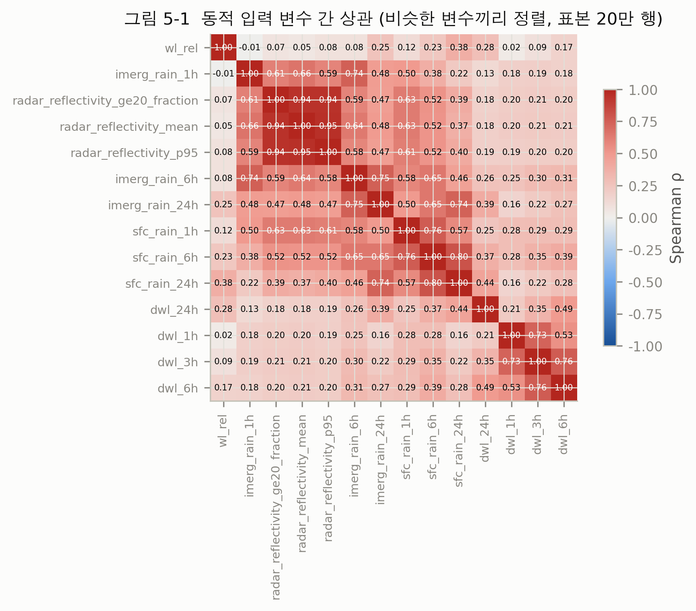

| 겹치는 묶음 | 근거 |
|---|---|
| 레이더 3변수 | 평균–p95 ρ 0.95, 평균–20 이상 비율 0.94. VIF 15.9 / 7.2 / 6.5 → **사실상 하나** |
| 강우 소스 | IMERG–지상 ρ 1h 0.50 → 24h 0.74. 같은 원천의 6h·24h도 VIF 5~6 |
| 경사 ↔ 산림 ↔ 표고 | 관측소 단위 ρ 경사–산림 0.96, 표고–산림 0.85 |
| 상류면적 ↔ 하천차수 | 관측소 단위 ρ 0.90 |

> [!tip] 시사점
> - 트리 모델(LightGBM·XGBoost·CatBoost)은 상관된 변수도 다룰 수 있다. 다만 중요도가 겹치는 변수에 나뉘므로 **중요도 해석에 주의**한다.
> - 순서: ① 전체 변수 사용 ② 중복 변수 일부 제거 ③ 사상 GroupKFold RMSE 비교. 상관이 아니라 **검증 점수가 좋아지는지**로 결정한다.
> - 선형·신경망 모델을 쓸 경우에만 레이더를 하나로 줄이고, 겹치지 않는 강우 창과 유역 주성분을 쓴다.

---

## 덩어리 8. EDA 결론 — 발견에서 결정으로

| # | 발견 | 근거 | 모델링 결정 |
|---|---|---|---|
| 1 | train/test는 사상 단위로 나뉘고, 이웃 행의 예측 창이 5시간 겹친다. 무작위 분할은 12% 낙관적 | 1.4 | 사상 GroupKFold, 미래 행 참조 금지 |
| 2 | 상위 1% 행이 0 예측 오차의 66%. 기준 모델 뒤 오차는 강한 비(행 14% → 오차 45%)·긴 사상(46% → 71%)에 몰림 | 2.1~2.3 | 꼬리 대응 실험, 상위 5사상 제외 점수 병행 |
| 3 | 조석 15곳이 전체 관계를 왜곡. 비조석에서 관측소 몫 2%, 사상 안 시간 변동 74% | 3.1~3.3 | 전체·비조석 따로 평가, 구간 플래그 |
| 4 | 가장 강한 신호는 최근 1~3h 수위 변화. 창이 길수록 약해짐. 하강 중이면 계속 하강 | 4.1~4.3 | 수위 차분, `dwl_1h` 부호 × 강우 |
| 5 | 사상 국면은 사상의 99%에서 일관. 경과 시간은 누적 강우의 대리 | 4.4 | 사상 누적강우 우선, 경과 시간 보조 |
| 6 | 지체시간 대부분 6h 이내, 유역이 클수록 늦음. 초단기 반응 33곳 | 5.2 | 과거 1~6h 강우, log 면적 = 도달시간 지표 |
| 7 | 두 소스가 함께 볼 때만 크게 오름. IMERG는 약한 비 과대·강한 비 과소 | 5.3 | 강한 비는 지상강수 중심, 소스 일치도 변수 |
| 8 | 유역은 단독으로 약하고, 비의 세기에 따라 방향이 바뀌는 조절 변수 | 6.2~6.3 | q × 강우, 규모 × 24h 강우, 도시화 × 강우, 단조 제약 금지 |
| 9 | 레이더 3개는 하나, 경사–산림 0.96, 면적–차수 0.90 | 7 | 삭제는 검증 점수로 결정 |

> [!warning] 쓰지 않는 것
> - **누수**: 사상 길이·끝, 사상 전체 순위·최대·최소, 미래 행(`shift(-k)`), test 뒤 시각 행, fold 밖에서 만든 타깃 기반 통계
> - **효과 없음**: 조석 위상 변수, 사상 단계 격자, 가속도, 감수 지수, 도달시간 공식(Hack) 지표, 레이더 p95 − 평균
> - **전처리**: ST0027은 학습 제외·예측 0. 결측 대치와 이상값 제거는 하지 않는다.

---

# Part Ⅱ. 향후 계획

## 9. 현재 위치

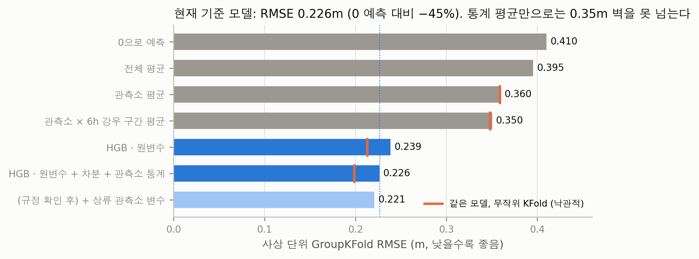

> [!note] 관찰
> - 관측소 평균, 관측소 × 강우 구간 평균 같은 통계 기준선은 **0.35m 벽**을 넘지 못한다. 시간 구조(수위 추세·강우)를 쓰는 트리 모델이 필요하다.
> - 기준 모델(HGB, 원변수 + 차분 + 관측소 통계)의 사상 단위 OOF RMSE는 **0.226m**다. 0 예측(0.410m) 대비 45% 낮다. 비조석 0.220m, 조석 0.376m다.
> - 같은 시각 상류 관측소의 수위 변화를 넣으면 0.221m(−2.4%)로 준다. 다만 test에서 다른 관측소의 같은 시각 행을 읽어야 만들 수 있어 **대회 규정 확인 전까지는 쓰지 않는다**. 조석 관측소에서는 오히려 나빠진다(0.376 → 0.386m).

## 10. 로드맵

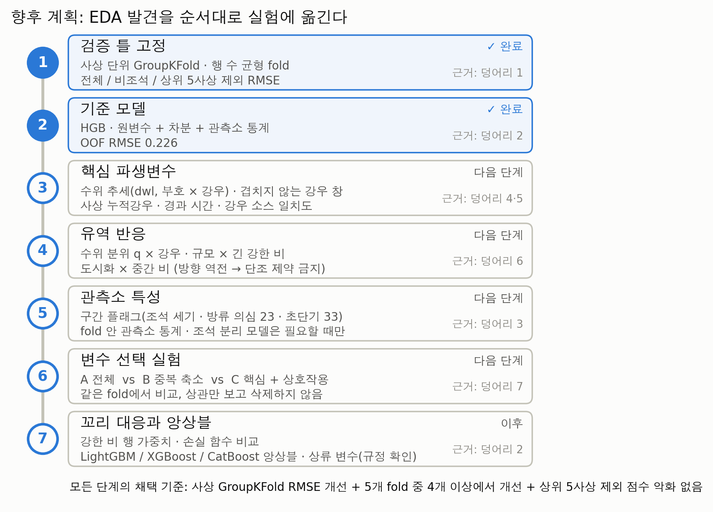

> [!abstract] 원칙
> "새로운 호우사상에 일반화할 수 있도록 **사상 단위로 검증**하고, **최근 수위 추세와 최근 강우**를 중심으로 예측하되, **유역 특성은 강우에 대한 반응 차이를 설명하는 변수**로 활용한다."

### 10.1 단계별 계획

| 단계 | 할 일 | 근거 | 비교 대상 |
|---|---|---|---|
| **1. 검증 틀** ✓ | 사상 단위 GroupKFold(5-fold, 반복). 155h 사상이 행의 10%라 **fold별 행 수를 맞춘다**. 지표 3종: 전체 · 비조석 · 상위 5사상 제외 RMSE | 1.4, 2.2 | – |
| **2. 기준 모델** ✓ | HGB · 원변수 + 차분 + 관측소 통계 → **0.226m** | 9 | 0 예측 0.410 |
| **3. 핵심 파생변수** | 수위: `dwl_1h/3h/6h/24h`, `dwl_1h` 부호 × 강우, 상승 속도 · 강우: 겹치지 않는 창(`r0_1`, `r1_6`, `r6_24`), 단기/누적 비율, 사상 누적강우 · 소스 일치도: 순위 차, 동시 감지, 한 소스만 강한 비 · 보조: 사상 경과 시간 | 4, 5 | 단계 2 |
| **4. 유역 반응** | ① `q × log1p(sfc_rain_6h)` ② log 상류면적(또는 PC2) × `sfc_rain_24h` ③ 도시화 × `sfc_rain_1h`·`sfc_rain_24h` ④ (후순위) 경사·산림·하천차수 × 강우 | 6.2, 6.3 | 단계 3 |
| **5. 관측소 특성** | 구간 플래그(조석 세기 = 12·24h 자기상관, 방류 의심 23곳, 초단기 33곳), 관측소 ID, fold 안 관측소 통계(평균·분위수). 조석·일반 **분리 모델은 필요할 때만** | 3.1 | 단계 4 |
| **6. 변수 선택** | A 전체 변수 vs B 중복 축소(레이더 1개, 경사·산림 중 1개 등) vs C 핵심 + 상호작용. 같은 fold에서 비교 | 7 | A/B/C |
| **7. 꼬리 대응 · 앙상블** | 강한 비·긴 사상 행 가중치, 손실 함수 비교(MSE 기본 · Huber · 분위수), 강우·레이더 단조 제약(비조석), LightGBM / XGBoost / CatBoost 앙상블, (규정 확인 후) 상류 관측소 변수 | 2.3, 9 | 단계 6 최선 |

> [!tip] 채택 기준 (모든 단계 공통)
> 사상 GroupKFold RMSE가 좋아지고, **5개 fold 중 4개 이상**에서 좋아지며, **상위 5사상 제외 점수가 나빠지지 않을 때**만 채택한다. EDA의 70% 판정 원칙을 모델링에도 그대로 적용한다.

### 10.2 우선 시험할 가설

| 순위 | 가설 | EDA 근거 | 기대 |
|---|---|---|---|
| 1 | 관측소 안 수위 분위 q × 강우가 꼬리를 줄인다 | 6.3 (잔차 +2.9%, 일관성 91%) | 강한 비 구간 RMSE 감소 |
| 2 | 하천 규모 × 24h 강우가 긴 사상의 큰 상승을 잡는다 | 6.2 (+0.21m, 재현율 74~81%) | 25h 이상 사상 오차 감소 |
| 3 | 강우 소스 일치도가 강우량 이상의 정보를 준다 | 5.3 | 양 통제 후에도 개선되는지 확인 |
| 4 | 강한 비 행 가중치가 전체 RMSE를 줄인다 | 2.3 (행 14% → 오차 45%) | 전체 개선, 약한 비 구간 악화 여부 확인 |
| 5 | 중복 변수를 줄여도 점수가 유지된다 | 7 | 학습 속도 향상, 해석 단순화 |

### 10.3 위험과 대응

| 위험 | 대응 |
|---|---|
| 몇몇 긴 사상에 맞춘 과적합 (25h 이상 사상이 기준 모델 오차의 71%) | 상위 5사상 제외 점수 병행, 반복 GroupKFold |
| 155h 사상 하나가 들어간 fold의 점수 쏠림 | fold별 행 수 균형, 해당 fold 점수 따로 확인 |
| 관측소 통계를 통한 누수 | 타깃 기반 통계는 학습 fold 안에서만 계산 |
| 유역 조절 효과가 정의에 따라 흔들림 (6.2) | 후보로만 두고 검증 점수로 최종 판정, 단조 제약 금지 |
| 강우·레이더 단위 미확인 | 트리 모델은 순위만 쓰므로 영향 작음. 소스 간 비교 변수는 순위·임계값으로 |
| 상류 관측소 변수의 규정 위반 가능성 | 대회 규정 확인 전까지 제외 |

---

## 부록

### A. 용어

| 용어 | 뜻 |
|---|---|
| 사상(호우사상) | 합성 시각에서 1시간 넘는 공백으로 끊긴 구간. train 122개, test 30개 |
| 비조석 | 조석 관측소 15곳과 수위 고정 관측소(ST0027)를 뺀 나머지 |
| `dwl_k` | `wl_t − wl_t_minus_kh`, 지난 k시간 수위 변화 |
| q | 관측소 train 수위 분포에서 현재 수위 `wl_t`의 분위(0~1) |
| OOF | 교차검증에서 각 행이 검증 fold에 있을 때 받은 예측 |
| 재현율 | 섞어 본 차이와 같은 방향인 사상의 비율. 70% 이상이면 채택 |
| 기준 모델 | HGB, 원변수 + 차분 + 관측소 통계, 사상 단위 5-fold. OOF RMSE 0.226m |

### B. 새로 만든 그림

| 그림 | 파일 | 내용 |
|---|---|---|
| 1-1 | `m1_problem.png` | 타깃 정의 예시, 예측 창 겹침과 누수 |
| 2-3 | `m2_error_share.png` | 구간별 행 비중 vs 0 예측·기준 모델 오차 비중 (`m2_error_share.csv`) |
| 4-1 | `m3_signal_decay.png` | 창 길이별 타깃과의 순위상관, 유역 변수 단독 상관 |
| 5-3 | `m4_rain_sources.png` | 강우 소스 일치 조합별 행 비율과 타깃 |
| 6-2 | `m5_moderation.png` | 유역 조절 효과 × 사상 재현율, 강우량 통제 (`m5_moderation.csv`) |
| 9-1 | `m6_ladder.png` | 기준선 사다리, GroupKFold vs 무작위 KFold |
| 10-1 | `m7_roadmap.png` | 향후 로드맵 |

모두 `eda/figures/midterm/`에 있고 `eda/src/m01_midterm_figs.py`로 다시 만든다. 나머지 그림은 `figures/textbook/`(종합본), `figures/final/`(최종본), `figures/event_length/`에서 가져왔다.
