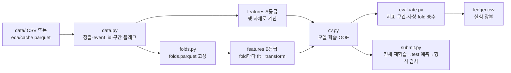

# 모델링 파이프라인·분석 로드맵 (회의 전 초안)

> 2026-10-30 작성 · 2026 KISTI DATA·AI 경진대회 — 6시간 최대 하천수위 상승량 예측
> 바탕: `eda/report_final.md`(최종 EDA), `eda/EDA_중간보고서.md` Part Ⅱ(중간 로드맵), `eda/research_findings.md`, 실험 `eda/src/x01·x02`
> 이 문서는 **회의에서 고칠 초안**이다. 날짜·역할은 비워 두었고, 정할 것은 7장에 모았다.

---

## 0. 한 장 요약

1. EDA는 끝났고, 기준 모델(HGB)의 사상 단위 OOF RMSE는 **0.2264m**(0 예측 0.410m)다. 중간 로드맵 1·2단계(검증 틀, 기준 모델)까지 왔다.
2. 지금까지 실험은 스크립트마다 데이터 로딩·fold·지표를 따로 짰다. 다음 단계 전에 **공용 파이프라인**을 먼저 만든다. 목표는 "실험 1회 = 설정 파일 1개"다.
3. 분석은 중간 로드맵 3~7단계를 그대로 따른다. 순서는 **핵심 파생변수 → 유역 반응 → 관측소 특성 → 변수 선택 → 모델·꼬리·앙상블 → 최종화**다.
4. 모든 변경은 같은 채택 기준을 통과해야 들어간다. 빠른 확인으로 거르고, 본 검증(20 fold)으로 채택한다.
5. 회의에서 꼭 정할 것: **마감·제출 횟수, 역할 분담, 코드 공유 방식, 상류 관측소 변수 규정 문의**.

| 단계 | 이름 | 핵심 산출물 | 넘어가는 조건(게이트) |
|---|---|---|---|
| P0 | 준비 | 라이브러리 설치, 규정 문의 발송, 저장소 | 환경에서 기준 스크립트가 돈다 |
| P1 | 파이프라인 골격 + 기준 재현 | `model/` 코드, fold 파일, 첫 제출 | 0.2264 ± 0.001 재현, 제출 형식 통과 |
| P2 | 핵심 파생변수 | 수위·강우·소스 일치 변수 그룹 | 그룹별 채택/기각 기록 |
| P3 | 유역 반응(상호작용) | q × 강우 외 2~3개 | Fq 본 검증 결론 |
| P4 | 관측소 특성·구간 | 구간 플래그, fold 안 관측소 통계, (필요시) 조석 분리 | 구간별 RMSE 표 |
| P5 | 변수 선택 | A/B/C 조합 비교 | 최종 변수 목록 고정 |
| P6 | 모델·손실·꼬리·앙상블 | GBM 3종, 손실·가중치, 블렌딩 | 앙상블이 단일 최선보다 나음 |
| P7 | 최종화 | 전체 train 재학습, 최종 제출, 재현 스크립트, 보고서 모델링 장 | 재현 1회 성공 |

곁가지: 확률과정 실험(x 시리즈)은 P2~P4와 나란히 진행한다(4.8절).

---

## 1. 현재 위치

| 항목 | 상태 | 근거 |
|---|---|---|
| EDA | 완료. 최종본·중간보고서·가설 42개 판정 | `eda/report_final.md` |
| 검증 틀 | 사상 단위 GroupKFold로 고정. 무작위 분할은 12% 낙관적 | 보고서 7.3 |
| 기준 모델 | HGB, 원변수 + 차분 + 관측소 통계 → **0.2264**(비조석 0.2197, 조석 0.3755) | `cache/results/s05_baseline.csv` |
| x01 산탄잡음 커널 | **기각** (20 fold 중 11개 개선, 평균 −0.15% → 잡음 수준) | `x01_shot_noise*.json` |
| x02 러닝 최대값 × q | **잠정** (간이 확인 −0.61%, 12 fold 중 10개). q 단독 대조와 본 검증이 남음 | `x02_running_max_sample_summary.json` |
| 상류 관측소 변수 | −2.4% 효과, **규정 확인 전 사용 보류** | 중간보고서 9장 |
| 환경 | scikit-learn 1.7.2만 있음. LightGBM·XGBoost·CatBoost·Optuna 없음. 6코어·8GB | 2026-10-30 확인 |

문제점: 실험 스크립트(`s05`, `x01`, `x02`)가 로딩·fold·지표·관측소 통계를 각자 구현한다. 그래서 실험끼리 비교할 때 조건이 같은지 매번 다시 확인해야 한다.

---

## 2. 고정 원칙 (EDA에서 넘어온 것)

다시 논의하지 않고 파이프라인에 코드로 박아 둔다.

- **검증**: 사상(event) 단위 GroupKFold. fold별 행 수를 맞춘다(155h 사상 하나가 행의 10%).
- **지표 3종 + 1**: 전체 RMSE · 비조석 RMSE · 상위 5사상 제외 RMSE + 구간별 RMSE 표.
- **누수**
  - t 이후 정보 금지: 사상 길이·끝, 사상 전체 순위·최대·최소, `shift(-k)`, test의 뒤 시각 행.
  - 타깃이나 train 분포를 쓰는 변수(B등급: q, 관측소 통계, 댐 플래그, 지체 L)는 **학습 fold 안에서만** 계산한다.
  - 학습 가중치는 test에서 쓰지 않으므로 사상 길이를 써도 된다(변수로는 금지).
- **전처리**: ST0027은 학습 제외·예측 0. 이상값 제거·결측 대치 없음.
- **쓰지 않는 것**: 조석 위상, 사상 단계 격자, 가속도, 감수 지수, 도달시간 공식, 레이더 p95 − 평균, 고정된 선행 관측소.
- **타깃 변환**: RMSE는 평균을 맞혀야 하므로 log 등 변환은 기본으로 쓰지 않는다. 실험할 때는 역변환 보정을 같이 본다.

---

## 3. 파이프라인 설계

### 3.1 흐름



### 3.2 폴더 구조 (제안)

EDA 코드(`eda/src/`)와 분리한다. EDA 스크립트는 재현용으로 그대로 둔다.

```
model/
  config.py          경로, 시드, fold 설정, 특수 관측소 목록(nb07_regimes.csv)
  data.py            로드, 정렬, event_id, ST0027 처리
  folds.py           사상 GroupKFold(행 수 균형) × 반복 시드 → folds.parquet
  features/
    base.py          A등급: dwl, 창 분해, 소스 일치도, 사상 누적강우·경과 시간 …
    station.py       B등급: fit(train) / transform(df) — q, 관측소 통계, 댐 플래그, 지체 L
    registry.py      변수 그룹 이름 → 함수, 누수 등급, 설명
  models.py          HGB / LightGBM / XGBoost / CatBoost 공통 인터페이스
  cv.py              실험 1회 실행: 설정 → OOF + 지표 저장
  evaluate.py        지표 3종 + 구간별·사상별, fold 승수, 챔피언 대비 차이
  submit.py          전체 train 재학습 → test 예측 → 형식 검사 → CSV
  experiments/       e001_baseline.json, e002_dwl.json …
runs/<실험 ID>/      oof.parquet, metrics.json, config.json, 로그
submissions/         제출 CSV + 제출 기록
ledger.csv           실험 장부 (한 줄 = 실험 1회)
```

### 3.3 핵심 설계 결정

| # | 결정 | 이유 |
|---|---|---|
| 1 | **fold는 파일로 한 번 만들어 고정**(`folds.parquet`: event_id × 시드 0~3 → fold) | 실험끼리 같은 분할을 쓰는지 다시 확인할 필요가 없다 |
| 2 | **B등급 변수는 `fit/transform` 인터페이스만 허용** | fold 밖 정보가 섞이는 실수를 구조로 막는다. 최종 제출 때는 전체 train으로 fit |
| 3 | **변수는 그룹 단위로 등록**하고 실험 설정은 그룹 이름 목록만 적는다 | "어떤 변수를 넣었나"가 설정 파일 한 줄로 남는다 |
| 4 | **두 가지 속도**: 빠른 확인(사상 40개 표본 × 4-fold × 3회, 약 1분) / 본 검증(5-fold × 4시드 = 20 fold) | x02에서 쓴 방식. 후보를 싸게 거르고 채택만 비싸게 한다 |
| 5 | **챔피언 방식**: 새 실험은 항상 "현재 챔피언"과 같은 fold에서 비교 | 원래 기준(0.2264)이 아니라 지금까지 쌓은 최선과 비교해야 효과가 겹치는지 보인다 |
| 6 | **OOF 예측을 모두 저장** | 앙상블·잔차 분석·구간별 오차를 다시 학습 없이 계산한다 |
| 7 | **제출 전 형식 검사 자동화**: 186,263행, row_id 일치·중복 없음, NaN·inf 없음, ST0027 = 0 | 규정 위반 제출을 막는다 |
| 8 | 데이터 읽기는 `eda/cache/*.parquet`를 쓰고 없으면 `data/` CSV에서 다시 만든다 | 로딩 시간 절약, 재현성 유지 |

### 3.4 실험 장부(`ledger.csv`) 열

`실험ID, 날짜, 담당, 단계, 설명, 변수그룹, 모델, 파라미터, 모드(빠른/본), RMSE, 비조석, 상위5제외, 조석, fold승수, 사상개선%, 챔피언대비%, 판정(채택/기각/보류), 메모`

---

## 4. 분석 로드맵

### 4.0 채택 기준 (모든 단계 공통)

| 모드 | 통과 조건 | 결과 |
|---|---|---|
| 빠른 확인 | 평균 RMSE 개선 + 12 fold 중 9개 이상 개선 | 본 검증으로 올림 |
| 본 검증 | 평균 RMSE 개선 + **20 fold 중 16개 이상** 개선 + 상위 5사상 제외 RMSE 악화 없음 | 채택 → 새 챔피언 |

EDA의 70% 판정 원칙을 그대로 옮긴 것이다. 기준을 넘지 못하면 효과가 있어 보여도 "보류"로 남긴다.

### 4.1 P0 — 준비

- [ ] LightGBM 설치(필수), XGBoost·CatBoost·Optuna는 P6 전에
- [ ] 저장소 결정(현재 폴더는 git이 아님) — 7장
- [ ] 주최 측에 문의: ① test에서 **같은 시각 다른 관측소 행**을 변수로 써도 되는지(상류 관측소 변수, −2.4%) ② 제출 횟수 제한 ③ 최종 제출 선택 방식
- 산출물: 설치 확인, 문의 발송 기록

### 4.2 P1 — 파이프라인 골격 + 기준 재현

- [ ] 3.2의 `data → folds → features(기준 그룹) → cv → evaluate` 연결
- [ ] e001 = s05 최고 모델 재현. **0.2264 ± 0.001**이 안 나오면 다음 단계로 가지 않는다
- [ ] 같은 설정을 LightGBM으로 돌려 속도·점수 비교 → 기본 모델 결정
- [ ] 첫 제출: CV와 리더보드 차이 확인(test 사상이 30개라 리더보드는 흔들림이 크다는 점을 기록)
- 게이트: 재현 성공, 제출 형식 검사 통과

### 4.3 P2 — 핵심 파생변수 (중간 로드맵 3단계)

변수 그룹을 하나씩 챔피언에 더한다.

| 그룹 | 내용 | EDA 근거 |
|---|---|---|
| `dwl` | `dwl_1h/3h/6h/12h/24h`, 상승 속도 | 보고서 4.2 |
| `sign_rain` | `dwl_1h` 부호 × 강우 | 4.6, 하강 중 지속 |
| `rain_win` | 겹치지 않는 창 `r0_1`, `r1_6`, `r6_24`, 단기/누적 비율 | 6.4 |
| `src_agree` | 소스 일치도: 순위 차, 동시 감지, 한 소스만 강한 비 | 중간보고서 5.3 |
| `event_cum` | 사상 누적강우, 사상 경과 시간(보조) | 6.5 |

- 주의: `event_cum`은 test 안에서 **같은 사상의 앞 시각 행**을 읽어 만든다. t까지의 정보라 문제 정의상 허용이지만, 뒤 시각 행이 섞이지 않는지 단위 검사를 둔다.
- 게이트: 그룹별 채택/기각이 장부에 기록됨

### 4.4 P3 — 유역 반응 (중간 로드맵 4단계)

| 순위 | 후보 | 해야 할 일 |
|---|---|---|
| 1 | `q × log1p(sfc_rain_6h)` | EDA 최선 신호(+2.9%, 일관성 91%) |
| 1' | x02 Fq(`러닝최대 × q`) | **E + q 대조**로 q 단독 효과와 교차 효과를 나눈 뒤 본 검증 |
| 2 | log 상류면적 × `sfc_rain_24h` | 사상 단위 재현이 약했음(19개 중 8개) → 기대 낮음, 한 번만 시험 |
| 3 | 도시화 × `sfc_rain_1h` | 중간 강우에서만 성립(사상 78%), 40mm 초과는 반대 |

- 단조 제약은 걸지 않는다(방향이 강우 세기에 따라 바뀜).

### 4.5 P4 — 관측소 특성·구간 (중간 로드맵 5단계)

- [ ] 구간 플래그: 조석 세기(12·24h 자기상관), 댐 방류 의심 23곳, 초단기 33곳(L = 0)
- [ ] fold 안 관측소 통계(평균·표준편차·분위수), 관측소 ID 범주 변수(LightGBM)
- [ ] 조석 15곳 분리 모델은 **조석 RMSE가 기준 오차의 8.8%뿐이라 후순위**. 구간별 RMSE에서 조석이 줄지 않을 때만 시험
- 산출물: 구간별 RMSE·편향 표(보고서 부록 C 형식)

### 4.6 P5 — 변수 선택 (중간 로드맵 6단계)

- A 전체 변수 / B 중복 축소(레이더 1개, 경사·산림 중 1개, 면적·차수 중 1개) / C 핵심 + 채택된 상호작용만
- 같은 20 fold에서 비교. 점수가 같으면 단순한 쪽
- 채택 순서대로 쌓았으므로 여기서 **빼 보기(ablation)** 를 한 번 해서 늦게 들어온 변수가 앞 변수를 대체했는지 확인
- 게이트: 최종 변수 목록 고정

### 4.7 P6 — 모델·손실·꼬리·앙상블 (중간 로드맵 7단계)

| 항목 | 후보 | 비고 |
|---|---|---|
| 모델 | HGB, LightGBM, XGBoost, CatBoost | 같은 변수·fold |
| 꼬리 대응 | 강한 비·긴 사상 행 가중치 | 강한 비 행 14% → 기준 오차 45% |
| 손실 | MSE(기본), Huber | 평가가 RMSE라 MSE가 기본 |
| 단조 제약 | 강우·레이더 + 방향(비조석, 24h 조작·고정 제외) | 보고서 부록 D |
| 튜닝 | Optuna, 빠른 확인 모드로 탐색 → 본 검증으로 확정 | 튜닝 과적합 주의 |
| 앙상블 | OOF 기반 단순 평균 → 비음수 가중 블렌딩, 시드 평균 | 블렌딩 가중치도 fold 밖에서 정한다 |
| (규정 허용 시) | 상류 관측소 같은 시각 수위 변화 | 조석에서는 악화 → 비조석에만 |

- 게이트: 앙상블이 단일 최선보다 채택 기준을 넘음

### 4.8 곁가지 — 확률과정 실험 (x 시리즈)

P2~P4와 나란히 돌리고, 같은 파이프라인·채택 기준을 쓴다.

| 순서 | 후보 | 상태 |
|---|---|---|
| x02 | 러닝 최대값 × q | E + q 대조 → 본 검증 (P3와 합류) |
| x03 | 댐 방류 점프(상태의존 해저드, 23곳) | 다음 후보 |
| x04 | 러닝 최대값 공식의 σ를 관측소·국면별로 | x02 결과 보고 결정 |
| 보류 | 미래 비 조건부 강도, Tweedie·허들 손실, HMM·Hawkes | 기대 낮음 |

### 4.9 P7 — 최종화

- [ ] 최종 구성으로 전체 train 재학습(B등급 변수도 전체 train으로 fit), 시드 여러 개 평균
- [ ] 제출 형식 검사 → 최종 제출
- [ ] `python -m model.submit --config final.json` 한 줄 재현 확인(새 폴더에서)
- [ ] 보고서 모델링 장: 단계별 챔피언 변화 표(장부에서 자동 생성), 선행연구 인용은 이 장에서만

---

## 5. 작업량 추정 (날짜는 마감 확인 후 채움)

| 단계 | 추정 작업일 | 나란히 할 수 있는 일 |
|---|---|---|
| P0 | 0.5 | — |
| P1 | 2~3 | 규정 문의 답 기다리기 |
| P2 | 2~3 | x02 대조 실험 |
| P3 | 1~2 | x03 댐 해저드 |
| P4 | 2 | — |
| P5 | 1 | — |
| P6 | 3~4 | 튜닝은 밤새 돌리기 |
| P7 | 1~2 | 보고서 모델링 장 |
| 합계 | **약 13~18일** | 2인이 나누면 단축 가능 |

본 검증 1회는 HGB 기준 약 5분(5-fold 70초 × 4시드)이다. LightGBM이면 더 짧을 것으로 예상하지만 P1에서 확인한다.

---

## 6. 위험과 대응

| 위험 | 대응 |
|---|---|
| 몇몇 긴 사상에 맞춘 과적합(25h 이상 사상이 기준 오차의 71%) | 상위 5사상 제외 점수 병행, 반복 fold |
| 155h 사상이 든 fold의 점수 쏠림 | fold 행 수 균형, 그 fold 점수 따로 보기 |
| B등급 변수를 통한 누수 | `fit/transform` 강제, fold 안 계산 단위 검사 |
| 리더보드에 맞춘 선택(test 사상 30개라 흔들림 큼) | 제출은 단계 끝에만, 결정은 CV로. 리더보드는 장부에 기록만 |
| 효과가 작은 변수를 잡음으로 채택 | 20 fold 16개 기준, 빠른 확인만으로 채택 금지 |
| 튜닝 과적합 | 튜닝은 빠른 확인 표본으로, 확정은 다른 시드 본 검증 |
| 8GB 메모리 | float32 변환, 변수 그룹별 계산 후 필요한 열만 유지 |
| 상류 관측소 변수 규정 위반 | 답 받기 전까지 코드에서 기본 꺼 둠 |
| 팀원 간 실험 조건 불일치 | fold 파일·장부 공유, 챔피언 설정은 한 사람이 관리 |

---

## 7. 회의에서 정할 것

| # | 안건 | 선택지 | 제안 |
|---|---|---|---|
| 1 | 마감·제출 횟수·최종 제출 선택 방식 | — | 확인 후 5장에 날짜 채움 |
| 2 | 역할 분담 | 파이프라인 담당 / 변수 실험 담당 / 모델·앙상블 담당 | P1은 한 사람이 끝까지, P2부터 나눔 |
| 3 | 코드 공유 | git(GitHub 비공개) / 공유 드라이브 / 노션 | git — 장부·fold 파일 충돌을 막기 쉬움 |
| 4 | 기본 모델 | HGB 유지 / LightGBM 전환 | P1 비교 후 LightGBM 유력(속도·범주 변수) |
| 5 | 상류 관측소 변수 문의 | 문의 / 안 씀 | 문의. −2.4%로 지금 후보 중 가장 큼 |
| 6 | 팀 노트(`eda_ver1.ipynb`) 변수 합류 | 변수 그룹으로 등록 / 따로 둠 | 그룹으로 등록해 같은 기준으로 판정 |
| 7 | 가설 우선순위 | 4.3~4.5 순서 유지 / 조정 | 유지, q × 강우를 가장 먼저 |
| 8 | 조석 처리 | 통합 모델 / 분리 모델 | 통합으로 시작, P4에서 판단 |
| 9 | 채택 기준 | 20 fold 중 16개 / 다른 기준 | 16개(EDA 70% 원칙과 같음) |

---

## 부록. 참고 파일

| 무엇 | 경로 |
|---|---|
| 최종 EDA | `eda/report_final.md` |
| 중간 로드맵 | `eda/EDA_중간보고서.md` Part Ⅱ |
| 확인된 사실 요약 | `eda/AGENT_REFERENCE.md` |
| 구간 플래그 | `eda/cache/results/nb07_regimes.csv` |
| 관측소 지체 L | `eda/cache/results/nb09_station_lag.csv` |
| 기준 모델 결과 | `eda/cache/results/s05_baseline.csv` |
| 기존 실험 | `eda/src/x01_shot_noise.py`, `eda/src/x02_running_max.py` |
