# 탐색형 EDA — 인사이트 지도

> 앞선 보고서([report.md](report.md))는 인과 지도(DAG)에서 세운 가설을 하나씩 확인하는 방식이었습니다.
> 이번에는 **가설 없이** 데이터에서 드러나는 구조·이상·패턴을 찾았습니다. 찾은 16가지를 지도로 정리했습니다.
> 재현: `eda.ipynb`의 Part 2, 또는 `src/s08~s11` 순서 실행 (전체 약 10분, 최대 메모리 1.2GB).
> 모든 숫자는 `cache/results/s08~s11_*.json`에서 나왔고, 지도 그림도 같은 파일을 읽어 그립니다.

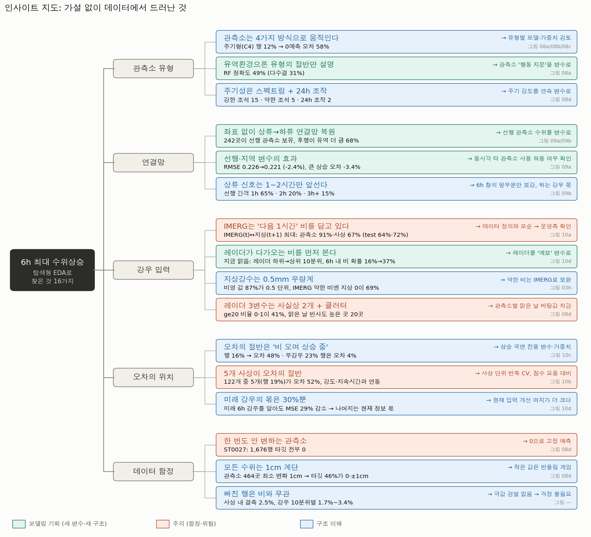

**카드 색 읽는 법**
- 초록 = 모델링 기회 (새 변수나 새 구조)
- 주황 = 주의 (함정이나 위험)
- 파랑 = 구조 이해

**확신도**
- 높음 = 여러 방식으로 일관되게 확인됨
- 중간 = 한 가지 방식이지만 뚜렷함
- 낮음 = 시사만 됨

---

## 0. 어떻게 찾았나 — 탐색 방법 6가지

| 방법 | 한 일 | 무엇이 튀어나왔나 |
|---|---|---|
| 관측소 행동 지문 → 비지도 군집 | 관측소마다 9개 지문 계산: 변화 지속성, 12·24h 주기, 무강우 변동, 강우 반응, 무변화 비율, 상승·하강 비대칭 등 | 4가지 움직임 유형, 24h 조작 관측소, 약한 조석 |
| 전 관측소 쌍 시차 상관 | 465×465쌍 × 시차 0~8h, 공통 호우 신호 제거 후 계산 | 상류→하류 연결망 |
| 원천 간 시차 교차상관 | IMERG·지상·레이더를 서로 ±4h 밀어가며 비교 | 강우 원천 간 1시간 시차 |
| 프로파일링 이상 탐지 | 최빈값, 값 격자, 계측 분해능, 급변, 맑은 날 바탕값 | 멈춘 관측소, 0.5mm 우량계, 레이더 클러터·이진화 |
| 잔차 지도 | 기준 모델(HGB) 사상 단위 CV 잔차를 국면·사상별로 분해 | 오차가 몰리는 국면과 사상 |
| 오라클 실험 (진단용) | 미래 6h 강우를 안다고 가정하고 오차 감소폭 측정 | 미래 강우가 남은 오차에서 차지하는 몫 |

---

## 1. 관측소 유형

### 1-1. 관측소는 4가지 방식으로 움직인다 · 구조 이해 · 확신도 중간

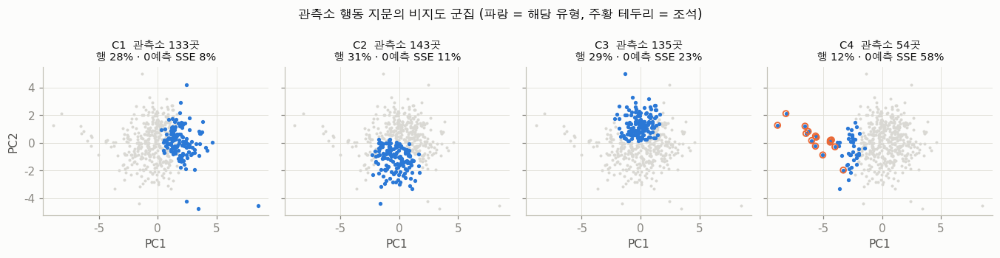
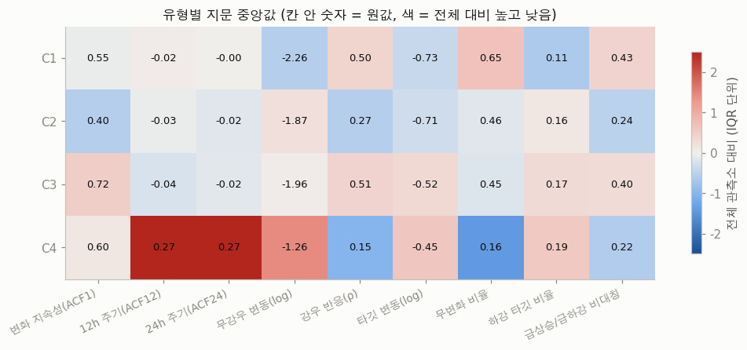
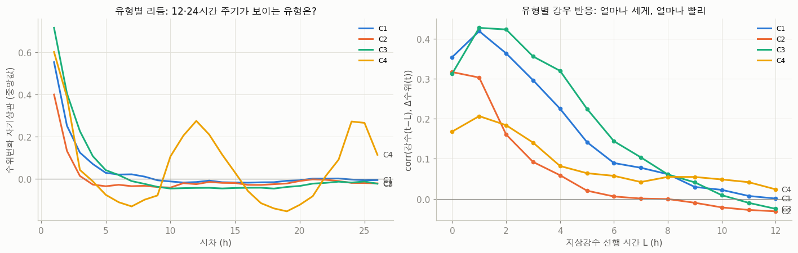

| 유형 | 관측소 | 행 | 0예측 오차 | 한 줄 요약 | 특징 (중앙값) |
|---|---|---|---|---|---|
| C1 조용한 산지 소하천 | 133 | 28% | 8% | 평소엔 멈춰 있다가 비 오면 1시간 안에 급반응 | 무변화 65%, 강우 반응 ρ 0.50, 빨리 오르고 천천히 내림, 유역 65, 표고 202m, 경사 14° |
| C2 비와 약하게 묶인 저지대·도시 | 143 | 31% | 11% | 비와 무관한 잔 흔들림이 많음 | 강우 반응 ρ 0.27(최저), 무강우 변동 큼, 도시화 11.6%, 표고 112m |
| C3 크게 반응하는 중규모 하천 | 135 | 29% | 23% | 한번 오르면 추세가 몇 시간 이어짐 | 변화 지속성 0.72(최고), 강우 반응 ρ 0.51, 반응이 1~4h에 걸쳐 넓게 퍼짐, 최대 상승 3.2m, 유역 194 |
| C4 비 없이도 움직이는 대하천 | 54 | 12% | **58%** | 12·24시간 주기, 강우 반응 약함 | 조석 15 + 약한 조석 5 + 24h 조작 2 전부 포함. 나머지 32곳도 유역 1,137의 대하천이고, 무강우 변동이 0.045m로 다른 유형(0.004~0.013m)의 3~10배 |

- **관찰**: 군집 품질(실루엣 0.16)은 높지 않습니다. 딱 떨어지는 4개 집단이라기보다 연속적인 스펙트럼 위의 네 영역에 가깝습니다. 다만 유형마다 서명 곡선(08c)은 확연히 다릅니다.
  - C4만 12·24h 자기상관 봉우리가 있습니다.
  - C3는 강우에 가장 오래, 크게 반응합니다.
  - C2는 반응이 약하고 즉시 끝납니다.
- **→ 시사점**: 유형은 오차가 어디서 나오는지를 가르는 축입니다. 유형별 모델이나 유형 변수, 유형별 가중치를 검토합니다.

### 1-2. 유역환경으로는 유형의 절반만 설명된다 · 기회 · 확신도 중간

- 유역환경 7변수로 유형을 맞히는 랜덤포레스트(5-fold)를 학습시켰습니다.
  - 정확도는 **49%**입니다. 다수결 기준은 31%입니다.
  - 균형 정확도는 46%로, 무작위 25%보다 높습니다.
- 같은 소권역 값을 공유하는 관측소 173쌍 중 같은 유형은 50%입니다. 무작위라면 27%입니다.
- **→ 시사점**: 유역환경보다 관측소 **행동 지문**이 더 직접적인 정보입니다.
  - 지문 예: 무변화 비율, 강우 반응 ρ, 주기 강도, 무강우 변동.
  - 이 값들을 train에서 관측소별로 계산해 변수로 넣습니다.
  - ⚠️ 지문 일부는 타깃을 쓰므로(ρ, 타깃 변동) **반드시 fold 안에서** 계산해야 합니다.

### 1-3. 주기성은 스펙트럼이고, 비와 무관한 24시간 조작이 있다 · 구조 이해 · 확신도 높음

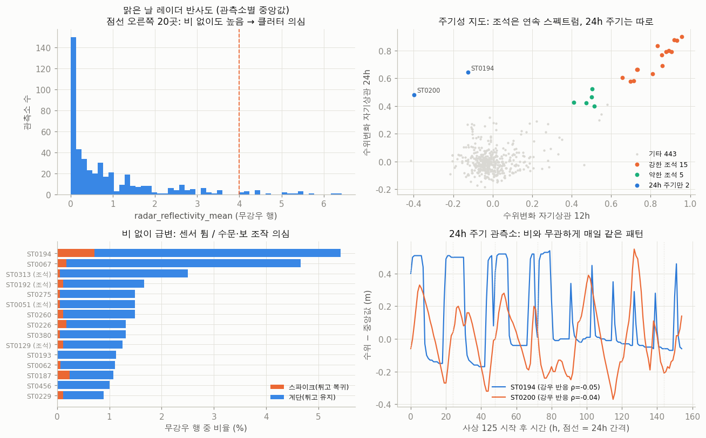

- 12h·24h 자기상관 평면(08d 오른쪽 위)에서 관측소가 세 무리로 갈립니다.
  - **강한 조석 15곳**: 기존 규칙으로 찾은 곳입니다.
  - **약한 조석 5곳**: ST0151, ST0193, ST0226, ST0229, ST0260. 12h 자기상관이 0.4~0.5로, 기존 규칙에서 빠졌습니다.
  - **24h 주기만 있는 2곳**: ST0194, ST0200.
- 24h 관측소 두 곳은 강우 반응 ρ가 −0.05와 −0.04로, **비와 완전히 무관**합니다.
  - ST0194는 매일 같은 시간대에 두 수위(약 +0.5m, −0.15m) 사이를 계단식으로 오갑니다.
  - 이 모양은 수문 개폐나 발전 방류 조작으로 보입니다.
  - 무강우 계단 변화도 전체에서 가장 잦습니다(무강우 행의 4.7%).
- **→ 시사점**:
  - "조석 여부"를 예/아니오 대신 12h·24h 자기상관 **값 자체**로 넣습니다.
  - 24h 조작 관측소에는 강우 변수가 쓸모없습니다. `wl_t_minus_24h`(어제 같은 시각)가 핵심 변수입니다.

---

## 2. 연결망

### 2-1. 좌표 없이 상류→하류 연결망이 복원된다 · 기회 · 확신도 높음

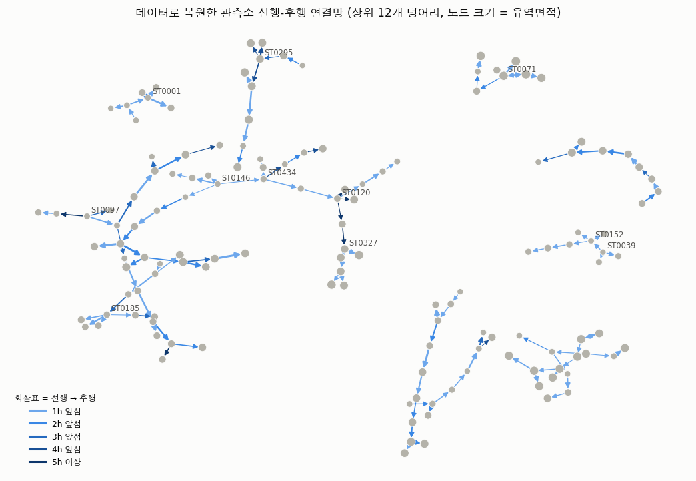
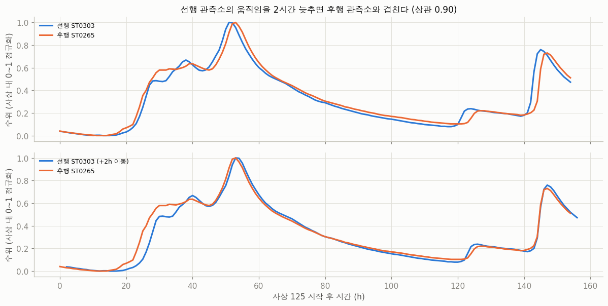

- **방법**:
  - 관측소 i의 "지금" 수위변화와 관측소 j의 "L시간 뒤" 수위변화의 상관을 전 쌍에 대해 계산했습니다.
  - 전 관측소 공통 호우 신호는 먼저 제거했습니다.
  - 동시 상관보다 0.05 이상 높을 때만 "선행"으로 인정했습니다.
- **관찰**:
  - 조석·조작·멈춘 관측소를 뺀 442곳 중 **242곳(55%)**에 뚜렷한 선행 관측소가 있습니다(상관 ≥ 0.5, 중앙값 0.64).
  - 서로 다른 소권역 쌍에서 **후행 쪽 유역면적이 더 큰 비율은 68%**입니다. 무작위라면 50%입니다. 하천차수가 더 높은 비율은 56%입니다.
  - 서로가 서로를 선행하는 모순 쌍은 4개뿐입니다.
  - 따라서 이 연결은 우연한 동조가 아니라 **실제 하천 흐름 방향**으로 보입니다.
  - 그림으로 보면 가지를 치는 사슬 구조로, 실제 수계 모양과 비슷합니다.
  - 예: ST0303의 수위곡선을 2시간 늦추면 ST0265와 거의 겹칩니다(상관 0.90).
  - 허브 관측소: ST0146, ST0120, ST0185, ST0071. 각각 4곳을 선행합니다.
- **→ 시사점**: 선행 관측소의 현재 수위변화·강우를 후행 관측소의 변수로 씁니다.

### 2-2. 연결망 변수의 효과 · 기회 · 확신도 중간

| 구간 | 기준 RMSE | + 선행·지역 변수 | 변화 |
|---|---|---|---|
| 전체 | 0.2264 | 0.2209 | −2.4% |
| 비조석 | 0.2197 | 0.2133 | −2.9% |
| 비조석 · 큰 상승(>0.5m) | 0.882 | 0.852 | −3.4% |
| 조석 | 0.376 | 0.386 | +2.7% (악화) |

- 사상 단위 GroupKFold로 비교했고, 5개 fold 중 4개에서 개선됐습니다.
- 선행 관측소는 **학습 fold의 시각만으로** 골랐습니다. 검증 구간의 정보는 쓰지 않았습니다.
- 추가한 변수:
  - 선행 관측소: `dwl_1h`, `dwl_3h`, 1h 지상강수, 6h IMERG, 시차, 상관
  - 지역(동시각 전 관측소) 요약: 평균 강우, 강우 관측소 비율, 상승 관측소 비율
- ⚠️ 이 변수들은 **같은 시각 다른 관측소의 행**(test에서도 test 행)을 씁니다.
  - 미래 행을 쓰는 것이 아니므로 누수의 성격은 다릅니다(실제 운영에서도 실시간으로 볼 수 있는 정보).
  - 그래도 허용 여부는 운영측에 확인하는 것이 안전합니다.

### 2-3. 상류 신호는 1~2시간만 앞선다 · 구조 이해 · 확신도 높음

- 선행 간격은 1h 65%, 2h 20%, 3h 이상 15%입니다.
- 6시간 예측창 가운데 **앞부분만 보강**하고, 뒷부분은 여전히 강우 정보가 담당합니다.
- 비조석 큰 상승(>0.5m) 중 내 격자에 24h 동안 비가 없었던 경우는 2%뿐입니다.
- 즉 연결망의 가치는 "다른 곳에 온 비"보다 **파동이 도착하는 타이밍**에 있습니다.

---

## 3. 강우 입력

### 3-1. ⚠️ IMERG `imerg_rain_1h`는 "다음 1시간" 비를 담고 있을 가능성이 높다 · 주의 · 확신도 중상

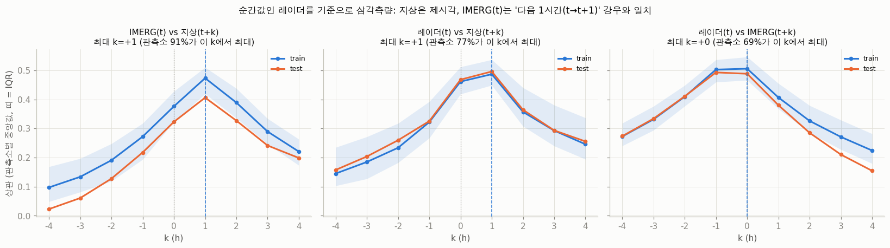

- **관찰**: IMERG(t)는 지상(t)가 아니라 **지상(t+1)**과 가장 잘 맞습니다.
  - train: 관측소 91%, 사상 67%
  - test: 관측소 64%, 사상 72%
- **어느 쪽이 어긋났나 (삼각측량)**: 레이더는 시각 t의 **순간값**이라 기준점으로 쓸 수 있습니다.
  - 레이더(t)와 지상의 상관은 k=0과 k=+1 사이에 대칭입니다(0.46 / 0.49, 중심 +0.5h). 지상 기록이 "정시 마감 누적"이라는 정상적인 경우와 맞습니다.
  - 지상이 1시간 늦게 찍혔다면 k=+2가 k=0보다 커야 합니다. 실제로는 0.36 vs 0.46으로 반대입니다.
  - 레이더(t)와 IMERG의 상관은 k=−1과 k=0 사이에 대칭입니다(0.50 / 0.51, 중심 −0.5h). 순간 t가 IMERG(t−1)과 IMERG(t)의 **경계**에 있다는 뜻이므로, IMERG(t)는 (t, t+1] 구간을 덮습니다.
- **보조 증거**:
  - 비가 시작되는 시각이 IMERG에서 지상보다 중앙값 1시간 빠릅니다(train·test 동일). 다만 이 차이는 우량계 0.5mm 분해능 때문에 일부 과장됩니다.
  - 수위 반응 지연도 지상 1h, IMERG 2h로, 정확히 1시간 차이입니다(S4).
- **해석**: 데이터 사전은 "t 시점까지, 미래 유입 없음"이라고 적었지만, 흔한 전처리 실수와 딱 맞아떨어집니다. IMERG 반시간 파일은 시작 시각 라벨을 달고 있는데, 이를 합산해 그 시각에 붙이면 이런 1시간 앞당김이 생깁니다. 사실이라면:
  - `imerg_rain_1h/6h/24h`는 **예측창의 첫 1시간 강우를 이미 포함**합니다.
  - 미래 강우 예측력이 IMERG-1h(ρ 0.56)에서 지상 1h(0.55)보다 높게 나온 것도 이와 맞습니다.
  - test에도 똑같이 들어 있어 "쓸 수 있는" 정보이지만, 운영측이 데이터를 고치면 모델이 흔들립니다.
- **→ 시사점**:
  1. 운영측에 IMERG 시각 기준을 문의합니다.
  2. 원천을 합칠 때 IMERG(t−1)을 지상(t)에 맞춘 **정렬 버전**도 만들어 비교합니다.
  3. 두 가정 모두에서 무너지지 않는 모델을 준비합니다.

### 3-2. 레이더가 다가오는 비를 먼저 본다 · 기회 · 확신도 중간

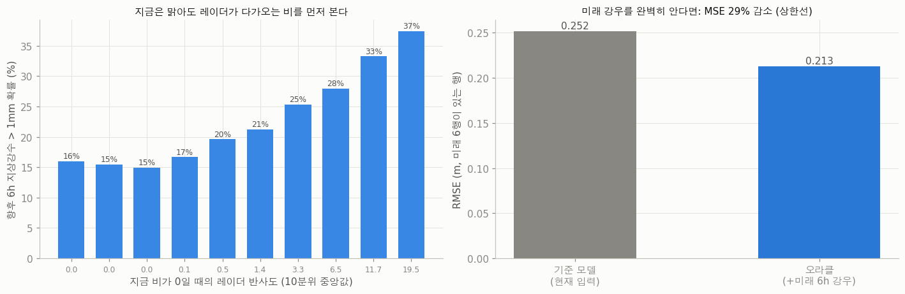

- 미래 6h 지상강수와의 Spearman 상관은 다음 순서입니다.
  - 레이더 평균 0.58
  - IMERG 1h 0.56
  - 지상 1h 0.55
  - 6h 누적 0.50~0.52
- **지금 비가 0인 행(29%)**에서도 레이더 반사도 10분위가 높아질수록 6h 안에 1mm 이상 비가 올 확률이 16%에서 37%로 오릅니다.
- **→ 시사점**: 레이더는 "과거 강우" 변수가 아니라 **초단기 예보(nowcast)** 변수로 해석하고 설계합니다. 예: 지금 강우가 0인데 반사도가 높은 행을 따로 표시하는 변수.

### 3-3. 지상강수는 0.5mm 우량계다 · 구조 이해 · 확신도 높음

- 0이 아닌 `sfc_rain_1h` 값의 **87%가 0.5의 배수**이고, 100%가 0.1의 배수입니다. 0.5mm 전도형 우량계에 일부 보간값이 섞인 모양입니다.
- IMERG가 0.1~0.5mm일 때 지상의 69%는 0입니다. 약한 비를 기록하지 못합니다.
- 24h 누적에서 지상/IMERG 비율은 0.76인데, 이 차이는 표고·경사·산림과 무관합니다(모두 ρ ≈ 0).
- **→ 시사점**:
  - 단위는 mm로 보는 것이 타당합니다. 이전 보고서의 추정을 강화하는 결과입니다.
  - 두 원천의 차이는 지형 편향이 아니라 **분해능과 시각**의 문제입니다.
  - 약한 비는 IMERG로 보완합니다.

### 3-4. 레이더 3변수는 사실상 2개이고, 클러터가 있다 · 주의 · 확신도 높음

- `radar_reflectivity_ge20_fraction`은 **41%가 정확히 0 또는 1**입니다.
  - 1일 때 평균반사도는 24 이상이고, 0일 때는 14 이하입니다.
  - 즉 평균반사도에 임계값을 적용한 버전이라 새로운 정보가 거의 없습니다.
- **맑은 날에도 반사도가 높은 관측소가 20곳** 있습니다(맑은 날 중앙값 4~6.4, 전체는 0.41). 지형 클러터로 추정되며, 같은 값을 공유하는 관측소가 많습니다(같은 격자).
- **→ 시사점**: 관측소별 맑은 날 바탕값을 뺀 **초과 반사도**를 변수로 씁니다.

---

## 4. 오차의 위치 (기준 HGB, 사상 단위 CV)

### 4-1. 오차의 절반은 "비 오며 상승 중"에서 나온다 · 구조 이해 · 확신도 높음

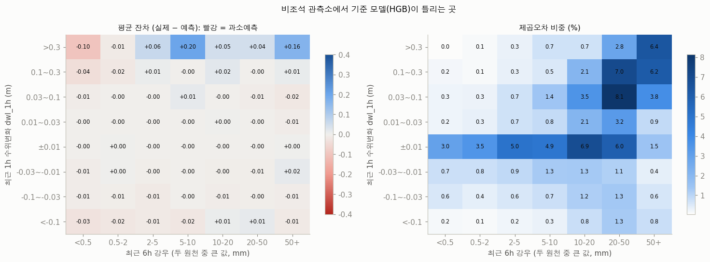

| 국면 (입력만으로 정의) | 행 비중 | 오차 비중 | RMSE | 평균 편향 |
|---|---|---|---|---|
| 비·상승 중 | 16% | **48%** | 0.391 | +0.005 |
| 비·아직 반응 없음 | 47% | 26% | 0.167 | −0.000 |
| 비·하강 중 | 9% | 13% | 0.266 | −0.003 |
| 조석(강·약) | 4% | 10% | 0.336 | −0.003 |
| 무강우 (정지·하강·상승) | 23% | **4%** | 0.08~0.12 | ≈0 |
| 24h 조작 | 0.7% | 0.4% | 0.175 | −0.003 |

- **관찰**:
  - 평균 편향이 거의 0입니다. 모델이 한쪽으로 치우쳐 틀리는 것이 아니라, **얼마나 더 오를지와 언제 반응할지의 불확실성**에서 오차가 나옵니다.
  - 가장 큰 칸은 "최근 1h 3~30cm 상승 & 6h 강우 20~50mm"입니다(칸마다 7~8%).
  - 체계적 과소예측은 "1h 30cm 이상 급상승" 줄에만 몰려 있습니다(강우 5~10mm에서 +0.20m, 50mm 이상에서 +0.16m). 급상승이 얼마나 더 이어질지를 모델이 짧게 잡습니다.
- **→ 시사점**: 무강우 구간은 이미 거의 다 맞히고 있습니다. 개선은 상승 국면에 집중합니다. 예: 국면별 가중치, 상승 국면 전용 모델, 상승 가속도 변수.

### 4-2. 5개 사상이 오차의 절반이다 · 주의 · 확신도 높음

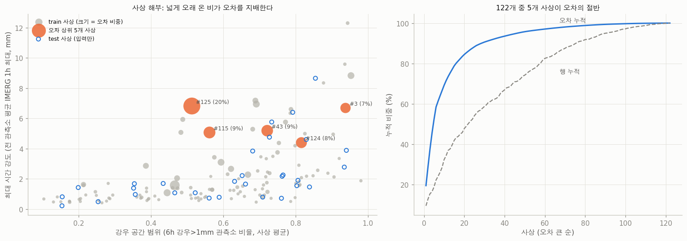

- train 122개 사상 중 **5개(행 19%)가 오차의 52%**, 10개가 69%를 차지합니다. 155시간짜리 사상 #125 하나가 20%입니다.
- 사상별 RMSE는 **최대 강도(ρ 0.46)·지속시간(0.50)**과 함께 움직이고, 공간 범위와는 무관합니다(0.03).
- test 30개 사상 중 3개가 train 상위 10% 강도를 넘습니다(입력만으로 비교).
- **→ 시사점**:
  - 리더보드 점수는 소수의 큰 사상에서 갈립니다.
  - 반복 GroupKFold와 **사상별 RMSE 분포**로 모델을 비교합니다.
  - 상위 5개 사상을 뺀 점수도 함께 봐서 큰 사상에 과적합하지 않았는지 확인합니다.

### 4-3. 미래 강우가 남은 오차에서 차지하는 몫은 약 30%다 · 구조 이해 · 확신도 중간

- 미래 6h 강우를 안다고 가정한 오라클 실험입니다. 미래 행이 6개 모두 있는 63%의 행으로 비교했습니다.
- RMSE는 0.252에서 0.213으로, MSE는 **29%** 줄었습니다(비조석은 31%).
- 이 실험은 진단용이고, 미래 강우를 변수로 쓰자는 뜻이 아닙니다.
- **→ 시사점**: 남은 오차의 약 70%는 미래 강우 탓이 아닙니다. 현재 입력을 덜 활용했거나 순수 잡음입니다. 따라서 **현재 정보로 줄일 여지가 크다**고 볼 수 있습니다.

---

## 5. 데이터 함정

### 5-1. 한 번도 변하지 않는 관측소: ST0027 · 주의 · 확신도 높음

- train 1,676행과 test 413행 모두 수위가 **28.19m로 고정**돼 있고, 모든 lag도 같습니다.
- train 타깃은 전부 0입니다.
- **→ 시사점**:
  - test의 ST0027 413행은 0으로 고정 예측합니다.
  - 다른 관측소 학습에서는 이 관측소를 빼거나 표시해, 잘못된 "무반응" 패턴을 배우지 않게 합니다.

### 5-2. 모든 수위는 1cm 계단이다 · 구조 이해 · 확신도 높음

- 464곳의 최소 수위변화가 정확히 1cm입니다.
- 타깃의 **46%가 0 또는 ±1cm**입니다.
- **→ 시사점**: 작은 값 구간의 예측은 반올림 싸움입니다. RMSE는 큰 값이 좌우하므로 여기에 공들일 필요는 없습니다.

### 5-3. 빠진 행은 비와 무관하다 · 구조 이해 · 확신도 중간

- 사상 안에서 빠진 칸은 2.5%입니다.
- 강우 10분위별 결측률은 1.7~3.4%로, 비가 많을수록 늘어나는 경향이 없습니다.
- 같은 시각에 20% 이상의 관측소가 동시에 빠진 적은 없습니다.
- 결측 직전 행은 오히려 평균보다 잔잔합니다(|Δ수위| 0.022 vs 0.034).
- **→ 시사점**: 홍수 때 값이 잘려 나간 흔적(극값 검열)은 없습니다. 결측은 lag 처리 규칙만 정하면 됩니다.

---

## 6. 인과 지도(DAG)에 반영할 것

앞 보고서의 갱신 DAG(`figures/07_dag_updated.png`)에 다음을 추가하거나 수정합니다.

- **강우 관측 노드의 시각 어긋남**: IMERG가 "미래 6h 강우" 노드의 첫 1시간을 일부 관측할 가능성 → 미래 강우는 완전한 미관측 노드가 아닐 수 있습니다.
- **상류 관측소 노드**: 선행 관측소 수위 → 후행 관측소 미래 수위(1~2h 지연).
- **24h 조작 노드**: 강우와 무관하게 수위를 움직이는 인위적 원인.
- **조석은 이진이 아닌 연속 강도**: 강한 15곳 + 약한 5곳.

---

## 7. 다음 단계 (우선순위 순)

1. **운영측 문의 3건**
   - IMERG 시각 기준(3-1)
   - 동시각 다른 관측소 행 사용 가능 여부(2-2)
   - 이전 보고서의 test 내부 미래 행 누수
2. **변수 추가**
   - 선행 관측소 변수
   - 레이더 초과 반사도·nowcast 표시
   - IMERG 정렬 버전
   - 관측소 행동 지문(fold 안에서 계산)
   - 12h·24h 주기 강도
   - ST0027 0 고정
3. **검증 방식**: 반복 GroupKFold, 사상별 RMSE 분포, 상위 5개 사상 제외 점수를 함께 봅니다.
4. **모델링 초점**: "비·상승 중" 국면(행 16%, 오차 48%)에 가중치나 전용 모델을 실험합니다.
