# 하천수위 6시간 최대상승량 — 사전점검 + EDA 보고서

> 대상: KISTI 2026 경진대회 train 749,657행 / test 186,263행, 관측소 465개
> 재현: `eda/eda.ipynb` (캐시 사용) 또는 `eda/src/s00~s07` 순서 실행
> 각 그림 아래에는 **관찰**(무엇을 봤나)과 **→ 시사점**(모델링에서 어떻게 할지)을 붙였습니다.
> 📍 후속편: 가설 없이 데이터에서 새 구조를 찾은 **[탐색형 인사이트 지도 (insights.md)](insights.md)**를 함께 보세요.

---

## 1. 요약 — 핵심 발견 7가지

| # | 발견 | 모델링에 주는 의미 |
|---|---|---|
| 1 | **하구 조석 관측소 15개**(행의 3.2%)가 0 예측 기준 제곱오차의 **51%**를 차지한다. 수위가 12.4시간 주기로 ±3m 이상 오르내린다. | RMSE 순위는 이 15곳에서 크게 갈린다. 과거 수위 lag로 조석 위상을 잡는 변수를 만들고, 조석/비조석을 따로 모델링하는 방안을 검토한다. |
| 2 | 데이터는 **호우사상 블록 152개**(train 122 / test 30)로 깔끔하게 나뉜다. 블록은 모든 관측소가 공유하는 합성 시간 구간이다. | 검증은 반드시 `event_block` 단위 GroupKFold로 한다. |
| 3 | 무작위 KFold는 RMSE를 **약 12% 낙관적**으로 보여준다(0.198 vs 0.226). fold 간 편차도 1/14로 과소평가된다. | 무작위 분할 점수는 믿지 않는다. |
| 4 | lag 수위·강우 누적·타깃 재계산이 **100% 일치**한다. 병합 품질은 매우 좋다. | 데이터 정제 부담이 거의 없다. 행 간 차분·누적 파생변수를 안심하고 만들 수 있다. |
| 5 | ⚠️ **test 행의 61%는 같은 관측소의 미래 6시간 행이 test 안에 있다.** 정답을 산술적으로 복원할 수 있는 구조적 누수다. | **모델에 사용 금지.** 대회 취지 위반 소지가 크니 운영측에 문의하기를 권한다. |
| 6 | 비가 올수록 타깃 평균과 **분산이 함께 커진다**(이분산). 상위 1% 행이 제곱오차의 66%를 차지한다. | 큰 사상의 상승량을 잘 맞히는 것이 핵심이다. 손실함수, 극값 가중치, 변환을 실험해 볼 가치가 있다. |
| 7 | train과 test 분포는 사실상 같다(적대적 검증 AUC 0.46). 기준선 최고 RMSE는 **0.226m**(HGB)다. | 분포 이동 대응은 우선순위가 낮다. 0.226이 개선의 출발점이다. |

---

## 2. 데이터 구성과 병합 구조

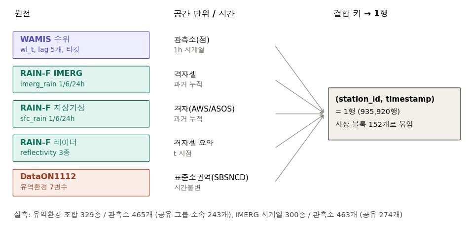

| 원천 | 컬럼 | 공간 단위 | 확인된 사실 |
|---|---|---|---|
| WAMIS 수위 | `wl_t`, lag 5개, 타깃 | 관측소 | 관측소마다 기준면이 달라 `wl_t` 범위가 −3.8~139.6m |
| RAIN-F IMERG | `imerg_rain_*` | 격자셀 | 관측소 463곳의 시계열이 **300종뿐**이다. 274곳이 같은 격자셀을 공유한다. |
| RAIN-F 지상기상 | `sfc_rain_*` | 격자 | 시계열 223종이다. 값이 0.5 단위로 계단처럼 끊겨 있어 **우량계형 mm로 추정**된다(아래 3.4). |
| RAIN-F 레이더 | `radar_*` | 격자셀 | IMERG와 같은 격자 구조로 보인다(시계열 300종, 공유 274곳). |
| DataON1112 | 유역환경 7변수 | 표준소권역 | 관측소 465곳에 조합이 **329종**이다. 243곳이 같은 소권역 값을 공유한다(그룹 최대 5곳). |

**→ 시사점**: 강우와 유역 변수는 여러 관측소가 같은 값을 공유한다. 그래서 관측소를 구별하는 힘은 수위 이력과 관측소 통계에서 나온다.

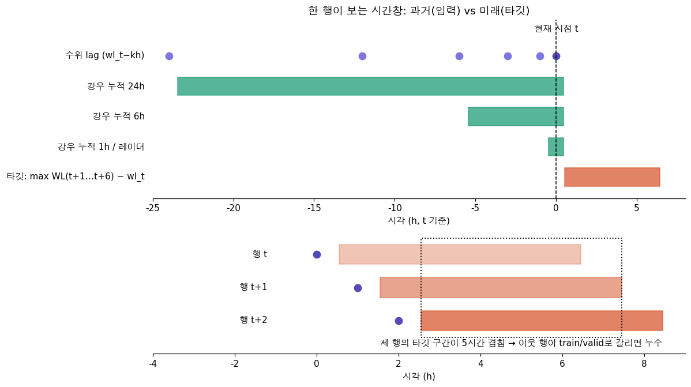

**관찰**: 한 행은 과거 24시간을 입력으로 보고 미래 6시간을 타깃으로 본다. 이웃한 행끼리는 타깃 구간이 최대 5시간 겹친다.
**→ 시사점**: 같은 사상의 행이 train과 valid로 나뉘면 정답이 새어 나간다(5장에서 실측).

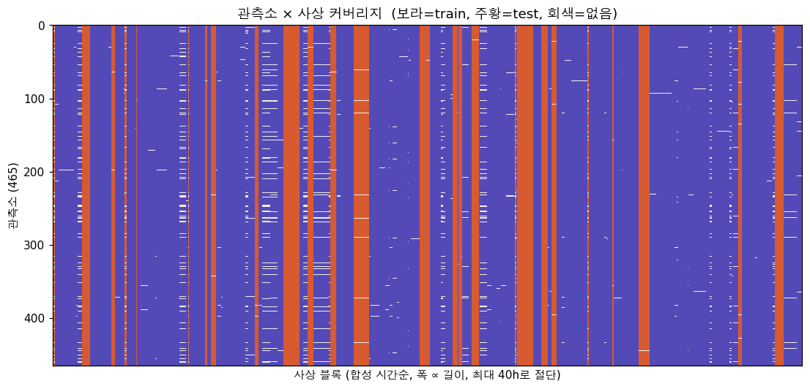

**관찰**: 사상 블록마다 관측소의 98%가 등장한다. test 사상(주황)은 전체 시간축에 흩어져 있다.
**→ 시사점**: 특정 기간이나 관측소가 test에 몰려 있지 않다. 관측소별 학습이 그대로 통한다.

---

## 3. 정합성 검산과 사상 복원

| 검산 | train | test |
|---|---|---|
| `wl_t_minus_kh` = k시간 전 행의 `wl_t` (k=1,3,6,12,24) | 100% | 100% |
| `rain_6h` = 직전 6행 `rain_1h` 합 (IMERG / 지상) | 100% / 100% | 100% / 100% |
| `rain_24h` = 직전 24행 합 | 100% / 100% | 100% / 100% |
| `1h ≤ 6h ≤ 24h` 위반 | 0% | 0% |
| 타깃 = 다음 6행 `wl_t` 최대 − `wl_t` (6행 모두 있는 63%) | **100%** | – |
| 미래 행이 일부만 있는 29%: 복원값이 타깃 이하(하한) | 100% | – |

- 사상 블록은 1시간이 넘는 공백으로 나뉘는 합성 시간 구간이며, train과 test 블록이 섞이지 않는다.
- 블록 길이는 중앙값 9~10시간, 최대 155시간(train)이다.
- 블록 끝의 타깃과 lag는 블록 밖 원자료로 계산됐다. 그래서 블록 경계에서도 값이 모두 있다.

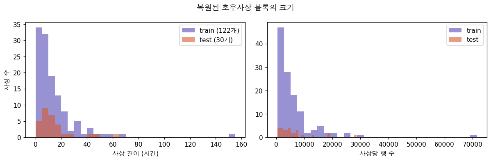

**→ 시사점**:
- 호우사상 ID는 `event_block`으로 확정됐다.
- 한 관측소 안에서 블록 내 run은 97.5%가 끊김 없이 이어진다. 그래서 같은 블록의 이전 행들로 시계열 파생변수(예: 최근 12시간 최대강우, 수위 추세)를 만들 수 있다.

### 3.1 ⚠️ test 누수 위험 (확인만 함)

- test 행의 **61.3%**는 같은 관측소의 t+1~t+6 행이 test 안에 모두 있고, **92.7%**는 1행 이상 있다.
- 3장에서 train 기준으로 이 방식이 정답과 100% 일치함을 확인했다. 따라서 test에서도 이웃 행으로 정답을 그대로 계산할 수 있는 구조다.
- 이 분석은 해당 비율만 계산했고, test 타깃은 계산하거나 저장하지 않았다.
- **권고**:
  - 미래 행의 `wl_t`를 입력으로 쓰는 변수는 만들지 않는다.
  - 과거 방향 파생변수(이전 행 참조)만 쓴다.
  - 허용 범위는 운영측에 문의한다.

---

## 4. EDA 결과

### 4.1 타깃

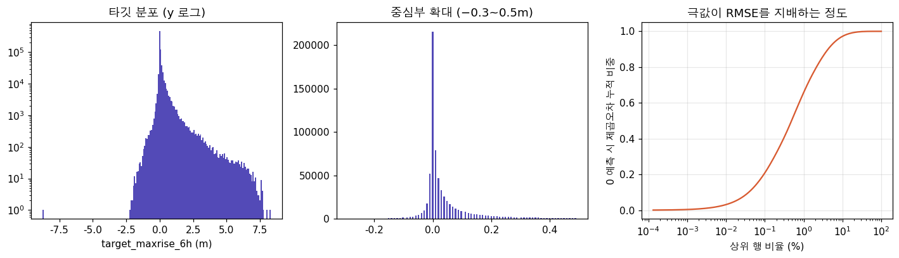

- **관찰**:
  - 중앙값 0.01m, 평균 0.109m, 표준편차 0.395m, 왜도 7.3이다.
  - 양수 55%, 0 29%, 음수 16%다.
  - p99는 1.87m, 최대는 8.3m, 최소는 −8.74m다.
  - **상위 1% 행이 0 예측 기준 제곱오차의 66%, 상위 5%가 92%**를 차지한다.
- **→ 시사점**: RMSE는 사실상 "큰 상승을 얼마나 맞히나"로 결정된다. 평균 근처를 정밀하게 맞히는 것보다 꼬리 예측이 중요하다.

### 4.2 입력 분포

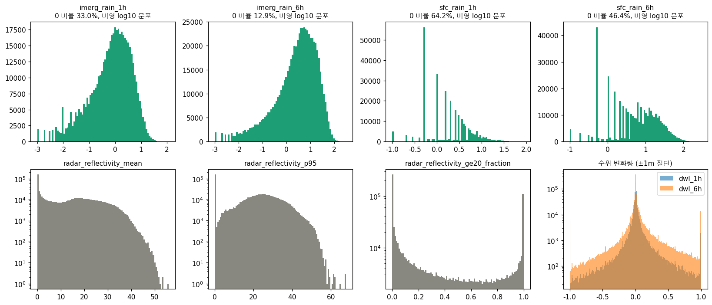
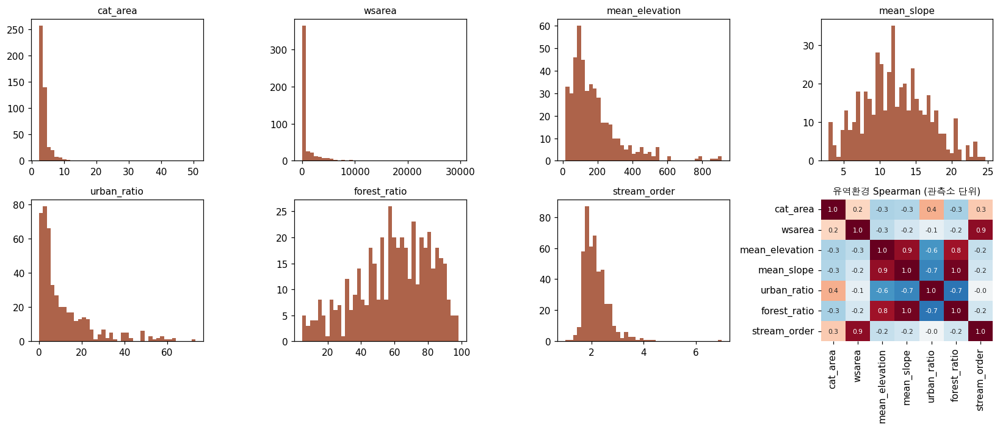

- **관찰**:
  - 0인 비율은 `imerg_rain_1h` 33%, `sfc_rain_1h` 64%다. 지상강수가 0을 훨씬 많이 기록한다(약한 비 미감지 또는 우량계 분해능 때문).
  - 유역면적(`cat_area`, `wsarea`)은 왜도 7~12로 매우 치우쳐 있다.
- **→ 시사점**:
  - 유역면적은 로그 변환한다. 트리 모델이면 필수는 아니지만 선형·신경망에는 필요하다.
  - "지상 0 & IMERG > 0" 같은 불일치 자체를 신호로 쓸 수 있다.

### 4.3 강우 → 타깃, 이분산성

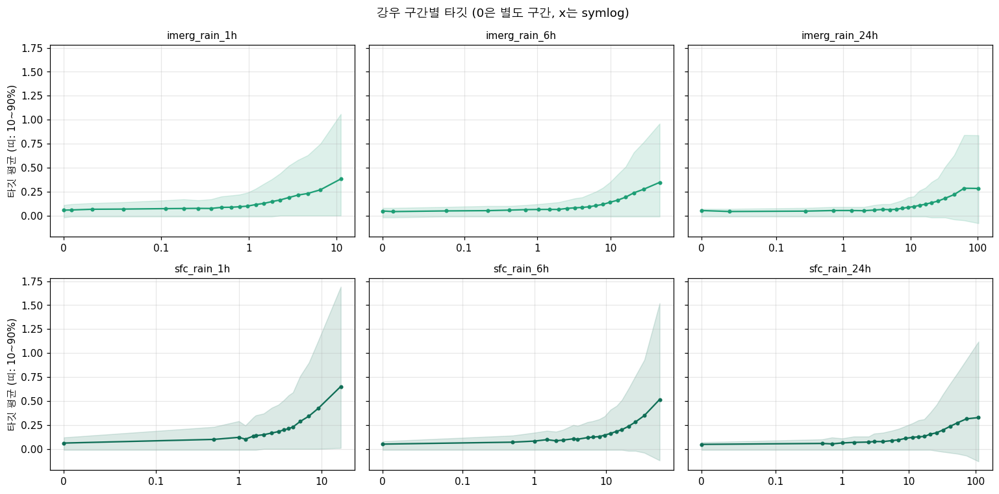
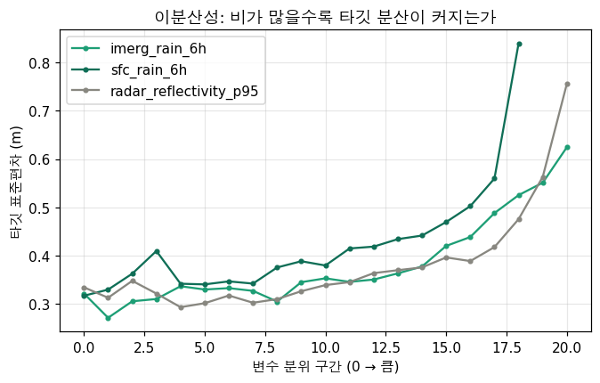

- **관찰**:
  - 강우가 약 1mm를 넘으면 타깃 평균이 가파르게 오른다.
  - 강우가 가장 많은 구간에서 타깃 평균은 `sfc_rain_1h` 0.65m, `imerg_rain_1h` 0.38m다. 지상강수 쪽 신호가 더 선명하다.
  - 같은 구간에서 표준편차도 0.33에서 0.65~0.86으로 두 배 이상 커진다.
- **→ 시사점**:
  - 짧은 창(1h·6h) 강우가 24h보다 유용하다.
  - 분산이 강우와 함께 커지므로, 큰 사상에서는 조건부 분위수나 분산 모델링을 고려할 만하다.

### 4.4 수위 추세와 정의상 결합

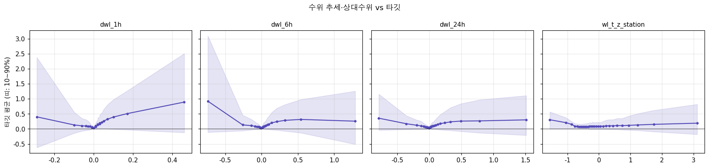
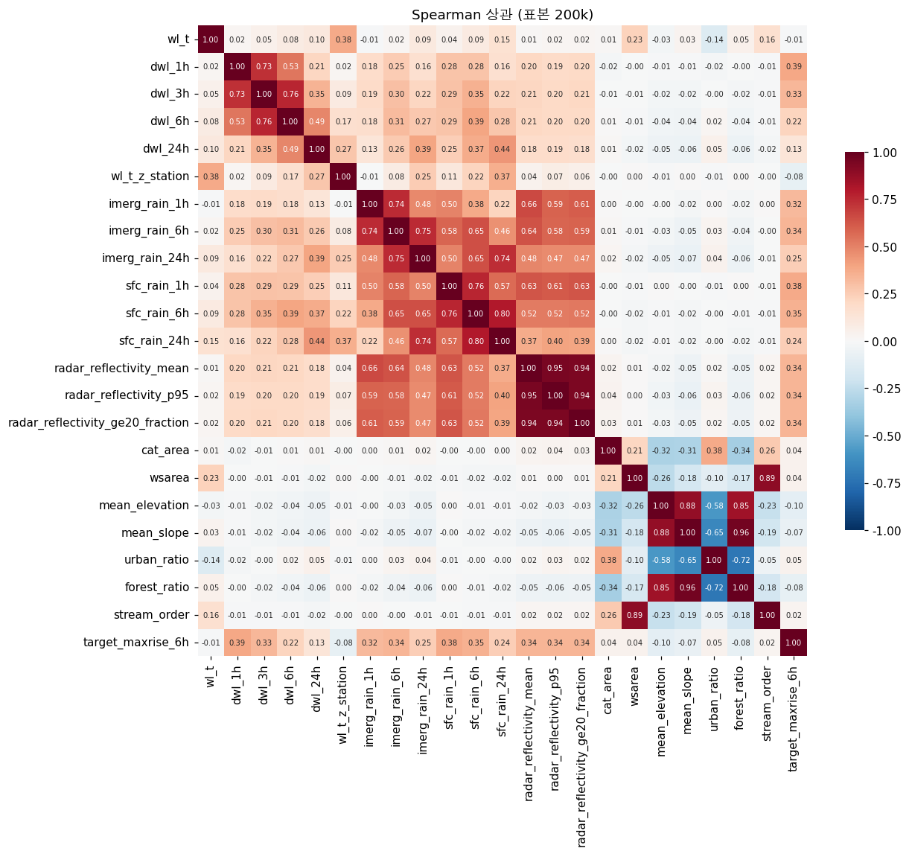

- **관찰**:
  - 타깃과 가장 상관이 높은 변수는 `dwl_1h`(Spearman 0.39)이고, 그다음은 `sfc_rain_1h`(0.38)와 레이더(0.34)다.
  - `dwl`과 타깃의 관계는 **V자 모양**이다. 수위가 오르는 중이면 계속 오르고, 크게 떨어진 직후에도 타깃이 크다. 뒤쪽 패턴은 조석 관측소의 썰물 → 밀물 전환 때문이다(5장).
  - 절대수위 `wl_t`는 상관이 −0.01로 거의 없다. 관측소 기준면이 달라서다.
- **→ 시사점**:
  - `wl_t` 절대값 대신 차분(`dwl_k`)과 관측소 내 상대 위치를 쓴다.
  - 인과 지도의 "정의상 결합(−)"은 관측소 내 표준화 수위 음의 상관(−0.08)으로 약하게 확인됐다.

### 4.5 강우 3종 비교

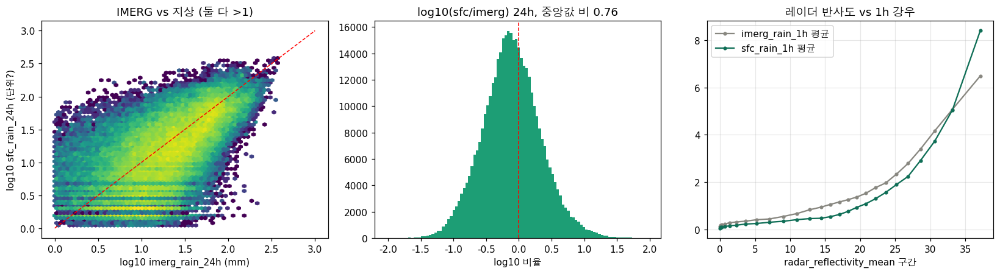

- **관찰**:
  - IMERG와 지상강수의 Spearman 상관은 1h 0.50, 6h 0.65, 24h 0.74다. 누적 창이 길수록 잘 맞는다.
  - IMERG > 0인데 지상 = 0인 행이 35%다.
  - 지상/IMERG 비율의 중앙값은 1h 1.03, 24h 0.73이다.
  - 레이더 반사도는 두 강우 모두와 단조 관계다(Spearman 0.63~0.66).
- **→ 시사점**:
  - 비율이 1에 가깝고 값이 0.5 단위로 끊겨 있으므로, `sfc_rain`은 **mm 단위일 가능성이 높다**(추정일 뿐 공식 확인은 아님).
  - 세 원천은 같은 강우를 잰 **대리지표**다. 합치면(평균·최대·불일치 변수) 측정오차를 줄일 수 있다.
  - 변수 중요도를 인과로 해석하지 않는다.

### 4.6 유역환경의 조절 효과

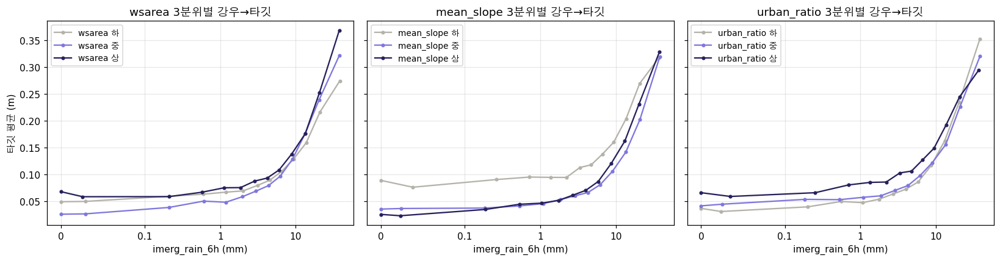

- **관찰**:
  - 비가 많은 구간(`imerg_6h` 상위)에서 유역면적 상위 3분위의 타깃(0.37m)이 하위(0.27m)보다 크다.
  - 도시화율은 반대로 상위(0.29)가 하위(0.35)보다 작다.
  - 경사 하위 3분위는 비가 없을 때도 타깃이 높다(0.09 vs 0.03). 경사가 완만한 하류나 조석 구간이 섞여 있을 가능성이 있다.
- **→ 시사점**: 유역환경은 단독 효과보다 **강우와의 상호작용**으로 작동한다. 트리 모델은 이를 자동으로 잡고, 선형 모델이면 교차항이 필요하다.

### 4.7 관측소·사상 이질성

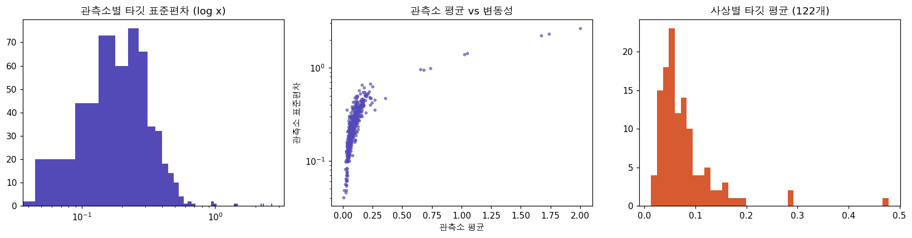
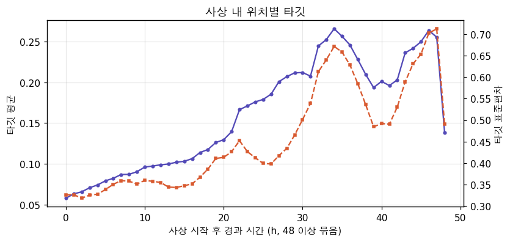

- **관찰**:
  - 타깃 분산 중 관측소 간 차이가 18%, 사상 간 차이가 3%, 관측소×사상 조합이 33%를 설명한다.
  - 관측소 평균 0.6m 이상의 이상군 약 10곳은 조석 관측소다.
  - 사상 시작 후 시간이 지날수록 타깃 평균과 분산이 커진다(0h 0.06 → 30h 0.21). 사상 블록은 **첨두를 향해 가는 구간이 중심**이다.
- **→ 시사점**:
  - 관측소 통계(평균·분산·분위수)는 강한 변수다. 반드시 fold 안에서만 계산한다.
  - "사상 시작 후 경과 시간"(`pos_in_block`)과 누적 강우 이력은 유용한 파생변수다. 다만 test에서도 계산 가능하므로 블록 경계를 쓰는 방식은 3.1과 같은 기준으로 운영측 허용 범위를 확인한다.

---

## 5. 수문 분석

### 5.1 조석 관측소 (이번 EDA의 최대 발견)

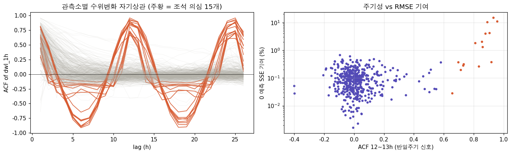
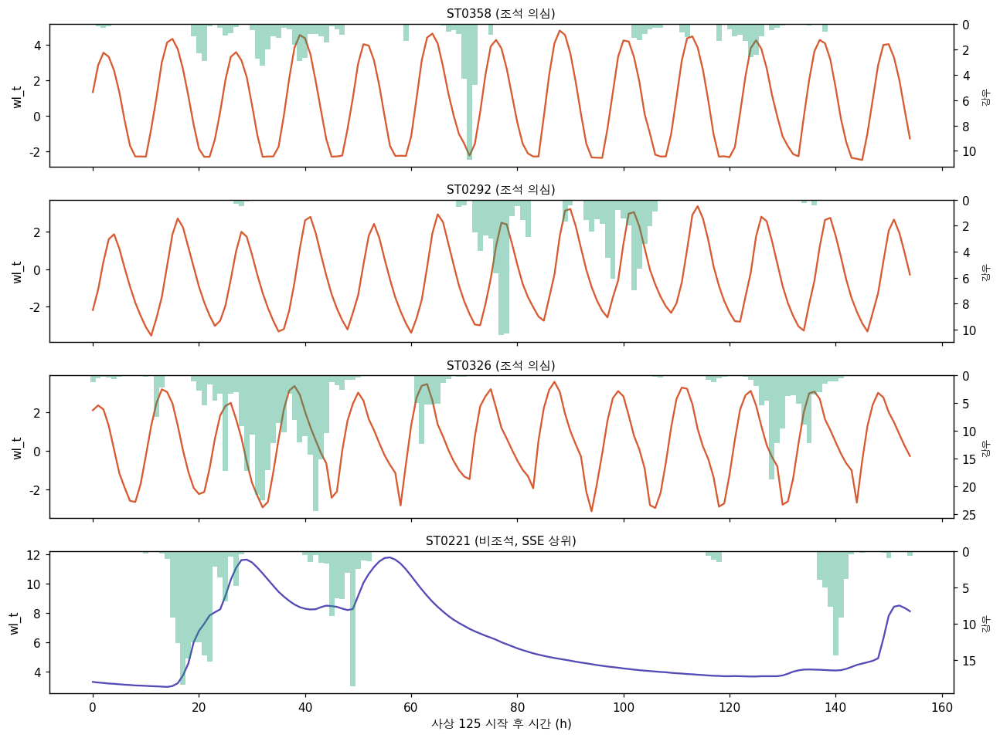

- **탐지 기준**: 수위변화(`dwl_1h`)의 자기상관이 12~13시간에서 0.6 초과이고 6~7시간에서 음수.
- **탐지 결과**: 15곳 — ST0358, ST0292, ST0326, ST0347, ST0159, ST0110, ST0313, ST0415, ST0234, ST0129, ST0192, ST0051, ST0130, ST0164, ST0123.
- **관찰**:
  - 수위가 약 12.4시간 주기로 −2~+4m를 오간다. 강우와 거의 무관하다.
  - 0 예측 기준 SSE 상위 10곳 중 8곳이 조석 관측소다.
- **→ 시사점**:
  - 조석 관측소의 타깃은 대부분 **조석 위상**으로 결정된다. 필요한 정보(`wl_t`, lag 1·3·6·12·24h)는 입력에 이미 있다. 예를 들어 `wl_t − wl_t−12h`나 "12시간 전 대비 현재 위치"가 위상을 알려준다.
  - HGB만 써도 조석 RMSE가 1.64에서 0.38로 떨어진다(6장).
  - `is_tidal` 플래그를 넣거나 조석 전용 모델을 두는 방안을 검토한다.

### 5.2 수문곡선

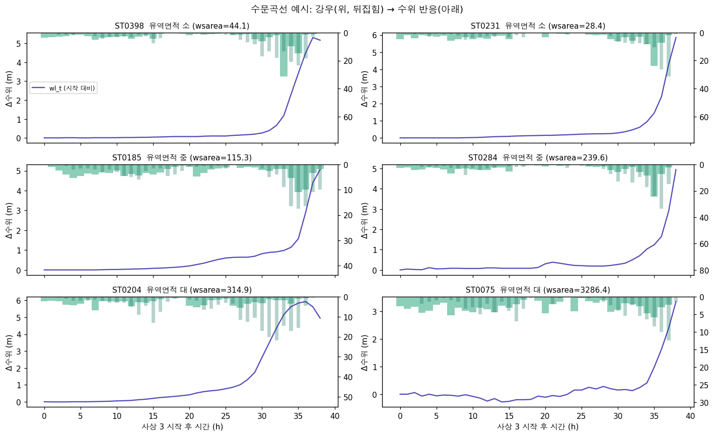

- **관찰**:
  - 비조석 관측소는 강우가 쌓인 뒤 수위가 급상승한다(사상 3에서 4~6m).
  - 유역이 클수록 반응이 늦고 완만하다.
  - 블록이 첨두 직전이나 상승 도중에 끝나는 경우가 많다.
- **→ 시사점**: 가장 중요한 예측 신호는 **이미 내렸지만 아직 도달하지 않은 비**다. 인과 지도의 핵심 경로가 그대로 확인됐다.

### 5.3 지체시간

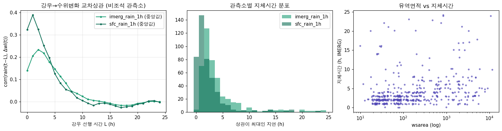

- **관찰**:
  - 강우와 수위변화의 교차상관은 지상강수 1시간, IMERG 2~3시간 지연에서 최대다.
  - 관측소별 지체시간 중앙값은 지상 1시간, IMERG 3시간이다.
  - 지체시간은 유역면적과 양의 상관을 보인다(Spearman 0.40~0.48).
  - IMERG가 1~2시간 늦게 반응하는 것은 위성 강우의 시간 지연이나 평활 특성 때문으로 보인다.
- **→ 시사점**:
  - 지체시간이 대부분 6시간 이내다. 따라서 과거 1~6시간 강우가 예측창(6h) 안의 수위 상승을 대부분 설명한다.
  - 유역면적 × 강우 교차 변수, 원천별로 다른 지연 창을 쓰는 것이 유효하다.

---

## 6. 기준선과 검증 전략

| 방법 | GroupKFold(사상) RMSE | fold 편차 | 조석 RMSE | 비조석 RMSE | 무작위 KFold RMSE |
|---|---|---|---|---|---|
| 0 예측 | 0.4101 | 0.022 | 1.639 | 0.292 | – |
| 전체 평균 | 0.3954 | 0.022 | 1.592 | 0.279 | – |
| 관측소 평균 | 0.3596 | 0.023 | 1.318 | 0.276 | 0.3588 |
| 관측소 × 강우6h 구간 평균 | 0.3503 | 0.021 | 1.322 | 0.263 | 0.3477 |
| HGB 원변수 | 0.2387 | 0.023 | 0.453 | 0.228 | 0.2128 |
| **HGB 원변수 + 차분 + 관측소 통계** | **0.2264** | 0.021 | 0.376 | 0.220 | 0.1984 |

- **관찰**:
  - 무작위 KFold는 HGB 계열에서 RMSE를 0.026~0.028 낮게 보여준다(**약 12% 낙관**).
  - 무작위 KFold의 fold 편차는 0.0015로, 사상 단위(0.021)보다 14배 작다. 신뢰도까지 과장된다.
  - 최고 모델에서 조석 관측소의 SSE 비중은 51%에서 **8.8%**로 줄었다. 이제 오차는 주로 비조석 관측소의 큰 사상에서 나온다.
- **→ 시사점**:
  - 검증은 `event_block` GroupKFold(5-fold 이상)로 한다. 사상이 122개뿐이라 fold 편차가 크니 반복(repeated) GroupKFold를 권한다.
  - 개선 목표는 RMSE 0.226m 아래다. 다음 개선 여지는 비조석 큰 사상의 상승량 예측이다.

---

## 7. train / test 차이 (적대적 검증)

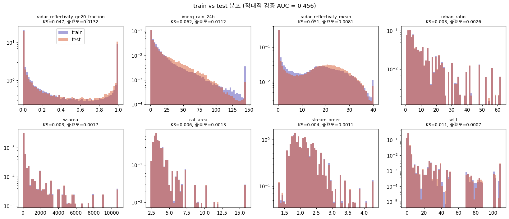

- **관찰**:
  - 사상 단위 GroupKFold로 train과 test를 구분한 AUC는 **0.46**이다. 0.5 이하이므로 구분 불가다.
  - KS 통계량은 최대 0.07(`imerg_rain_1h`)이다.
  - test 중앙값이 약간 더 습하다(`radar_ge20_fraction` 0.11 → 0.18, `imerg_24h` 7.6 → 9.1mm). 반면 극값(p99)은 train이 더 크다.
- **→ 시사점**: 분포 이동은 무시할 만하다. 교차검증 점수가 리더보드를 잘 대변할 것으로 기대된다(누수 변수를 쓰지 않는다는 전제).

---

## 8. 인과 지도 재검토

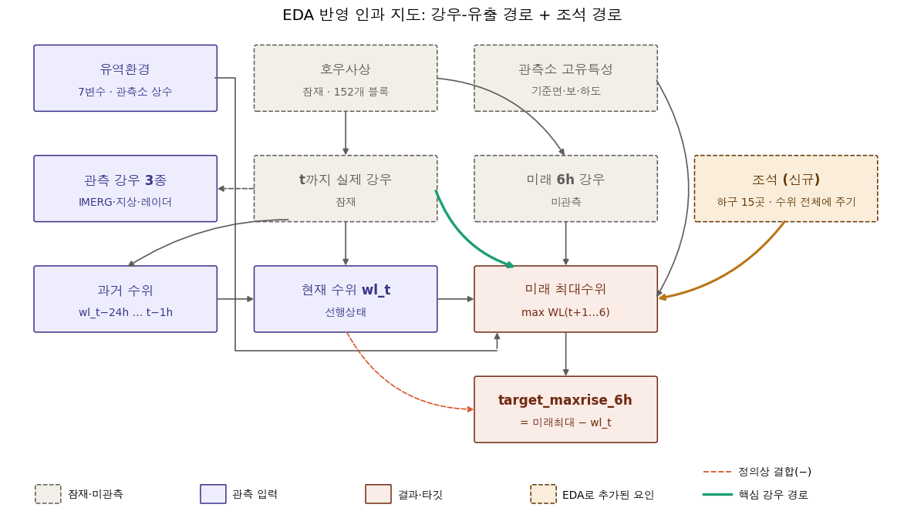

| 사전 가정 | EDA 결과 |
|---|---|
| 이미 내린 비 → 미래 최대수위가 핵심 경로 | ✅ 확인. 짧은 창 강우와 `dwl_1h`가 최상위 신호이고 지체시간은 1~3h다. |
| 강우 3종은 같은 실제 강우의 대리지표 | ✅ 확인. 상관 0.5~0.74, 서로 불일치가 크다. |
| 유역환경은 조절변수 | ✅ 부분 확인. 유역면적·도시화율에 따라 강우 반응이 달라지지만 효과 크기는 중간이다. |
| 관측소 기준면은 타깃에서 상쇄 | ✅ 확인. 절대 `wl_t`와 타깃의 상관 ≈ 0이다. |
| 타깃 정의상 `wl_t`와 음의 결합 | △ 약하게 확인(상대수위 −0.08). 조석 관측소에서 가장 강하다. |
| 사상 단위 분할이 필요하다 | ✅ 확인. 무작위 분할은 12% 낙관적이다. |
| (없었음) | ➕ **조석이라는 새 원인 경로**. 하구 15곳에서는 강우보다 조석 위상이 타깃을 지배한다. |
| (없었음) | ➕ **test 내부 미래 행 누수 구조** (61%) |

---

## 9. 다음 단계 체크리스트

- [ ] 검증 프레임: `event_block` 기준 Repeated GroupKFold를 고정하고, 관측소 통계는 fold 안에서만 계산한다.
- [ ] 누수 정책: test 이웃 행 활용 범위를 운영측에 문의한다. 답을 받기 전까지는 과거 방향 파생변수만 쓴다.
- [ ] 조석 변수:
  - `is_tidal`
  - `wl_t − wl_t−12h`, `wl_t − wl_t−6h` 부호
  - 관측소 내 상대수위
  - 조석 전용 모델 비교
- [ ] 강우 변수:
  - 원천 간 평균·최대·불일치
  - 이전 행 기반 최근 k시간 최대강우
  - 사상 누적강우
  - 유역면적과의 교차항
- [ ] 극값 대응: 큰 상승 구간 가중치, 분위수·Tweedie 계열 손실, 타깃 변환을 비교한다(검증 RMSE 기준).
- [ ] 모델: LightGBM이나 CatBoost를 도입한다(설치 필요). 관측소 범주 변수는 네이티브 처리와 타깃 인코딩을 비교한다.

---

### 부록: 산출물 위치

- 그림: `eda/figures/*.png` (21장)
- 수치 결과: `eda/cache/results/*.json|csv`
- 정렬 캐시: `eda/cache/train_sorted.parquet`, `test_sorted.parquet` (`event_block`, `run_id`, `pos_in_block`, `dwl_*` 포함)
- 실행 환경: `/opt/anaconda3/bin/python` 3.13. 단계별 peak 메모리는 0.4~0.9GB, 전체 실행 약 5분이다.
