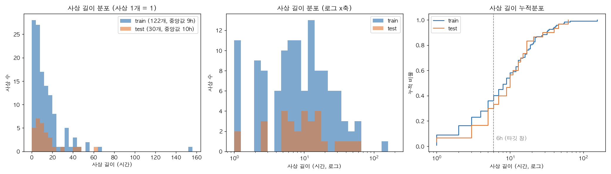
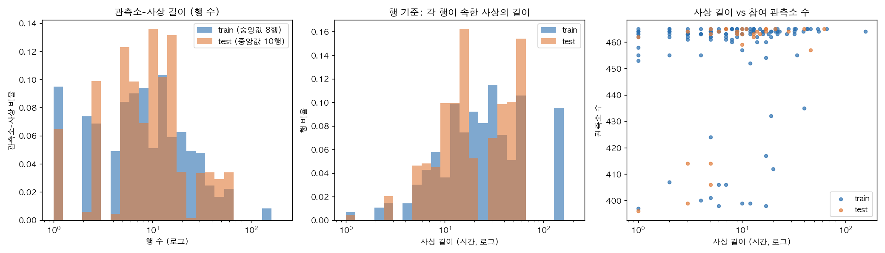
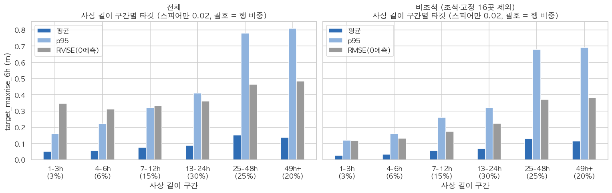

# 호우사상 길이 분포

- 재현: `python eda/src/t09_event_length.py` (프로젝트 루트에서)
- 산출물: `eda/figures/event_length/` — 그림 `el1_*.png`, `el2_*.png`, 사상별 표 `event_length_{train,test}.csv`, 요약 `event_length_summary.json`
- **분석용만.** 사상 길이는 t 이후를 봐야 알 수 있는 값이라 모델 변수로 쓰면 누수다.

## 정의

사상은 AGENT_REFERENCE 7절 방식으로 나눈다. 전체 합성 시각 축에서 1시간 넘게 비면 새 사상으로 본다. 길이는 두 가지로 쟀다.

| 이름 | 정의 |
|---|---|
| 사상 길이 | 사상의 마지막 시각 − 첫 시각 + 1h |
| 관측소-사상 길이 | 한 관측소가 그 사상에서 가진 행 수 |

## 요약 수치

| | train 사상 | test 사상 | train 관측소-사상 | test 관측소-사상 |
|---|---|---|---|---|
| 개수 | 122 | 30 | 55,663 | 13,618 |
| 평균 | 13.7h | 13.8h | 13.5행 | 13.7행 |
| p10 / p25 | 2 / 4 | 3 / 5 | 2 / 4 | 3 / 5 |
| **중앙값** | **9h** | **10h** | 8행 | 10행 |
| p75 / p90 | 17 / 32 | 16.5 / 29 | 17 / 32 | 17 / 28 |
| 최대 | 155h | 62h | 155 | 62 |
| 왜도 | 4.6 | 2.2 | 4.6 | 2.1 |

- 6h(타깃 창) 이하 사상: train 40% / test 33%. 그런데 이 사상들에 든 행은 train 9.4% / test 8.6%뿐이다.
- 행 하나가 속한 사상의 길이로 다시 재면 중앙값이 train 22h / test 17h이고, 평균은 37.5h / 27.2h다. 길이가 긴 상위 10% 사상이 행의 38%(train)를 차지한다.
- 사상 하나에 들어온 관측소 수는 중앙값 463곳이다. 길이와의 순위상관은 train 0.21 / test 0.47로 약하다. 짧은 사상 몇 개에서만 관측소가 400곳 안팎으로 빠진다.

## 그림

- 오른쪽 꼬리가 긴 분포다. 거의 모든 사상이 70h 안에 끝나고, train의 155h 사상 1개만 따로 떨어져 있다.
- 로그 축으로 보면 길이 1h 사상이 한 덩어리로 따로 있고(train 11개), 본체는 5~30h에 몰려 있다.
- 누적분포를 보면 train과 test가 거의 겹친다. test에는 155h 같은 초장기 사상이 없고 최대가 62h다.

- 왼쪽: 관측소-사상 행 수도 사상 길이와 모양이 같다. 빠진 시각은 관측소-사상 구간 기준으로 1.3%(train), 0.6%(test)에 그친다.
- 가운데: 행 기준으로 보면 무게가 긴 사상 쪽으로 옮겨 간다. train에서는 155h 사상 1개가 행의 약 9.5%를 차지한다.
- 오른쪽: 길이와 관계없이 대부분 사상에 관측소가 460곳 넘게 들어온다.

## 시사점

1. **사상 단위 fold 편향**: 155h 사상 1개가 train 행의 약 10%다. 사상 단위 5-fold에서 이 사상이 들어간 fold는 크기와 분포가 다른 fold와 크게 다를 수 있다. fold를 나눌 때 행 수를 맞추거나, 이 사상이 들어간 fold의 점수를 따로 확인하는 게 좋다.
2. **짧은 사상의 끝부분**: 6h 이하 사상이 개수로 33~40%다. 이런 사상에서는 타깃의 6h 창이 사상 끝을 넘어가고, 그러면 데이터 쪽에서 창을 어떻게 처리했는지가 문제다. 행 비중이 9% 정도라 RMSE 영향은 제한적일 것으로 보이지만 확인은 하지 않았다.
3. **train/test 길이 분포는 비슷함**: 중앙값 9h 대 10h이고 누적분포도 겹친다. 길이 때문에 분포가 어긋날 걱정은 작다. test에는 초장기 사상이 없다는 점만 다르다.
4. **참고**: 빠진 시각 비율이 AGENT_REFERENCE의 2.5%와 다르게 1.3%로 나온다. 이번에는 관측소-사상 자기 구간 안에서 셌기 때문이고, 2.5%는 사상 전체 구간 기준으로 보인다(정의 차이, 이번에 따로 확인하지는 않음).

## 추가: 사상 길이 구간별 타깃 (2026-09-29)

- 노트북 셀 버전: `eda/src/cell_event_length.py` (`df`, `test` 로딩 후 붙여 넣으면 됨. 위 그림 2장 + 아래 그림 1장)

- 사상 길이와 타깃의 스피어만은 전체 0.02 / 비조석 0.02다. 사상이 길다고 보통의 행이 더 오르지는 않는다.
- 하지만 꼬리는 다르다. 비조석 기준으로 p95가 1-3h 0.12m에서 25h 이상 0.68~0.69m까지 오르고, 0 예측 RMSE도 0.12에서 0.37~0.38로 커진다. 큰 상승은 긴 사상에 몰려 있다.
- 25h 이상 사상이 행의 45%를 차지한다. 그래서 RMSE도 이 사상들이 거의 결정한다.
- 전체 패널에서 짧은 사상의 RMSE가 높은 것(1-3h 0.35)은 조석 관측소 때문이다. 비조석에서는 0.12다.
- 누수: 사상 길이는 사상이 끝나야 아는 값이라 모델 변수로 쓸 수 없다. fold 설계와 오차 해석에만 쓴다.
