# 탐색적 데이터 분석 (EDA) — 최종본

> 2026 KISTI DATA·AI 분석 경진대회 — 호우 시 6시간 최대 하천수위 상승량 예측
> 구성: 분석 원칙 → 개요 → 품질 → 단변량 → 이변량 → 다변량 → 시계열·수문 → train/test → 요약 → 부록
> 재현: `eda/src/t01_overview_quality.py`, `t03_univariate.py`, `t04_bi_multivariate.py`, `t06_timeseries_split.py`, `t08_final_assets.py` (캐시 사용). 수치 원본: `eda/cache/results/t0*.json`, `nb07~10_summary.json`. 표 원본: `eda/figures/textbook/tab*.csv`, `eda/figures/final/tab*.md`
> 상세 근거: 노트북 1~10권과 조석 별책(부록 E). 이 문서는 `archive/report_textbook.md`(2026-09-27 초안)를 노트북 점검 결과로 정정·보강한 것이다.
> 작성 2026-09-28

---

## 0. 분석 원칙

### 0.1 네 가지 원칙

| 원칙 | 내용 |
|---|---|
| **층화** | 조석 관측소 15곳(6.3절)은 비와 무관하게 12.4시간 주기로 움직인다. 타깃이 들어가는 분석은 **전체와 비조석을 나란히** 보인다. 비조석 = 조석 15곳과 수위 고정 관측소(ST0027)를 뺀 나머지 |
| **전체 확인** | 몇 곳의 예시로 결론 내리지 않는다. 모든 관측소·사상에서 같은 방향이 나오는지 센다. 사상을 짝·홀 번호로 반씩 나눠 두 절반에서 같은 결과가 나오는지도 본다 |
| **판정 기준** (분석 전 고정) | 관측소·사상의 **70% 이상**이 같은 방향이면 채택, 50~70%면 부분 채택, 50% 미만이면 기각 |
| **누수 방지** | 예측 시점 t 이후의 정보는 어떤 행에서도 쓰지 않는다. 사상 길이·끝, 사상 전체 순위, test 안의 뒤 시각 행이 모두 여기에 해당한다. 타깃을 쓰는 관측소 통계는 학습 fold 안에서만 계산한다 |

### 0.2 점검으로 고친 결론

위 원칙을 적용하자 초기 분석의 결론 일부가 바뀌었다. 본문에는 고친 결론만 싣고, 바뀐 과정은 이 표에 모았다.

| # | 초기 결론 | 점검 | 최종 결론 | 위치 |
|---|---|---|---|---|
| 1 | 조석 관측소는 "사상 안에서 수위가 낮은 때" 곧 오른다 | '낮음'을 사상 전체 순위로 정해 **미래 수위가 섞였다**(누수). 비조석까지 +0.07m 부풀려짐 | 과거만 쓰는 `dwl_6h`(6시간 새 많이 내려옴)로 다시 정의하자 결론이 유지되고 더 선명해졌다 | 6.3 |
| 2 | 강한 비(40mm+)에서 큰 유역이 더 오른다 | 사상별로 나눠 보니 **19개 중 8개**에서만 성립. 길고 큰 사상 몇 개가 만든 차이 | 채택하지 않는다. 유역환경의 조절 효과는 도시화 × 짧은 강우에서만 일관되게 확인됐다 | 5.3 |
| 3 | 관측소마다 수위 변화를 앞서는 '선행 관측소'가 있다 | 사상을 반씩 나눠 따로 찾으면 **같은 선행 관측소는 34%** | 고정된 하천 구조(약 1/3)와 호우마다 바뀌는 관계가 섞여 있다 | 6.6 |
| 4 | 수위가 떨어지는 중에도 타깃 평균은 +0.016m다 | 평균만 봤다. 중앙값은 −0.01m, 큰 하강의 68%는 음수 | 하강 중이면 대체로 계속 내려간다. 평균은 비 오는 중 재상승과 방류 의심 관측소가 끌어올린 것 | 4.2 |
| 5 | 조석 관측소에는 위상 변수(`wl_t − wl_t−12h` 등)를 추가한다 | 기준 모델 잔차에 대한 설명 몫 −1.5%, 사상 일관성 38% | 추가하지 않는다. 위상 정보는 이미 lag 수위에 들어 있다 | 6.3 |

---

## 1. 데이터 개요

### 1.1 문제 정의

- 예측 대상: `target_maxrise_6h = max(WL(t+1h), …, WL(t+6h)) − WL(t)` (단위 m, 음수 가능)
- 평가: test 전체 186,263행에 대한 단일 RMSE
- 입력: 시각 t까지의 과거 수위, 위성강우(IMERG), 지상강수, 레이더 반사도, 유역환경

### 1.2 출처와 병합 구조

| 원천 | 변수 | 공간 단위 |
|---|---|---|
| WAMIS 수위 | `wl_t`와 lag 5개, 타깃 | 관측소 |
| IMERG 위성강우 | `imerg_rain_1h/6h/24h` | 격자셀 (관측소 463곳에 시계열 300종) |
| 지상기상 | `sfc_rain_1h/6h/24h` | 격자 (시계열 223종) |
| 레이더 | 반사도 평균·p95·20 이상 비율 | 격자셀 |
| DataON 유역 | 유역환경 7변수 | 표준소권역 (465곳에 조합 329종) |

강우와 유역 값은 여러 관측소가 공유한다. 따라서 관측소를 구별하는 정보는 주로 수위 이력에서 나온다.

### 1.3 관측 단위

한 행은 (관측소, 시각) 하나다. 입력은 과거 24시간의 요약이고, 타깃은 미래 6시간이다. 이웃한 행끼리는 타깃 구간이 최대 5시간 겹친다.

### 1.4 변수 분류 (표 1-1)

| 역할 | 변수 | 측정 척도 | 비고 |
|---|---|---|---|
| 식별 | `row_id`, `station_id` | 명목 | 관측소 465곳, train/test 공유 |
| 식별 | `timestamp` | 구간(합성 시각) | 사상 내 순서와 간격만 유효 |
| 동적 입력 | `wl_t`, `wl_t_minus_*` (6) | **구간** | 관측소마다 기준면이 다름 → 변화량만 의미 |
| 동적 입력 | IMERG·지상 강우 (6) | 비율 | 지상강수 단위는 공식 미확인 |
| 동적 입력 | 레이더 평균·p95 | 구간(로그형) | 단위 미기재 |
| 동적 입력 | 레이더 20 이상 비율 | 비율 | 0~1 |
| 정적 입력 | 유역환경 (7) | 비율·구간·순서 | 시간 불변, 하천차수는 소권역 평균이라 비정수 |
| 타깃 | `target_maxrise_6h` | 비율(차이값) | train에만 있음 |

수위가 **구간 척도**라는 점은 이후 분석의 출발점이다. 관측소 간 절대수위 비교는 의미가 없으므로, 이 보고서는 수위를 차분(`dwl_k = wl_t − wl_t−k`)으로 다룬다.

### 1.5 패널 구조

데이터는 관측소 465곳 × 호우사상 152개(train 122 / test 30) × 시간으로 이루어진 패널이다.
- 사상은 합성 시각에서 1시간이 넘는 공백으로 나뉘는 구간이다. 길이는 중앙값 9~10시간, 최대 155시간이다.
- 사상마다 관측소의 약 98%가 등장한다.

---

## 2. 데이터 품질 점검

데이터 품질의 표준 기준(완전성·유일성·유효성·일관성·정확성)을 차례로 적용했다.

### 2.1 완전성

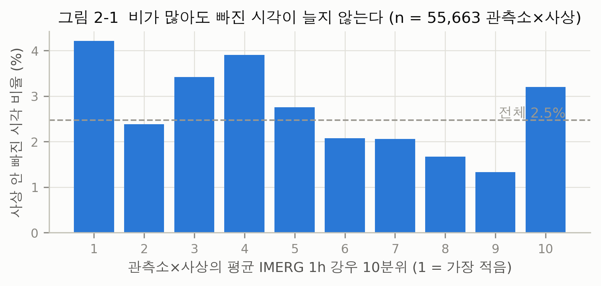

- **관찰**:
  - NaN은 0개다.
  - 사상 안에서 빠진 시각은 2.5%다.
  - 관측소×사상의 강우 10분위별 결측률은 1.3~4.2%다. 비가 많아져도 결측이 늘지 않는다.
- **→ 시사점**: 홍수 때 값이 잘려 나간 흔적(극값 검열)은 없다. 결측은 대치하지 않고, lag 계산 규칙만 정하면 된다.

### 2.2 유일성

중복 행은 0개, (관측소, 시각) 중복도 0개다. train과 test의 관측소 집합은 같다.

### 2.3 유효성 (표 2-1)

| 규칙 | 위반 | 판정 |
|---|---|---|
| 강우 ≥ 0 | 0 | – |
| 누적강우 1h ≤ 6h ≤ 24h (IMERG·지상) | 0 | – |
| 레이더 비율 0~1 | 0 | – |
| 도시 + 산림 ≤ 100% (최대 99.2%) | 0 | – |
| 면적 > 0, 비율 0~100% | 0 | – |
| 레이더 평균 ≤ p95 | 7.5% | **오류 아님**: 위반 행의 99.9%가 p95 = 0에 평균만 소량인 약한 에코(에코 화소 5% 미만) |

- 수위 범위는 −5.18 ~ 139.7m다. 관측소마다 기준면이 달라 범위가 넓다.
- 지상강수에서 0이 아닌 값의 87%가 0.5의 배수이고, 100%가 0.1의 배수다. 0.5mm 전도형 우량계와 같은 모양이므로 **mm로 추정**한다(공식 단위는 미확인).

### 2.4 일관성 (표 2-2)

| 검산 | train | test |
|---|---|---|
| `wl_t_minus_kh` = k시간 전 행의 `wl_t` (k = 1, 3, 6, 12, 24) | 100% | 100% |
| 6h·24h 누적강우 = 1h 강우의 합 | 100% | 100% |
| 타깃 = 다음 6행 최대 − `wl_t` (미래 6행이 모두 있는 63%) | 100% | – |

병합과 파생 계산이 정확하다. 이전 행을 참조하는 파생변수를 안심하고 만들 수 있다.

### 2.5 이상값 (표 2-3)

- **관찰**:
  - 교과서 기준(Tukey 울타리, MAD 강건 z > 3.5)을 적용하면 수위 차분과 타깃의 12~25%가 이상값으로 잡힌다.
    - 원인: 값이 0에 몰려 IQR이 매우 좁다.
    - 기계적 기준은 이렇게 치우친 분포에서 정상 호우를 이상값으로 오판한다. 그래서 판정은 물리적 기준으로 했다.
  - 강우는 log1p 척도에서 판정했다. 1시간 100mm를 넘는 IMERG 7행은 국내 극한 호우 범위이므로 실제 극값이다.
  - 오류로 판정한 것은 **ST0027 한 곳**이다. 수위가 train 1,676행과 test 413행 모두 28.19m로 고정되어 있다.
  - 맑은 날(24시간 강우 0)에도 반사도 중앙값이 4를 넘는 관측소가 train 기준 18곳 있다(train+test로 보면 21곳). 전체 맑은 날 중앙값은 0.17이다. 지형 클러터로 추정된다.
  - 수위는 1cm, 지상강수는 0.5mm 단위로 기록된다. 타깃의 46%가 0 또는 ±1cm다.
- **→ 시사점**: 큰 강우와 큰 상승은 이 과제의 핵심 신호이므로 제거하지 않는다.

### 2.6 품질 점검 → 전처리 결정 (표 2-4)

| 품질 발견 | 전처리 결정 |
|---|---|
| ST0027 수위 고정 | test 예측을 0으로 고정, 학습에서 제외 |
| `wl_t`는 기준면이 다른 구간 척도 | 차분·관측소 내 상대값 사용 |
| 유역면적 왜도 7~12 | 로그 변환(트리 모델은 선택) |
| 클러터 관측소 18곳(train 기준) | 관측소별 맑은 날 바탕값 차감 검토 |
| 지상강수 0.5 계단, 약한 비 미감지 | mm로 추정해 표기, 약한 비는 IMERG로 보완 |
| 1cm 분해능 | 작은 값 정밀도보다 꼬리 예측에 집중 |
| 결측·중복·정합성 문제 없음 | 대치·삭제 없음 |

---

## 3. 단변량 분석

### 3.1 타깃

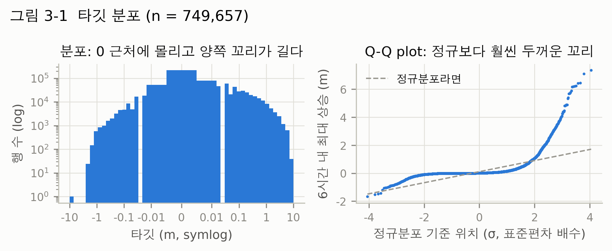

- **관찰**:
  - 요약 통계: 평균 0.109m, 중앙값 0.01m, 표준편차 0.395m, 왜도 7.3, 첨도 78.7
  - 부호: 양수 55%, 0 29%, 음수 16%
  - 꼬리: p99 1.87m, 최대 8.30m, 최소 −8.74m. Q-Q plot에서 약 +1m 위쪽부터 정규분포를 크게 벗어난다.
  - **상위 1% 행이 0 예측 기준 제곱오차의 66%**를 차지한다.
- **→ 시사점**: RMSE는 사실상 큰 상승을 얼마나 잘 맞히는지로 결정된다.

### 3.2 꼬리는 어디서 오나

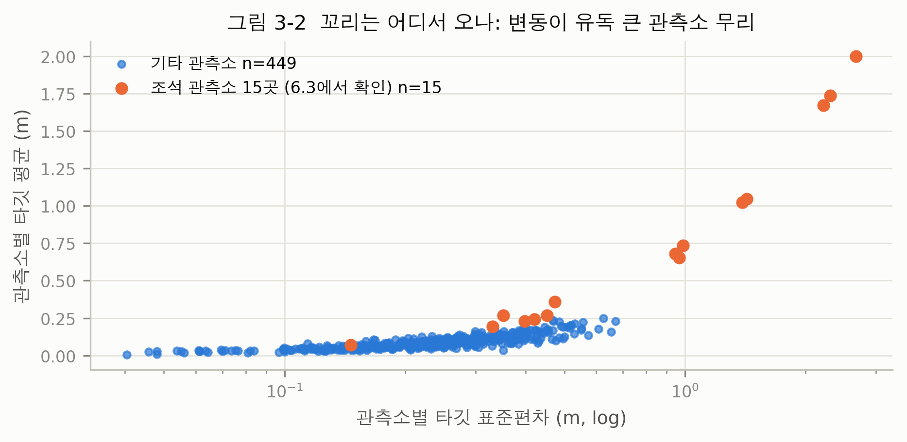

- **관찰**:
  - 관측소별 타깃의 평균과 표준편차를 그려 보면, 표준편차 1~2.7m·평균 0.65~2.0m인 **7곳이 무리에서 떨어져 나온다**.
  - 이 7곳을 포함해 6.3절에서 12.4시간 주기(조석)로 확인되는 **15곳**은 행의 3.2%에 불과하다. 그런데 0 예측 기준 제곱오차의 **51%**를 차지한다.
  - 15곳의 타깃 표준편차 중앙값은 0.94m로, 나머지 관측소(0.24m)의 4배다.
  - 15곳 중 나머지 8곳은 일반 관측소 무리의 위쪽 가장자리에 있어, 이 그림만으로는 구분되지 않는다(6.3절 참조).
  - 51%는 **0으로 예측할 때** 기준이다. 조석의 규칙적인 주기는 과거 수위로 대부분 맞힐 수 있어서, 기준 모델(HGB, 사상 단위 5-fold)의 오차에서는 조석 몫이 **8.8%**로 줄어든다(부록 C). 조석은 "분석을 흐리는 무리"이지 "모델 오차의 대부분"은 아니다.
- **→ 시사점**: 4·5장에서 타깃이 들어가는 분석은 **전체(회색)와 비조석(파랑)을 나란히** 보인다. 비조석은 조석 15곳과 고정 관측소를 뺀 것이다.

### 3.3 수위

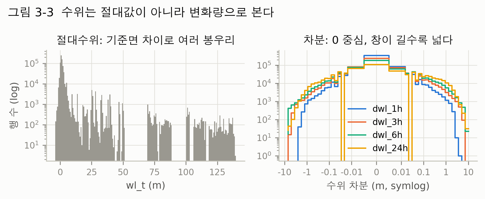

- **관찰**: 절대수위는 관측소 기준면 차이로 봉우리가 여럿이다(왜도 6.3). 차분은 0을 중심으로 분포하고, 창이 길수록 넓게 퍼진다.
- **→ 시사점**: 절대수위 대신 차분을 입력으로 쓴다.

### 3.4 강우

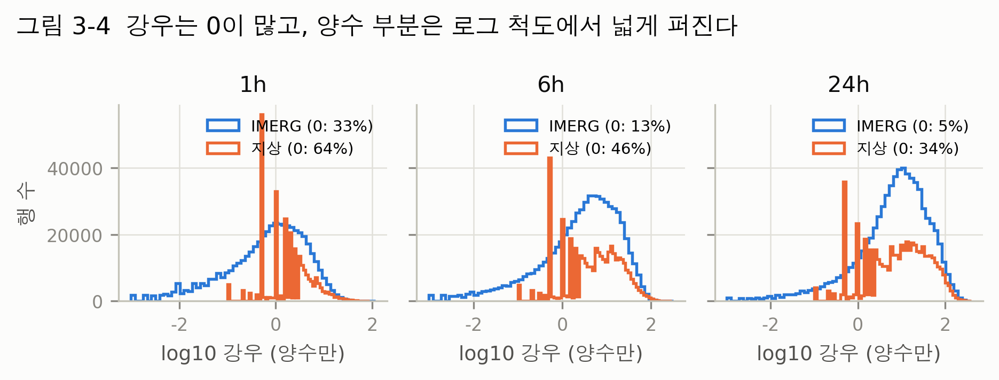

- **관찰**:
  - 0인 비율은 IMERG가 1h 33% → 6h 13% → 24h 5%다. 지상은 64% → 46% → 34%로 0을 훨씬 자주 기록한다.
  - 양수 부분은 로그 척도에서 넓게 퍼진다(왜도 3.1~6.6).
- **→ 시사점**: 강우는 log1p로 변환한다. 약한 비는 지상강수가 놓치는 경우가 많으므로 IMERG로 보완한다.

### 3.5 레이더

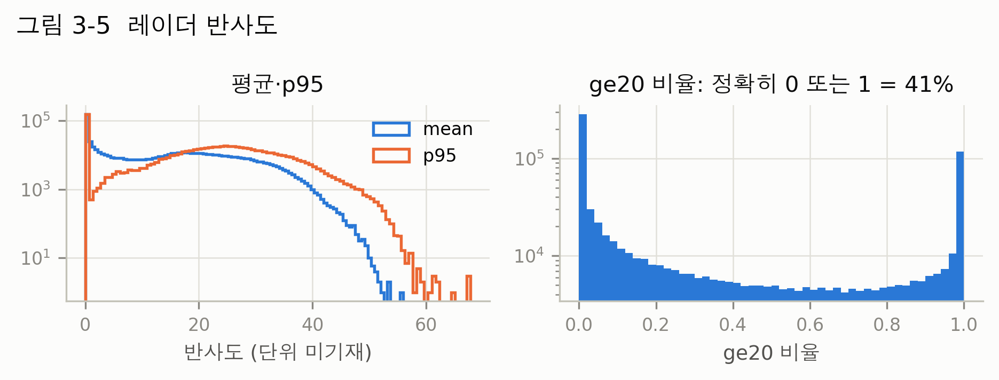

- **관찰**:
  - 평균과 p95는 거의 대칭이다(왜도 0.4, −0.2).
  - 20 이상 비율은 **41%의 행이 정확히 0 또는 1**이다(0이 28%). 연속값이라기보다 이진값에 가깝다.
  - 평균·p95 값의 범위는 0~56이고 음수가 없다. 단위는 공식 미기재지만 dBZ처럼 로그형 값으로 보인다. dB로 가정해 선형 강도로 바꾸면 타깃과의 Pearson 상관이 0.36 → 0.45로 오른다.
- **→ 시사점**: 트리 모델에는 변환이 필요 없다(순위가 같으므로). 선형 모델이라면 선형 강도 변환을 검토한다. 20 이상 비율은 평균에 임계값을 적용한 것과 비슷해 새 정보가 적다(5.1절에서 확인).

### 3.6 유역환경 (관측소 단위, n = 465)

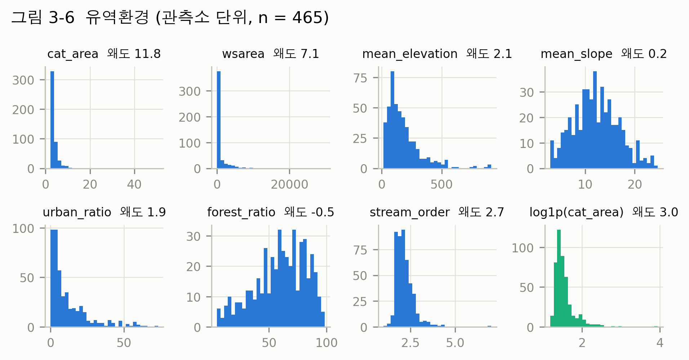

- **관찰**:
  - 시간에 따라 변하지 않는 변수라 관측소 단위로 봤다. 행 단위로 보면 행이 많은 관측소에 가중치가 쏠린다.
  - 소권역 집수면적의 왜도는 11.8, 상류 유역면적은 7.1이다.
  - 소권역 집수면적은 log1p 변환 뒤에도 왜도가 3.0이다. 값이 작아(대부분 2~10) log1p의 효과가 약하다.
- **→ 시사점**: 면적은 log 또는 순위 변환을 비교한다.

### 3.7 기술통계 요약 (표 3-1)

변수별 평균·중앙값·표준편차·IQR·왜도·첨도·0 비율·권장 변환은 `tab3-1_summary.csv`에 정리했다. 요점은 다음과 같다.
- 강우 6개와 면적 2개는 **log1p 변환**을 권장한다.
- 수위는 **차분**을 쓴다.
- 레이더와 경사·산림은 변환이 필요 없다.

---

## 4. 이변량 분석 — 타깃과 각 변수의 관계

### 4.1 타깃 × 강우

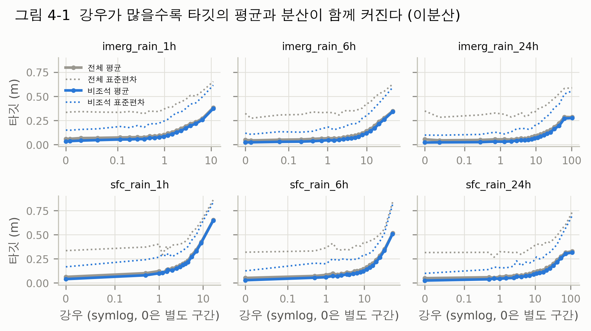

- **관찰**:
  - 강우가 약 1mm를 넘으면 타깃 평균이 가파르게 오른다.
    - `sfc_rain_1h`: 0 구간 0.04m → 최상위 구간 0.65m (비조석)
    - `imerg_rain_1h`: 0.03m → 0.37m
  - 같은 구간에서 표준편차도 0.17 → 0.84로 커진다(**이분산**).
  - 비가 없는 구간의 표준편차는 전체 0.33 → 비조석 0.15로 절반 이하가 된다. 무강우 시의 흔들림 중 상당 부분이 조석에서 온다.
  - 6시간 누적 강우로 보면 반응이 꺾이는 문턱은 **약 15mm**다. 다만 사상을 반씩 나누면 11mm와 18mm로 흔들려, 날카로운 문턱이라기보다 완만한 전환 구간이다. 도시화·산림·선행 습윤 상하위로 나눠도 문턱 위치는 13~15mm로 거의 같다.
- **→ 시사점**:
  - 짧은 창(1h·6h)과 지상강수의 신호가 가장 선명하다.
  - 분산이 강우와 함께 커지므로, 큰 사상에서는 극값 가중치나 분위수 손실을 검토한다.

### 4.2 타깃 × 수위 변화

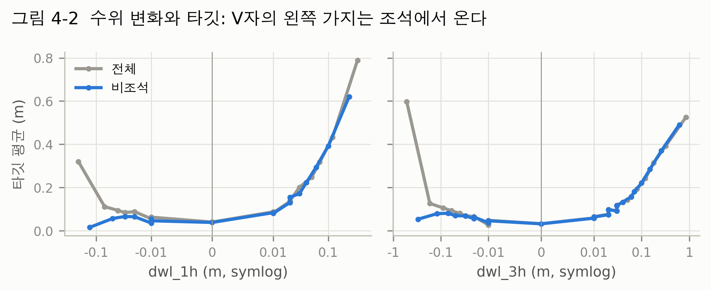

- **관찰**:
  - 전체 데이터에서는 V자 관계가 보인다. 수위가 크게 떨어진 직후(dwl_1h 최하위 구간)에도 타깃 평균이 0.32m로 크다.
  - 그런데 비조석에서는 같은 구간의 평균이 **0.02m**로 사라진다(dwl_3h는 0.60 → 0.05m).
  - 오른쪽 가지(상승 중이면 계속 오름)는 두 집단에서 같다.
- **→ 시사점**: "크게 떨어진 뒤 반등"은 조석의 썰물 → 밀물 전환이다. 비조석 관측소에서 수위 변화는 **추세 지속** 신호로만 작동한다.

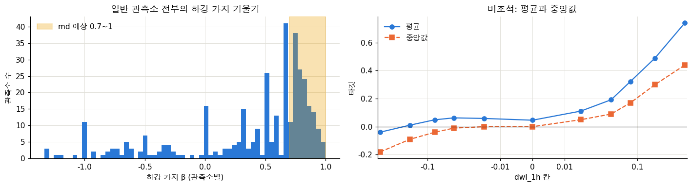

*그림 4-2b. 왼쪽: 일반 관측소별 하강 가지 기울기 β(하강 중 타깃 ≈ β · dwl_1h). 음영은 문헌에서 기대한 0.7~1 범위. 오른쪽: 비조석 dwl_1h 구간별 타깃 평균과 중앙값.*

- **관찰**:
  - 하강 중인 행에서 타깃 평균은 +0.016m로 0보다 크다. 하지만 **중앙값은 −0.01m**이고, 크게 떨어지는 중(dwl_1h 하위 구간)인 행의 68%는 타깃이 음수다(그림 오른쪽, 평균과 중앙값의 간격).
  - 관측소마다 하강 가지 기울기를 구하면 **78%가 양(+)**이다. 떨어지는 속도가 빠를수록 앞으로도 더 떨어진다. 기울기 중앙값은 0.67이다.
  - 같은 수위 높이에서 비교하면, 상승 중인 행의 타깃이 하강 중인 행보다 크다(관측소의 **99.5%**). 수위–타깃 관계에 오르내림 방향에 따른 이력이 있다.
- **→ 시사점**: 하강 가지의 평균을 끌어올린 것은 "비 오는 중의 재상승"과 방류 의심 관측소(6.3절)다. `dwl_1h`의 부호와 강우를 함께 보면 된다(강우 × `dwl_1h`). 수위의 오르내림 방향은 `dwl_1h` 부호로 충분히 표현된다.

### 4.3 타깃 × 레이더

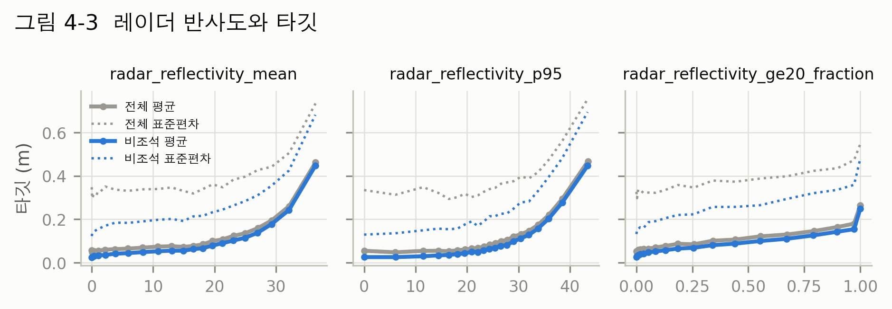

- **관찰**: 반사도가 높을수록 타깃 평균이 0.02~0.03m에서 0.45m(평균·p95 최상위 구간, 비조석)로 오른다. 20 이상 비율은 최대 0.25m로 상대적으로 약하다.
- **→ 시사점**: 레이더도 강우와 비슷한 크기의 신호를 준다. 세 변수 중 평균이나 p95 하나면 충분하다.

### 4.4 타깃 × 유역환경 (관측소 단위, 비조석)

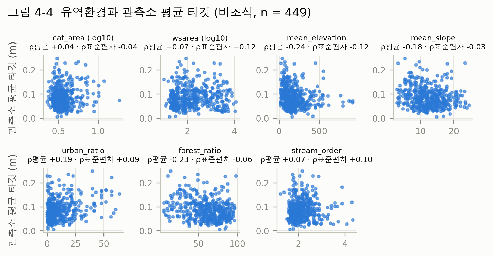

- **관찰**:
  - 유역환경과 관측소 평균 타깃의 상관은 모두 약하다(|ρ| ≤ 0.24).
  - 표고(−0.24)·산림(−0.23)·경사(−0.18)가 높을수록 평균 상승이 작고, 도시화율(+0.19)이 높을수록 크다.
  - 면적·하천차수는 거의 무관하다(ρ 0.04~0.07).
  - 면적이 클수록 강우 1mm당 상승(비유량)이 작아진다는 통념도 이 데이터에서는 보이지 않는다. 관측소 면적 3분위별 '타깃 ÷ 강우'는 0.0040 / 0.0052 / 0.0046이다.
- **→ 시사점**: 유역환경은 단독으로는 약한 변수다. 강우와의 상호작용 가능성은 5.3절에서 사상 단위로 확인한다.

### 4.5 타깃 × 관측소 (비조석)

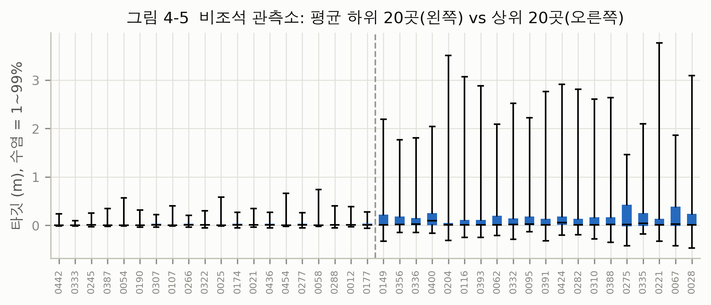

- **관찰**: 비조석 관측소 사이에서도 평균 타깃이 p10 0.04m ~ p90 0.15m로 약 4배 차이 난다. 상위 관측소는 중앙값뿐 아니라 위쪽 꼬리도 길다.
- **→ 시사점**: 관측소 통계(평균·분위수)는 유용한 변수다. 단, 검증 fold 안에서만 계산한다.

### 4.6 상관 요약 (표 4-1)

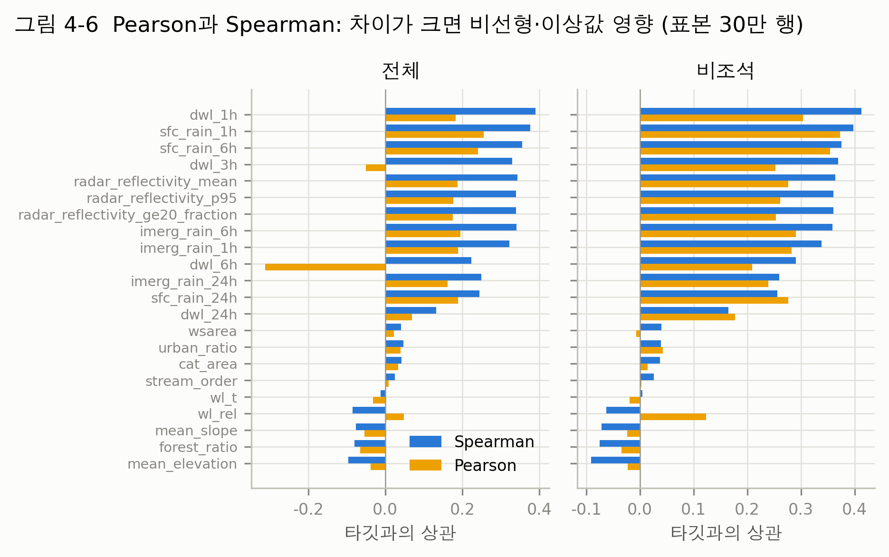

- **관찰**:
  - 비조석 기준 Spearman 상관이 가장 큰 변수는 `dwl_1h` 0.41, `sfc_rain_1h` 0.40, `sfc_rain_6h` 0.38, `dwl_3h` 0.37, 레이더 0.36 순이다.
  - Pearson은 Spearman의 절반 정도에 그친다. 관계가 **단조롭지만 비선형**이고, 극값의 영향을 받는다는 뜻이다.
  - 절대수위 `wl_t`는 상관이 거의 0이다.
- **→ 시사점**: 비선형 관계를 자동으로 다루는 트리 계열 모델이 적합하다. 선형 모델을 쓴다면 변환과 교차항이 필요하다.

---

## 5. 다변량 분석

### 5.1 입력 변수 간 상관과 다중공선성 (표 5-1)

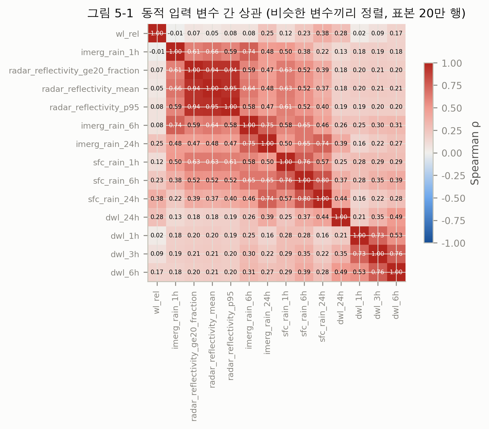

- **관찰**:
  - 레이더 평균–p95의 상관은 ρ 0.95, 평균–20 이상 비율은 0.94다. VIF는 레이더 평균 15.9, 20 이상 비율 7.2, p95 6.5로 **레이더 3변수는 사실상 하나**다.
  - IMERG와 지상강수의 상관은 1h 0.50에서 24h 0.74로, 누적 창이 길수록 잘 맞는다.
  - 같은 원천의 6h·24h 강우도 서로 VIF 5~6 수준으로 겹친다.
- **→ 시사점**:
  - 트리 모델에는 큰 문제가 아니다. 다만 변수 중요도를 해석할 때 중요도가 겹치는 변수에 나뉘는 점에 주의한다.
  - 선형 모델에서는 레이더를 하나로 줄인다.
  - 세 강우 원천은 같은 강우를 잰 대리지표이므로 평균·최대·불일치 변수로 합칠 수 있다.
- **원천 간 크기 차이**: 24시간 누적에서 IMERG ÷ 지상 비율은 지상 1~5mm 구간 2.8에서 100mm 초과 구간 0.62로 떨어진다. IMERG는 약한 비를 크게, 강한 비를 작게 잡는다. 강한 비의 크기는 지상강수를 주 변수로 본다.

### 5.2 유역환경 주성분분석 (표 5-2)

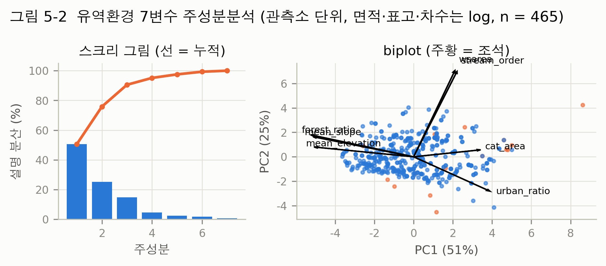

- **관찰**: 7변수 가운데 PC1이 51%, PC2가 25%, PC3가 15%로 **3개 성분이 92%**를 설명한다.
  - PC1: 산지(표고·경사·산림 −) ↔ 저지·도시(도시화 +)
  - PC2: 하천 규모(상류면적 0.66, 하천차수 0.66)
  - PC3: 소권역 면적과 도시화
  - 조석 관측소는 PC1의 저지·도시 쪽에 모여 있다(PC1 순위 중앙값 상위 82% 지점).
- **→ 시사점**: 유역환경은 '산지–저지'와 '규모' 두 축으로 요약된다. 신경망 등에는 주성분 3개로 줄여 넣을 수 있다.

### 5.3 조절 효과 — 같은 비라도 누가 더 오르나 (비조석)

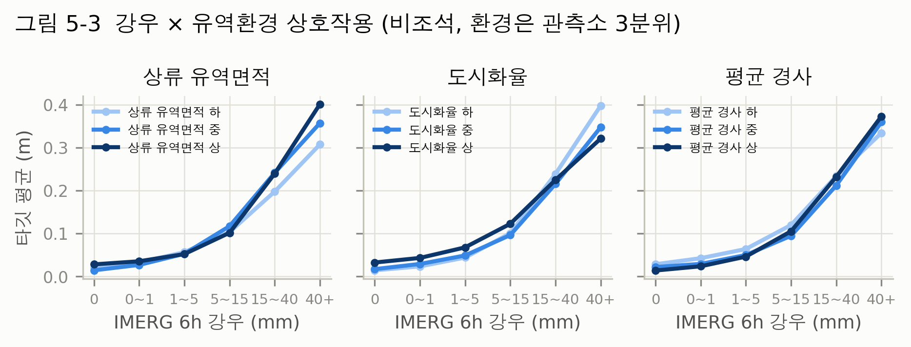

강우 구간 × 조절 변수 3분위의 타깃 평균을 섞은 그림(그림 5-3)은 길고 큰 사상 몇 개에 끌려가기 쉽다. 그래서 조절 효과마다 **사상별로 같은 방향이 나오는지** 세어 판정했다(0.1절 기준).

| 조절 변수 | 섞은 그림에서 보인 것 | 사상·관측소별 확인 | 판정 |
|---|---|---|---|
| 상류 유역면적 | 40mm+ 강우에서 큰 유역이 더 오름(0.40 vs 0.31m) | 사상 **19개 중 8개** | 기각 |
| 도시화율 | 도시 상위 관측소가 짧은 강우(1h)에 더 강하게, 긴 강우(6~24h)에 약하게 반응 | 면적 3분위 모두에서 같은 방향, 사상 **78%**. 단 40mm 초과 극한 비에서는 반대 | 채택(중간 강우) |
| 관측소 안 수위 높이 | 칸 평균으로는 높을 때 더 오르는 것처럼 보임 | 관측소 **안에서** 수위 분위를 매기면 높을수록 같은 비에 덜 오름: 관측소 80%·사상 96% | 채택(관측소 안 기준) |
| 선행 습윤(6~24시간 전 강우) | 많을수록 더 오르는 것처럼 보임 | 최근 강우·경과 시간을 통제하면 음(ρ −0.15), 관측소 24%·사상 25%만 양 | 기각(양의 효과 없음) |
| 산림·경사 | 산림 많고 경사 급할수록 평균 상승 작음 | 면적을 통제한 부분 순위상관: 산림 −0.19, 경사 +0.13(빠른 반응 가설과 반대 방향) | 약함 |

- **관찰**:
  - 섞은 그림에서 가장 눈에 띈 "큰 유역 × 강한 비"는 사상 단위로 재현되지 않았다.
  - 대신 두 조절 효과가 일관되게 남았다. **도시화 × 짧은 강우**, 그리고 **관측소 안 수위 높이 × 강우**다.
  - 수위 높이는 관측소마다 기준면이 달라(1.4절) 칸 평균으로 보면 방향이 뒤집힌다. 관측소 train 수위 분포에서의 분위(q)로 바꿔야 원래 방향이 보인다.
- **→ 시사점**:
  - 파생변수 후보 1순위는 **q × 강우**다. q는 관측소별 train 수위 분포로 계산한다(부록 B).
  - 도시화 × 1시간 강우는 교차 변수로 시험한다. 극한 비에서 방향이 바뀌므로 단조 제약은 걸지 않는다.
  - 선행 습윤에는 + 방향 제약을 걸지 않는다.

### 5.4 타깃 분산 분해

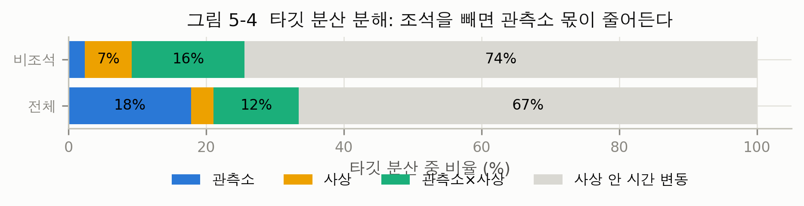

| 성분 | 전체 | 비조석 |
|---|---|---|
| 관측소 간 차이 | 18% | **2%** |
| 사상 간 차이 | 3% | 7% |
| 관측소 × 사상 | 12% | 16% |
| 사상 안 시간 변동 | 67% | **74%** |

- **관찰**: 조석을 빼면 관측소 몫은 18% → 2%로 줄어든다. 전체에서 '관측소 효과'로 보였던 것은 대부분 조석 관측소였다.
- **→ 시사점**: 비조석 관측소에서 예측의 핵심은 "어느 관측소인가"가 아니다. **"사상 안 지금이 어떤 국면인가"**다. 시간 구조를 담은 변수(최근 수위 추세, 누적 강우, 사상 경과 시간)가 중요하다.

### 5.5 관측소 군집

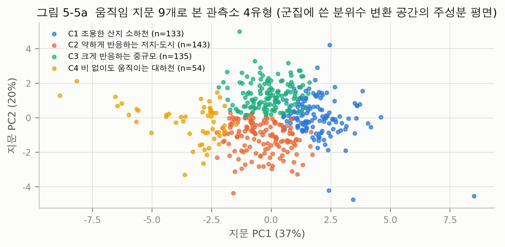
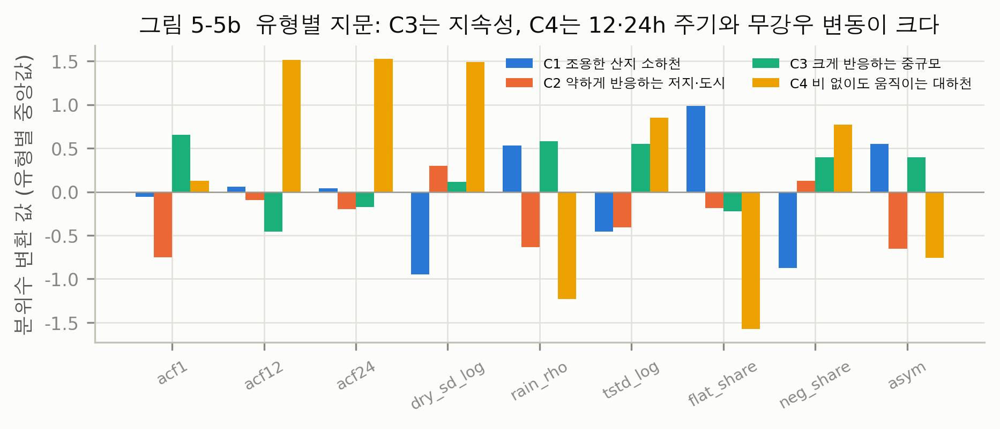

- **관찰**: 움직임을 요약한 지표 9개(변화 지속성, 12·24h 주기, 무강우 변동, 강우 반응 등)로 관측소를 네 유형으로 묶었다.

  | 유형 | 관측소 수 | 특징 |
  |---|---|---|
  | C1 조용한 산지 소하천 | 133 | 평소엔 멈춰 있다가 비가 오면 빠르게 반응 |
  | C2 약하게 반응하는 저지·도시 | 143 | 비와의 연관이 약하고 잔 흔들림이 많음 |
  | C3 크게 반응하는 중규모 하천 | 135 | 한번 오르면 추세가 몇 시간 이어짐 |
  | C4 비 없이도 움직이는 대하천 | 54 | 조석 관측소 포함 |

  - 군집 품질은 낮다. k=4 실루엣 0.163은 같은 상관구조를 가진 '군집 없는' 가우시안 데이터(0.140±0.008)보다 0.02 높을 뿐이다.
    - 진짜 갈래는 하나다: C4(대하천·조석)와 C1(산지 소하천)은 분명히 다르다(두 유형만 본 실루엣 0.47).
    - C1·C2·C3 사이 경계는 임의에 가깝다(두 유형씩 본 실루엣 0.20~0.23).
    - k도 확정되지 않는다. k=4~7의 실루엣 차이가 0.015 안이고, GMM BIC는 k=2와 k=4가 거의 같다. 다시 뽑기(부트스트랩)를 하면 배정이 꽤 바뀐다(ARI 평균 0.71).
    - 따라서 네 유형은 '연속 스펙트럼을 네 칸으로 나눈 이름표'로만 읽는다.
  - 유역환경 7변수로 지문 9개를 하나씩 예측하면 설명력(교차검증 R²)이 0.08~0.32다. 가장 잘 맞는 강우 반응(rain_rho)도 0.32다.
    - 참고로 유역환경으로 유형을 맞히는 정확도는 49%다(다수결 기준 31%). 다만 유형 경계가 임의라 이 숫자는 보조 근거로만 쓴다.
- **→ 시사점**: 관측소의 움직임 특성은 유역환경으로 잘 설명되지 않는다. 유형 라벨 대신 **연속 지문 지표를 학습 fold 안에서 계산해 변수로** 쓴다. 유형별로 모델을 따로 만들거나 유형별로 결론을 내지 않는다. 대하천·조석 쪽 끝만은 따로 다룰 근거가 있다.

---

## 6. 시계열·수문 분석

### 6.1 수문곡선

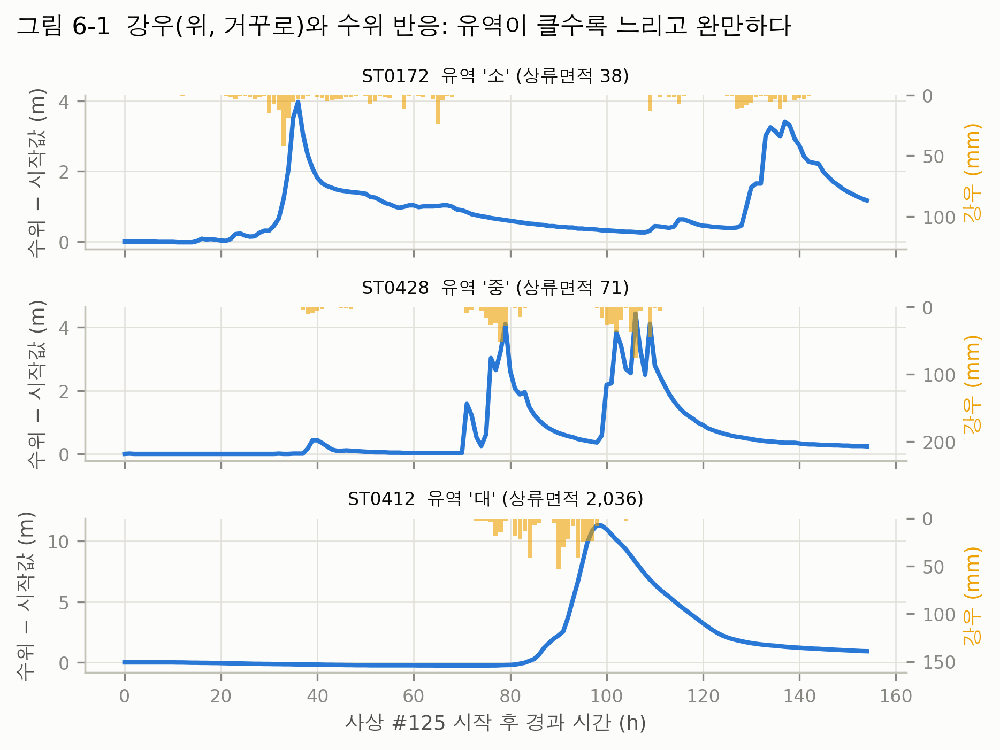

- **관찰**:
  - 사상 #125에서 유역 크기가 다른 세 관측소를 비교했다.
  - 소유역(상류면적 38)은 강우 직후 몇 시간 안에 4m 가까이 급상승하고 빠르게 내려간다.
  - 대유역(2,036)은 강우가 쌓인 뒤 약 20시간에 걸쳐 11m까지 완만하게 오르고 천천히 내려간다.
- **→ 시사점**: 가장 중요한 예측 신호는 **이미 내렸지만 아직 하천에 도달하지 않은 비**다. 도달 속도는 유역 규모가 정한다.

### 6.2 자기상관 — 지속성과 주기성

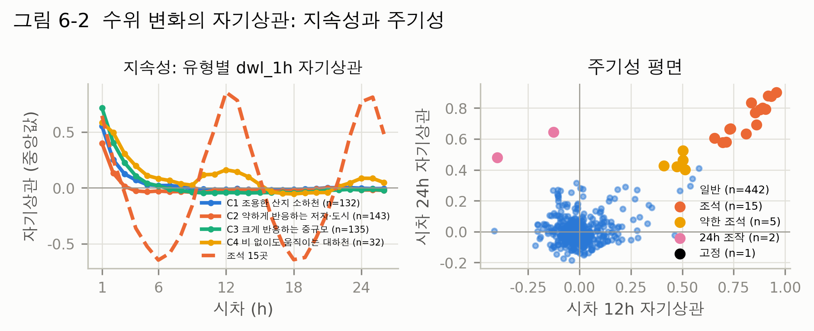

- **관찰**:
  - 수위 변화(dwl_1h)의 1시간 자기상관은 C3 0.72, C4 0.58, C1 0.55, C2 0.40이다.
  - 3시간이 지나면 C3 0.23, C4 0.31, C1 0.12, C2 0.01로 줄고, 6시간 뒤에는 거의 0이다.
  - 조석 관측소는 12시간 +0.86, 6시간 약 −0.6으로 뚜렷한 주기를 보인다.
- **→ 시사점**: 수위 추세는 1~3시간 정도 이어진다. 그래서 최근 1~3시간의 수위 차분이 강한 입력 변수가 된다(4.6절과 일치).

### 6.3 비 말고 다른 이유로 움직이는 관측소

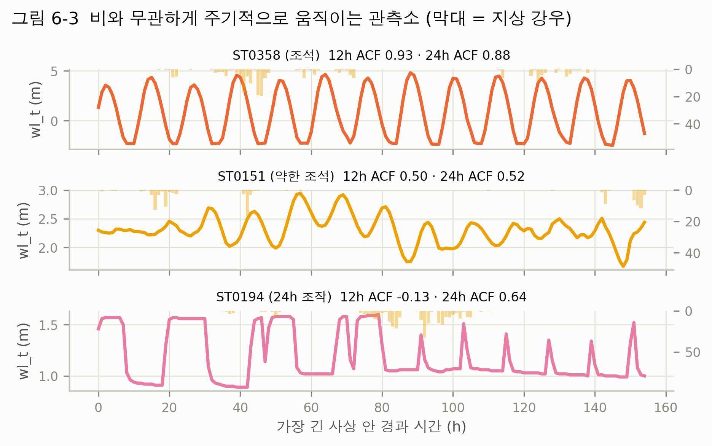

- **관찰**: 12시간·24시간 자기상관 평면(그림 6-2 오른쪽)에서 관측소가 네 무리로 나뉜다.

  | 무리 | 관측소 수 | 12h 자기상관 | 24h 자기상관 | 특징 |
  |---|---|---|---|---|
  | 조석 | 15 | 0.86 | 0.77 | 하구, 12.4시간 주기 |
  | 약한 조석 | 5 | 0.50 | 0.43 | |
  | 24h 조작 | 2 (ST0194, ST0200) | −0.26 | 0.56 | 비와 무관하게 매일 계단식으로 오르내림(수문 개폐·방류 추정) |
  | 일반 | 442 | ≈ 0 | ≈ 0 | |

  - 3.2절에서 따로 떨어져 나온 무리의 원인이 이 조석 주기다.
  - 조석 15곳은 모두 비와 무관하다(강우–수위 변화 상관 −0.03~+0.12, 일반 관측소 중앙값 +0.42).
  - 조석 15곳 모두에서, 지난 6시간 동안 크게 내려왔으면(`dwl_6h` 하위) 곧 오른다. 비조석은 반대로 오르던 것이 계속 오른다. 이 판정에는 과거 값만 썼다(0.2절 #1).
  - 조석 세기는 '있다/없다'가 아니라 연속적이다(강한 15곳 + 약한 5곳).

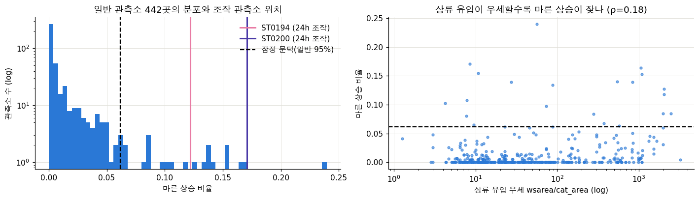

*그림 6-3b. 왼쪽: 일반 관측소 442곳의 '마른 상승 비율'(24시간 강우가 거의 없는데 수위가 오른 행의 비율) 분포와 24h 조작 관측소 2곳의 위치. 점선은 일반 관측소 95% 지점(6.15%). 오른쪽: 상류 유입 우세(wsarea/cat_area)와의 관계.*

- **방류 의심 관측소**:
  - 비 없이 오르는 비율이 일반 관측소 95% 지점(6.15%)을 넘는 곳이 **23곳**이다(행 5.1%). 비와 무관하게 조작되는 것으로 확인된 24h 조작 관측소 2곳도 이 분포의 97.7%·99.5% 지점에 온다. 같은 지표가 조작성 상승을 잡아낸다는 뜻이다.
  - 상류 유입이 우세할수록(자기 소권역보다 상류 유역이 클수록) 마른 상승이 잦다(ρ 0.18). 상류 댐·보 방류와 들어맞는 방향이지만 약하다.
  - 비가 와도 수위가 멈춰 있는 '보 관리수위' 관측소도 같은 방식으로 찾아봤다. 그러나 잡힌 곳의 대부분(23곳 중 17곳)이 원래 조용한 산지 소하천 유형이라, 보 때문인지 구별할 수 없었다. 플래그로 쓰지 않는다.
- **→ 시사점**:
  - 조석 여부는 이진 플래그 대신 **12·24h 자기상관 값**(관측소 특성, fold 안에서 계산)으로 넣는 것을 검토한다.
  - 조석 위상 변수(`wl_t − wl_t−12h` 등)는 따로 만들지 않는다. 위상 정보는 이미 lag 수위에 들어 있고, 추가해도 기준 모델 잔차를 줄이지 못했다(0.2절 #5).
  - 24h 조작 2곳은 비 변수가 쓸모없고 `wl_t_minus_24h`가 핵심이다. 강우 단조 제약에서 빼야 한다(부록 D).
  - 방류 의심 23곳은 플래그 후보로 둔다. 기준 모델에서 이 구간의 오차 비중(7.0%)이 행 비중(5.1%)보다 크다(부록 C).

### 6.4 교차상관과 지체시간

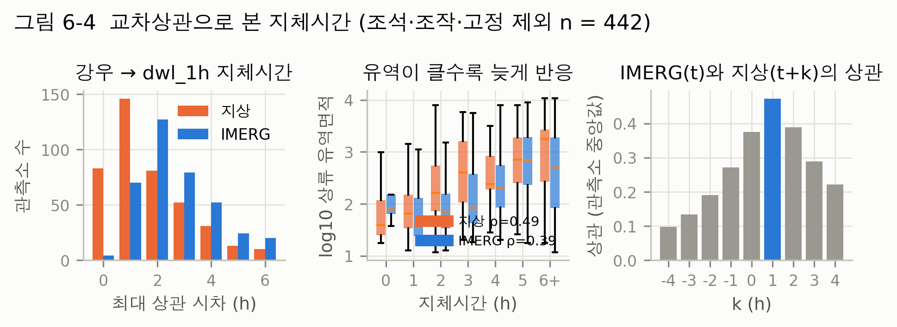

- **관찰**:
  - 강우와 수위 변화의 교차상관이 최대가 되는 시차(지체시간)는 관측소 중앙값 기준으로 지상강수 1시간, IMERG 3시간이다.
  - 지체시간이 6시간 이내인 관측소는 지상 기준 94%, IMERG 기준 85%다.
  - 유역이 클수록 지체시간이 길다(유역면적과의 Spearman ρ: 지상 0.49, IMERG 0.39).
  - IMERG(t)와 지상강수(t+k)의 상관은 k = +1h에서 가장 크다(0.47, k = 0에서 0.38).
  - 사상마다 지체시간을 따로 구해 관측소 중앙값(L)을 내면, 유역면적과의 상관이 **ρ 0.55**로 더 뚜렷해진다. 도달시간 공식(Hack 등)으로 만든 지표는 ρ 0.51로 면적 하나보다 낫지 않다. 경사는 면적을 통제하면 오히려 +0.13(가파를수록 늦음)으로, "급경사 = 빠른 반응"은 확인되지 않았다.
  - **L = 0인 관측소가 33곳**이다. 이들은 모두 짧은 창(최근 1시간) 강우와의 상관이 긴 창보다 크다. 비가 오면 같은 시간 안에 수위가 반응하는 초단기 반응 관측소다.
  - 가장 강한 강우 창은 L이 길수록 '최근 1시간'에서 '1~6시간 전'으로 옮겨 간다. L에 따른 예상 창과 일치하는 관측소는 62%다.
- **→ 시사점**:
  - 대부분 관측소는 6시간 예측창 안에 이미 내린 비의 영향이 도달한다. 과거 1~6시간 강우가 핵심 입력이다.
  - 도달시간 지표는 log 유역면적 하나로 충분하다. 강우를 겹치지 않는 창(0~1h, 1~6h, 6~24h)으로 나누면 VIF가 2.79 → 1.42로 줄어 선형·신경망 모델에 유리하다. 트리 모델은 창 이동을 이미 스스로 잡는다.
  - 초단기 반응 관측소는 L = 0인 33곳으로 정의한다.

### 6.5 사상 안 시간 효과

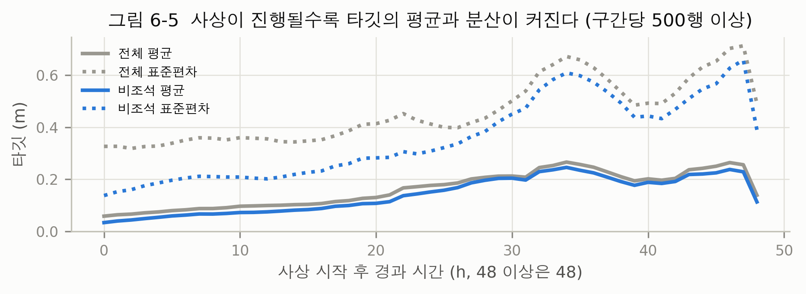

- **관찰**: 사상이 시작된 시점부터 24시간 뒤까지 타깃 평균은 0.03 → 0.15m, 표준편차는 0.14 → 0.31m로 커진다(비조석).
- 사상 하나하나로 보면 대부분 중반이 초반보다 크지만, 초반에 비가 몰렸다가 그친 사상처럼 반대인 경우도 있다. 경과 시간 혼자로는 부족하다.

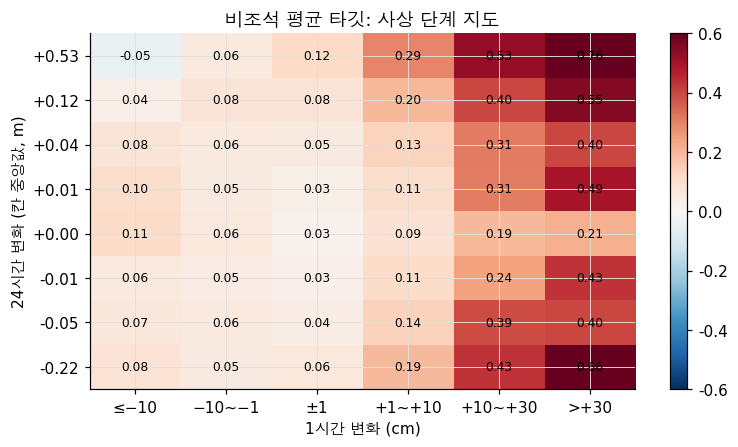

*그림 6-5b. 비조석 평균 타깃을 24시간 수위 변화(세로) × 1시간 수위 변화(가로) 칸으로 나눈 '사상 단계 지도'.*

- **관찰**: 24시간 변화와 1시간 변화를 함께 보면 사상의 단계가 드러난다. 막 오르기 시작한 초기(24h 변화 작음, 1h 변화 큼)의 타깃은 0.18m, 첨두를 지난 뒤는 0.04m다. 이 차이는 사상의 **99%**에서 같은 방향이다.
- **→ 시사점**: 사상 경과 시간과 사상 누적 강우는 유용한 파생변수다(5.4절의 '사상 안 시간 변동' 74%와 연결). 사상 단계는 `dwl_1h`·`dwl_24h`에 이미 담겨 있어 별도 격자 변수는 필요 없다(기준 모델 잔차 −1.0%). 사상 **시작 후** 경과 시간은 과거로 정해지지만, 사상 길이·끝은 미래 정보라 쓰지 않는다.

### 6.6 관측소 간 선행

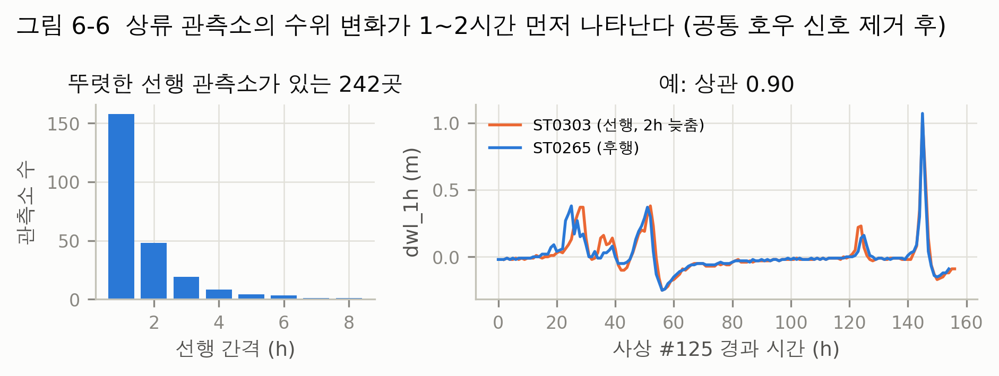

- **방법**: 모든 관측소에 공통인 호우 신호를 먼저 뺐다. 그다음 관측소 쌍마다 시차 상관을 계산했다.
- **관찰**:
  - 조석·조작·고정 관측소를 뺀 442곳 중 **242곳(55%)**에 수위 변화를 뚜렷이 앞서는 관측소가 있다(상관 ≥ 0.5).
  - 앞서는 시간은 1시간이 65%, 2시간이 20%다.
  - 소권역이 다른 쌍 중 뒤따르는 쪽의 유역면적이 더 큰 비율이 68%다(무작위라면 50%). 좌표 없이도 상류 → 하류 방향이 복원된다는 뜻이다.
  - **안정성**: train 사상을 짝·홀로 반씩 나눠 각각 선행 관측소를 찾으면, 두 절반에서 같은 관측소가 나오는 곳은 **34%**다(무작위 0.2%). 안정적인 관계는 상관이 더 강하고 1시간 간격이 더 많다. 나머지는 비구름의 이동 방향처럼 호우마다 달라지는 관계로 보인다.
- **→ 시사점**:
  - 같은 시각 상류 관측소의 수위 변화는 하류 관측소의 1~2시간 앞 신호가 된다. 다만 한 관측소를 고정해 쓰기보다 **안정적인 관계만** 쓰거나 **주변 여러 관측소의 요약**을 쓴다.
  - 이 변수는 test에서 다른 관측소의 같은 시각 행을 읽어야 만들어진다. 사용 여부는 **대회 규정을 확인한 뒤** 모델링 장에서 정한다. 조석 관측소에는 쓰지 않는다.

---

## 7. train/test 비교와 검증 전략

### 7.1 분할 구조

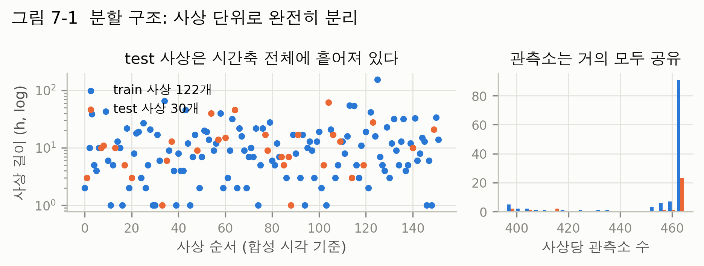

- **관찰**: train과 test는 **사상 단위로 완전히 분리**되어 있다(train 122개, test 30개). test 사상은 시간축 전체에 흩어져 있다. 사상당 관측소 수는 중앙값 464곳으로, 관측소는 거의 모두 공유한다.
- **→ 시사점**: 관측소별 특성은 test에서도 그대로 쓸 수 있다. 반면 사상 자체는 test에서 처음 보는 것이다.

### 7.2 분포 비교 (표 7-1)

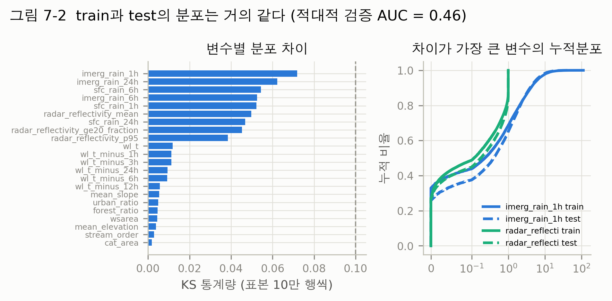

- **관찰**:
  - 변수별 KS 통계량은 최대 0.07(`imerg_rain_1h`)로 모두 작다.
  - train과 test를 구분하는 분류기(사상 단위 교차검증)의 AUC는 **0.46**이다. 0.5 이하이므로 두 데이터를 구분할 수 없다.
- **→ 시사점**: 분포 이동은 무시할 만하다. 교차검증 점수가 test 성능을 잘 대변할 것으로 기대된다.

### 7.3 검증 방식

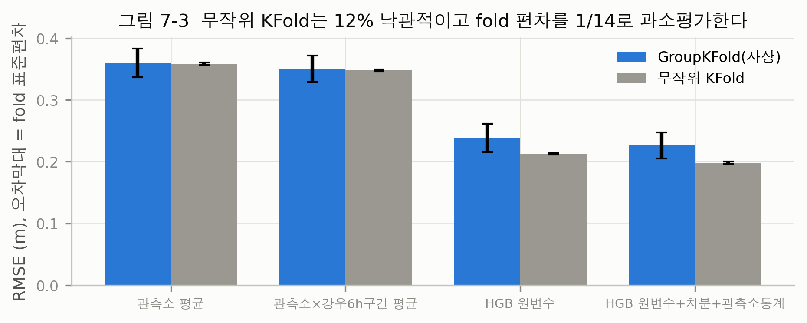

- **관찰**:
  - 같은 모델을 두 방식으로 검증했다.
    - 무작위 KFold: RMSE 0.198
    - 사상 단위 GroupKFold: RMSE 0.226
  - 무작위 분할은 성능을 **약 12% 낙관적**으로 보여준다.
  - fold 간 표준편차도 0.0015 vs 0.021로 1/14 수준으로 과소평가한다.
  - 원인은 1.3절의 타깃 구간 겹침이다. 같은 사상의 이웃 행이 학습과 검증에 나뉘면 정답 정보가 검증 쪽으로 새어 나간다.
- **→ 시사점**: 검증은 **사상 단위 (반복) GroupKFold**로 고정한다.

### 7.4 누수 방지 원칙

예측 시점 t 이후의 정보는 어떤 행에서도 사용하지 않는다(0.1절). 각 분석에서 미래 정보가 섞일 수 있었던 곳과 처리는 부록 E에 모았다.

---

## 8. 요약

### 8.1 핵심 발견

| # | 발견 | 근거 | 모델링 결정 |
|---|---|---|---|
| 1 | 상위 1% 행이 0 예측 기준 제곱오차의 66%를 차지한다. RMSE는 큰 상승을 맞히는 능력으로 갈린다 | 3.1 | 꼬리 예측에 집중: 극값 가중치·손실함수 실험. 상위 5사상 제외 점수도 함께 본다 |
| 2 | 조석 15곳(행 3.2%)이 0 예측 오차의 51%를 차지하고 전체 관계(V자, 관측소 효과 18%)를 왜곡한다. 다만 과거 수위로 대부분 맞힐 수 있어 기준 모델 오차에서는 8.8%다 | 3.2, 4.2, 5.4, 6.3 | 전체·비조석 RMSE를 따로 본다. 위상 변수는 추가하지 않는다 |
| 3 | 비조석에서는 분산의 74%가 사상 안 시간 변동이고 관측소 몫은 2%다. 사상 단계(초기 vs 첨두 후)가 사상 99%에서 일관된다 | 5.4, 6.5 | 수위 추세·사상 누적강우·사상 경과 시간 |
| 4 | 가장 강한 신호는 최근 1~3h 수위 변화와 짧은 창 강우다. 관계는 단조롭지만 비선형이고, 하강 중이면 대체로 계속 내려간다 | 4.1, 4.2, 4.6, 6.2 | 트리 계열 모델, 강우 × `dwl_1h` |
| 5 | 강우 → 수위 지체시간은 대부분 6h 이내이고 유역이 클수록 길다(사상 단위 ρ 0.55). 33곳은 같은 시간 안에 반응한다 | 6.1, 6.4 | log 면적 = 도달시간 지표, 초단기 플래그(L = 0) |
| 6 | 유역환경은 단독으로 약하다. 일관된 조절 효과는 **관측소 안 수위 높이 × 강우**와 **도시화 × 짧은 강우** 두 가지뿐이다. "큰 유역 × 강한 비"는 사상 단위로 재현되지 않았다 | 4.4, 5.3 | q × 강우(1순위), 도시화 × 1h 강우 |
| 7 | 비 말고 다른 이유로 움직이는 관측소가 있다: 조석 15 · 약한 조석 5 · 24h 조작 2 · 방류 의심 23 · 수위 고정 1 | 2.5, 6.3 | 구간 플래그, 해당 구간은 강우 단조 제약에서 제외 |
| 8 | 레이더 3변수는 사실상 하나이고, 강우 3원천은 같은 비의 대리지표다. IMERG는 강한 비를 작게 잡는다 | 5.1 | 레이더 축약, 강한 비는 지상강수 중심 |
| 9 | 무작위 분할은 12% 낙관적이고, train/test 분포는 같다(AUC 0.46) | 7.2, 7.3 | 사상 단위 GroupKFold |

### 8.2 결정 목록

- **전처리**
  - ST0027은 학습에서 빼고 예측을 0으로 고정한다.
  - 수위는 차분·관측소 안 상대값(분위)으로 쓴다.
  - 강우·면적은 로그 변환한다(선형 모델). 트리 모델은 선택이다.
  - 레이더 클러터 18곳은 맑은 날 바탕값 차감을 검토한다.
  - 결측은 대치하지 않는다.
- **파생변수** (우선순위 순, 상세는 부록 B)
  1. 관측소 안 수위 분위 q × 강우
  2. 수위 차분(1·3·6·24h), 강우 × `dwl_1h`
  3. 사상 경과 시간·사상 누적강우
  4. 도시화 × 1h 강우
  5. 구간 플래그: 방류 의심 23곳, 초단기 반응 33곳, 조석 세기(12·24h 자기상관)
  6. 겹치지 않는 강우 창(선형·신경망용), 강우 원천 요약(평균·최대·불일치)
  7. 관측소 통계·움직임 지표(fold 안에서 계산)
  8. (규정 확인 후) 안정적인 상류 관측소의 수위 변화
- **쓰지 않는 것**: 조석 위상 변수, 사상 단계 격자, 감수 지수, 도달시간 공식 지표, 레이더 p95 − 평균, 사상 길이·끝·전체 순위(누수)
- **단조 제약**: 강우·레이더는 + 방향이 매우 일관된다. 24h 조작·고정 관측소를 빼면 제약 후보다. 수위 변화 변수는 비조석에서만 +다. 선행 습윤·가속도·도시화에는 제약을 걸지 않는다(부록 D).
- **검증**
  - 사상 단위 반복 GroupKFold를 쓴다.
  - 전체·비조석·상위 5사상 제외 RMSE를 함께 본다.
  - 타깃을 쓰는 관측소 통계는 학습 fold 안에서만 계산한다.

---

## 부록

### 부록 A. 가설 판정표 (42개)

모델링 장에서 인용할 선행연구 가설을 이 데이터로 점검한 결과다. 판정 기준은 0.1절과 같다. 잔차 = 타깃 − 기준 HGB OOF 예측(RMSE 0.2264). "설명 가능 몫"은 사상 짝·홀 반분 기준이고, 음수는 기준 모델이 이미 그 정보를 쓴다는 뜻이다. 상세는 `research_findings.md`와 노트북 7~10권.

| 코드 | 가설 | 판정 | 근거 | 모델링 조치 |
|---|---|---|---|---|
| T1 | 하강 중 y ≈ β·dWL1 | ✅ 방향 / 🔶 크기 | 관측소 β>0 78%, β 중앙값 0.67(0.7~1 안 39%). 중앙값 −0.01, 큰 하강 68% 음수 (8권 2장) | 비 × dwl_1h 상호작용. 평균 착시 주의 |
| T2 | 가속 중이면 더 오름 | ❌ | dwl_1h 통제 시 음(−), 관측소 42%·사상 11% (8권 3장) | 약한 후보(음의 방향), 제약 금지 |
| T3 | 24h×1h로 사상 단계 | ✅ | 초기 0.18 vs 첨두 후 0.04m, 사상 99% (8권 4장) | 새 변수 불필요(잔차 −1.0%) |
| T4 | 꼬리·관측소 오차 기여 | 기존 확인 | 보고서 3.1·3.2, 별책 4-7 | – |
| T5 | 관측소 안 수위 정규화 | ✅ | 순위상관 0.003 → −0.063 (10권 1장) | q(B등급) 약한 후보 |
| A1 | 강우 문턱 + 토지이용별 이동 | 🔶 | 6h 약 15mm에서 꺾임(짝 11/홀 18). 도시·산림·습윤별 이동 없음 (9권 5장) | 이동 변수 불필요 |
| A2 | 선행 습윤 → 반응 증가 | ❌ | 강우·경과 시간 통제 시 음(ρ −0.15), 관측소 24%·사상 25% (9권 6장) | r6_24에 + 제약 금지 |
| A3 | 합리식(도달시간 강우강도) | 🔶 | A6과 통합 | – |
| A4 | Kirpich: 면적·길이 → 늦음 | ✅ | 지체 L ↔ 면적 ρ 0.55 (9권 2장) | 도달시간 지표 = log 면적 |
| A5 | Hack Tc_index | 🔶 | Tc_index ρ 0.51, 면적보다 낫지 않음 | Tc_index 불채택 |
| A6 | 도달시간에 맞춘 강우 창 | 🔶 | 가장 강한 창이 L에 따라 r0_1 → r1_6로 이동, md 예상 일치 62% (9권 3장) | 트리가 이미 잡음(잔차 −0.2~−0.4%) |
| A7 | 면적↑ 비유량↓ | ❌ | 타깃÷강우 0.0040 / 0.0052 / 0.0046 (10권 5장) | – |
| A8 | 하천차수–면적 | 기존 확인 | PCA PC2 | – |
| A9 | 경사↑ 빠른 반응 | ❌ | 면적 통제 부분 순위상관 +0.13 (9권 2장) | 경사 보정 안 함 |
| A10 | 고수위일수록 덜 오름 | 🔶 | 관측소 안 순위로 음(−) 80%·사상 96%. 칸 평균은 반대 (10권 2장) | **q × 강우 1순위 시험**(잔차 +2.9%, 일관성 91%) |
| A11 | 이력(상승≠하강) | ✅ | 같은 높이에서 상승 중이 더 큼 100% (10권 3장) | dwl_1h 부호로 충분 |
| A12 | 감수곡선 | ❌ | 감수 지수 b 중앙값 0.00, b>0 22% (8권 5장) | – |
| A13 | 도시화 × 짧은 강우 | ✅(중간 강우) | 면적 3분위 모두 도시 상위 ρ(r0_1)↑·ρ(r6_24)↓, 사상 78%. 40mm 초과는 반대 (10권 4장) | 도시화 × 1h 강우, 제약 금지 |
| A14 | 산림 − | 🔶 | 부분 순위상관 −0.19 | 제약 없음 |
| A15 | 표고와 강우 추정 차이 | 기존 확인 | insights 3-3, 9권 7장 재확인(표고 3분위 1.27~1.32) | – |
| A16 | p95−평균 | ❌ | 타깃 ρ 0.05, 잔차 −0.35% (9권 7장) | – |
| B1 | 단일모델 + 정적 속성 | 모델링 단계 | – | 정적 속성 빼기 비교 |
| B2 | 유역 수 늘리기 | 모델링 단계 | – | 관측소별 vs 전역 비교 |
| B3 | 겹치지 않는 창 | ✅ | VIF 최대 2.79 → 1.42 (9권 3장) | 선형·신경망에 사용 |
| B4 | 수위 자기회귀 우선 | 기존 확인 | 2·3권 | – |
| B5 | 결측 플래그 | 해당 없음 | NaN 0 | – |
| B6 | 이동평균 + SHAP | 모델링 단계 | – | – |
| B7 | 조석 위상 변수 | ❌ | 타깃 설명은 60.5% vs dwl_6h 56.2%지만 잔차 −1.5%·일관성 38% (7권 5장) | 추가 불필요 |
| B8 | 관측소 인코딩 | 기존 확인 | train·test 관측소 동일 | – |
| B9 | 방향 맞는 단조 제약 | 표 4 | 10권 6장 | 켜고 끄기는 모델링 단계 |
| B10 | 방류량·조위가 핵심 | 해당 없음 | C1·C3에 흡수 | – |
| B11 | 위성 × 고도 | 기존 확인 | 표고와 무관 | – |
| B12 | 레이더 한계 기여 | 모델링 단계 | – | – |
| C1 | 감조 조석 | 기존 확인 | 별책 | – |
| C2 | 홍수 → 조석 진폭 감소 | ❌ | 음(−)인 조석 관측소 40%, ρ 중앙값 0.02 (7권 5장) | – |
| C3 | 댐 방류 계단 상승 | 🔶 | 마른 상승 상위 23곳. 조작 관측소가 97.7·99.5% 지점에 옴. 무강우 오차 2배, 비·상승 중 편향 없음 (7권 2장) | 댐 의심 플래그·wsarea/cat_area 후보(오차 몫 7%) |
| C4 | 보 관리수위 | ⏸ | 잡힌 23곳의 17곳이 산지 소하천 유형 → 보와 구별 불가 (7권 3장) | – |
| C5 | 초단기 반응 | ✅ | 사상 단위 L=0 33곳, 100% 짧은 창 상관 > 긴 창 (9권 4장) | 플래그를 L=0 33곳으로 |
| C6 | 도시하천 | ✅(중간 강우) | A13과 같음 | – |
| C7 | IMERG 강한 비 과소 | ✅ | IMERG÷지상 24h: 2.8 → 0.62 (강도↑) (9권 7장) | 강한 비는 지상강수 주 변수 |
| C8 | 레이더 단위 | 🔶 | 0~56, 음수 없음, 대칭. dB 가정 환산 시 Pearson 0.36 → 0.45 | 트리는 변환 불필요 |
| C9 | 극한 사상 위성 과소 | 🔶 | 오차 상위 5사상 비율 1.18 vs 1.35 | – |

### 부록 B. 파생변수 후보

잔차 점검: 설명 가능 몫(전체 / 상위 5사상 제외), 사상 일관성

| 순위 | 이름 | 정의 | 근거 | 잔차 점검 | 누수 등급 |
|---|---|---|---|---|---|
| 1 | 수위 분위 × 강우 | q × log1p(sfc_rain_6h), q = 관측소 train 수위 분포에서의 분위 | A10 | −1.1% / **+2.9%**, 91% (비조석 상승 중) | B(q 기준 분포) |
| 2 | 선행 습윤 | r6_24 = sfc_24h − sfc_6h | A2 | −2.1% / +1.9%, 78% (비·상승 중, 음의 방향) | A |
| 3 | 가속도 | 1.5·dwl_1h − 0.5·dwl_3h | T2 | −1.1% / +1.9%, 71% (음의 방향) | A |
| 4 | 도착 예정 비 | Σ sfc_rain_1h(t−k), k = L−6…L−1 | A6 (구체화) | −4.1% / +1.6%, 44% (비·상승 중) | A (L은 B) |
| 5 | 수위 분위 q | 위와 같음 | T5 | −0.3% / +1.0%, 76% | B |
| 6 | 댐 방류 의심 플래그 | 마른 상승 비율 ≥ 일반 95% 지점 | C3 | 구간 RMSE 0.266 vs 0.225 | B |
| 7 | 관측소 지체 L | 사상 단위 교차상관 최대 시차 중앙값 | A4 | −0.05% / +0.3%, 72% | B |
| – | 불채택 | 단계 격자, 감쇠비, Tc_index, 조석 위상, p95−평균 | T3·A12·A5·B7·A16 | 모두 음수 | – |

### 부록 C. 구간 플래그와 구간별 기준 모델 오차

기준 모델 = HGB, 사상 단위 5-fold OOF. 한 관측소가 여러 구간에 걸칠 수 있다(방류 의심·보 관리수위 의심·초단기 의심은 겹침 허용). 보 관리수위 의심은 폐기 권고, 초단기 의심(108곳, 지체 ≤1h & 소유역)은 L = 0 33곳(RMSE 0.246)으로 교체 권고다. `src/t08_final_assets.py`가 `nb07_summary.json`에서 생성했다.

| 구간 | 관측소 | 행 | 행 비중 | 오차 비중 | RMSE(m) | 편향(m) |
|---|---|---|---|---|---|---|
| 24h 주기 | 2 | 3,352 | 0.4% | 0.4% | 0.214 | -0.0028 |
| 고정 | 1 | 1,676 | 0.2% | 0.0% | 0.024 | -0.0026 |
| 댐 방류 의심 | 23 | 38,100 | 5.1% | 7.0% | 0.266 | +0.0015 |
| 보 관리수위 의심 | 22 | 33,219 | 4.4% | 1.8% | 0.146 | -0.0021 |
| 약한 조석 | 5 | 8,378 | 1.1% | 0.7% | 0.180 | -0.0007 |
| 일반(나머지) | 289 | 466,525 | 62.2% | 61.7% | 0.225 | -0.0009 |
| 조석 | 15 | 23,963 | 3.2% | 8.8% | 0.376 | -0.0036 |
| 초단기 의심 | 108 | 174,444 | 23.3% | 19.6% | 0.208 | +0.0002 |

### 부록 D. 단조 방향 네 겹 점검

① 강우·변수 구간별 평균 타깃의 순위상관, ② 관측소별 기울기 부호가 기대와 같은 비율, ③ 기대와 반대 부호가 나온 구간, ④ 다른 변수를 통제한 조건부 일치율. `nb10_summary.json`에서 생성했다.

| 변수 | ① 칸 순위상관 | ② 관측소 일치 | ③ 반대 부호 구간 | ④ 조건부 일치 | 권고 |
|---|---|---|---|---|---|
| sfc_rain_1h | 0.68 | 100% | 고정 | 100% | + 제약 후보 |
| r1_6 | 0.87 | 98% | 24h 주기, 고정 | 75% | 구간별 제약(비조석만) |
| imerg_rain_1h | 0.93 | 100% | 24h 주기, 고정 | 100% | 구간별 제약(비조석만) |
| imerg_rain_6h | 1.0 | 100% | 24h 주기, 고정 | 100% | 구간별 제약(비조석만) |
| radar_reflectivity_mean | 1.0 | 100% | 24h 주기, 고정 | 100% | 구간별 제약(비조석만) |
| radar_reflectivity_p95 | 0.98 | 100% | 24h 주기, 고정 | 100% | 구간별 제약(비조석만) |
| radar_reflectivity_ge20_fraction | 0.97 | 100% | 24h 주기, 고정 | 100% | 구간별 제약(비조석만) |
| dwl_1h | 0.49 | 99% | 고정 | 100% | + 제약 후보 |
| r6_24_big | 0.87 | 97% | – | 75% | + 제약 후보 |
| acc | 0.3 | 95% | 고정 | 50% | 제약 없음 |
| wl_t | 0.68 | 23% | 24h 주기, 고정, 댐 방류 의심, 약한 조석, 조석, 초단기 의심 | 0% | 제약 없음 |
| dwl_6h | 0.41 | 91% | 24h 주기, 고정, 댐 방류 의심, 약한 조석, 조석 | 100% | 구간별 제약(비조석만) |
| r6_24 | 0.87 | 79% | 고정 | 75% | + 제약 후보 |

- "구간별 제약(비조석만)"은 24h 조작·고정 관측소를 빼거나 따로 모델링할 때의 제약 후보라는 뜻이다.
- `r6_24`(선행 습윤)는 이 표만 보면 + 제약 후보지만, 최근 강우와 경과 시간을 통제하면 음이다(5.3절). 최종 권고는 **제약 없음**이다(큰 유역만 본 `r6_24_big`도 보류).

### 부록 E. 노트북 지도와 누수 점검

| 권 | 주제 | 보고서 위치 | 누수 점검에서 짚은 것 |
|---|---|---|---|
| 1권 | 데이터 구조와 품질 | 1·2장 | test 뒤 시각 행은 존재만 세고 값은 쓰지 않음 |
| 2권 | 타깃과 강우 | 3.1·3.4·4.1·4.6 | 관측소 반응 크기는 fold 안에서만 |
| 3권 | 수위 변화와 시간 | 3.3·6.1·6.2·6.4·6.5 | 원천 간 시차는 뒤 시각 값을 써서 분석용으로만. 사상 길이·끝 금지 |
| 4권 | 관측소 유형과 유역환경 | 3.6·4.4·5.2·5.3·5.5 | 지문 중 타깃을 쓰는 3개는 fold 안에서만 |
| 5권 + 별책 5b | 관측소 연결망 | 6.6 | 연결망은 fold마다 학습 사상으로 다시 찾음. 규정 확인 필요 |
| 6권 | 검증 전략과 오차 위치 | 7장 (오차 진단은 모델링 장) | 미래 강우 오라클은 진단용 |
| 조석 별책 | 조석 관측소 | 3.2·4.2·5.4·6.3 | '물 낮음' 정의를 사상 전체 순위 → `dwl_6h`로 교체 |
| 7권 | 구간 나누기 | 6.3, 부록 C | 구간 정의는 입력만 사용 |
| 8권 | 수위 국면과 타깃 | 4.2·6.5 | 국면은 과거 차분으로만 정의 |
| 9권 | 도달시간과 강우 창 | 4.1·5.1·6.4 | L은 관측소 특성, train에서 계산 |
| 10권 | 조절 효과와 판정 | 4.4·5.3, 부록 A·D | q 기준 분포는 train 수위(타깃 미사용) |

### 부록 F. 수치 출처표

본문의 주요 수치와 원본 파일이다. 표 C·D는 스크립트로 생성했고, 나머지는 아래 파일에서 확인할 수 있다.

| 절 | 수치 | 원본 |
|---|---|---|
| 2.1~2.6 | 결측률, 유효성 위반, 정합성, 이상값, 클러터 18곳 | `cache/results/t01_quality.json`, `figures/textbook/tab2-*.csv` |
| 3.1~3.7 | 타깃 요약 통계, 상위 1% 몫 66%, 조석 몫 51% | `cache/results/t03_univariate.json`, `tab3-1_summary.csv` |
| 3.2 | 기준 모델 오차에서 조석 몫 8.8% | `cache/results/nb07_summary.json` → 부록 C |
| 3.5 | 레이더 dB 변환 후 Pearson 0.36 → 0.45 | 9권 7장, `research_findings.md` 표 1 (C8) |
| 4.1~4.6, 5.1~5.5 | 구간별 평균, 상관, VIF, PCA, 분산 분해 | `cache/results/t04_bi_multi.json`, `tab4-1`, `tab5-*.csv` |
| 4.1 | 강우 문턱 15mm(짝 11 / 홀 18) | `nb09_summary.json` → `hinge` |
| 4.2 | 하강 가지 β 양 78%, 중앙값 0.67, 이력 99.5% | `nb08_summary.json` → `beta_down_*`, `nb10_summary.json` → `a11` |
| 4.4 | 면적 3분위 비유량 | `nb10_summary.json` → `a7` |
| 5.1 | IMERG ÷ 지상 2.8 → 0.62 | `nb09_summary.json` → `imerg_ratio` |
| 5.3 | 도시화 사상 78%, 수위 분위 80%·96%, 선행 습윤 24%·25% | `nb10_summary.json` → `a13_event`, `a10`; `nb09_summary.json` → `a2_*` |
| 6.3 | 방류 의심 문턱 6.15%, 23곳 | `nb07_summary.json` → `dam_cut`, `dam_ids` |
| 6.4 | 사상 단위 L, L = 0 33곳, 창 이동 62% | `nb09_station_lag.csv`, `nb09_summary.json` → `lag_share_expected_window` |
| 6.5 | 사상 단계 99% | `nb08_summary.json` → `stage_event_share` |
| 6.1~6.6, 7장 | 자기상관, 지체시간, 선행 관측소, KS·AUC·CV | `cache/results/t06_ts_split.json`, `s06_adversarial.json`, `s05_baseline.csv`, `s09_network.json` |
| 6.6 | 선행 관측소 반분 일치 34% | 5권 4-2절 |
